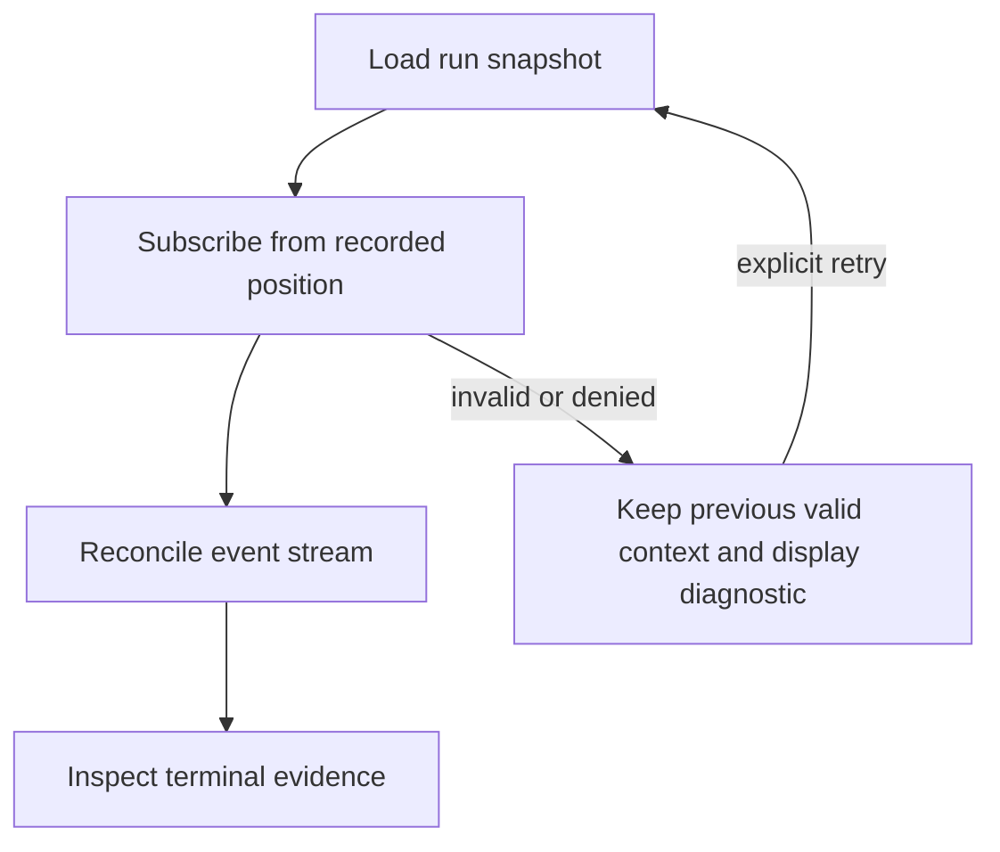
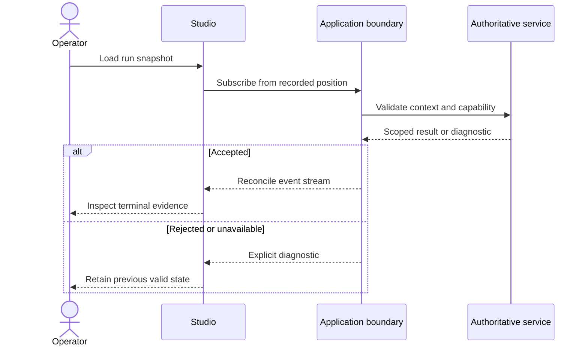
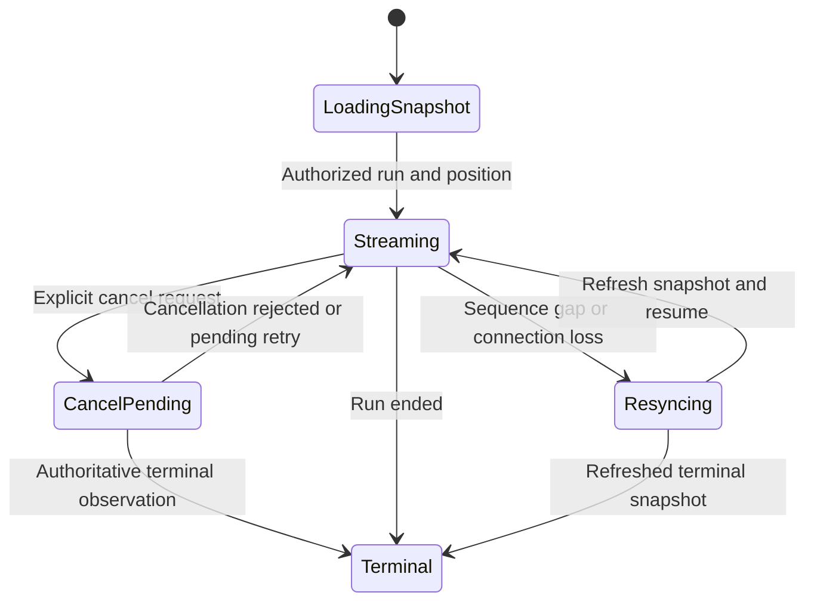

# UI11 — detailed specification review

Source: [functional scope](../../UI11.md) · [wireframe](../../drafts/UI11-wire.svg) · [proposed high-fidelity study](../studies/UI11.svg) · [accepted field dictionary](../../../pilot-field-dictionary-v1.md).

**Implementation gates:** UI01 (#90), S07 (#32), S10 (#35), SP02 (#160). No feature coding before its claimed dependencies close.

## User journey and component/data flow

The operator navigates through Load run snapshot → Subscribe from recorded position → Reconcile event stream → Inspect terminal evidence. The application boundary, not Studio, owns authoritative mutation, validation and storage.

## Fields and ports

| Module | Existing binding | Direction and validation | Remaining owner seam |
|---|---|---|---|
| UI11 | P:F-RUN,F-STATUS,F-TERM,F-OBJ,F-BOUND,F-ELAPSED,F-CPU,F-MEM; S:SolverResult, Measurement, ObjectiveObservation/Bound, Evidence | Read snapshot/events; scope by run and revision; cancellation acknowledged by runtime; adapter evidence separate from verified | S07/S10 event ordering/resumption, cancellation, progress source and independent verification projection |

### Approved pilot field definitions applicable to this module

| Field ID / JSON key | Type, units, presence | Source and relationship | Valid representation / rejected condition |
|---|---|---|---|
| F-RUN / runId | R, opaque text | Job registry → run key unique in tenant; referenced by evidence and cancellation | `"run-7"` / foreign tenant lookup |
| F-ELAPSED / elapsedMs | N, nonnegative integer milliseconds | Monotonic runtime clock → elapsed duration observed for run | `56` / negative; unavailable is null |
| F-OBJ / objectiveValue | N, finite exact value in objective units | Original model verifier → checked objective of candidate | `12` or `null` before evaluation / nonnumeric value |
| F-BOUND / bestBound | N, finite value in same objective units | Adapter → scoped bound for direction, revision and evidence | `null` or evidenced bound / incompatible direction or scope |
| F-TERM / termination | R, case-sensitive enum | Worker → reason the run ended, independent of mathematical status | `"Timeout"` / mathematical outcome in termination slot |
| F-STATUS / mathematicalStatus | R, case-sensitive enum | Worker and proof policy → run's mathematical outcome | `"Feasible"` / unsupported Optimal assertion |
| F-CPU / cpuMs | N, nonnegative integer milliseconds | Worker accounting → aggregate CPU of process tree for run | `31` / wrong unit or unknown counter reported as zero |
| F-MEM / peakBytes | N, nonnegative integer bytes | Worker accounting → peak process-tree measurement with platform and scope | `8192` / negative or undocumented measurement scope |

Ledger pilot field IDs: F-RUN, F-ELAPSED, F-OBJ, F-BOUND, F-TERM. Baseline logical ports: API-RUN. Read inherited type, unit, requiredness, defaults, relationship and classification rules in the field profiles; do not invent wire DTOs or physical storage.

## Operation sequence

## Interaction states and recovery

| Module | Navigation and loading | Invalid / unavailable | Keyboard and recovery |
|---|---|---|---|
| UI11 | Load run snapshot then subscribe from sequence; inspect observed events. | Missing bound/CPU/memory, duplicate or out-of-order event, sequence gap, failed subscription. | Select event, cancel with acknowledgement, refresh on gap; retain verified incumbent; unknown progress remains indeterminate and null never becomes zero. |

Initial loading, empty, denied, invalid, unavailable and failed are separate presentation states; the owner result determines which is shown. Explicit retry never implies mutation.

## Acceptance and test trace

| Requirement | Review case | Action | Observable oracle | Feature acceptance IDs |
|---|---|---|---|---|
| UI11-01 Live state and elapsed time | SP02-UI11-01 | Read live status and elapsed | Only observed events; unknown progress indeterminate and no synthetic percentage | TC-UI11-A, TC-UI11-B |
| UI11-02 Measured CPU and memory | SP02-UI11-02 | Read measured CPU and memory | Nullable counters and process-tree scope preserved, explicit display units | TC-UI11-A, TC-UI11-B |
| UI11-03 Incumbent, bound and gap | SP02-UI11-03 | Inspect incumbent bound and gap | Compare same objective stage, direction, units and evidence; absent bound gives no gap | TC-UI11-A, TC-UI11-B |
| UI11-04 Cancellation | SP02-UI11-04 | Cancel running job | Await owner acknowledgement; terminal reason independent of mathematical status; preserve verified incumbent | TC-UI11-A, TC-UI11-B |
| UI11-05 Solver transitions | SP02-UI11-05 | Inspect solver transitions | Use recorded events and solver identities; duplicates/out-of-order trigger proper reconciliation | TC-UI11-A, TC-UI11-B |
| UI11-06 Convergence | SP02-UI11-06 | Select convergence point | Exact event ID and sequence preserved; missing observation/gap not interpolated | TC-UI11-A, TC-UI11-B |

Feature-level acceptance:

- TC-UI11-A: Replay events with an incumbent and absent bound. Show measured values and preserve the verified incumbent after cancellation.
- TC-UI11-B: Handle duplicate or out-of-order events and avoid synthetic percent completion.

## Visual, localization and accessibility gates

Use approved DS01 tokens and DS02 components, with English LTR and Arabic RTL in separate scenarios. Isolate exact IDs, source spans and units; preserve logical focus order and named controls. Test keyboard and pointer equivalence for the actions above, focus recovery on errors and explicit unavailable/empty state. Compare common chrome with the reference and pin viewport, font, DPI, renderer and fixture. Do not use proposed mockups as approved screenshot baselines. Native monitor, screen-reader and feature-specific functional evidence belong to implementing issues.

**Disposition:** review proposal with implementation-specific acceptance cases. Domain-source bindings are checked, but owner seams are not approved by this document. No feature execution or final visual approval claimed.
