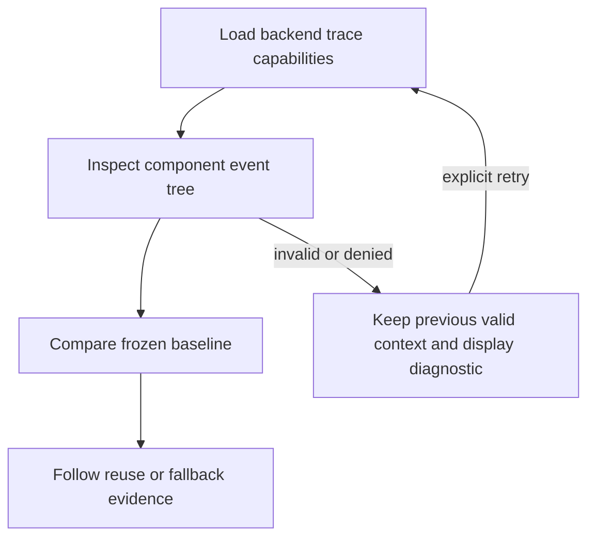
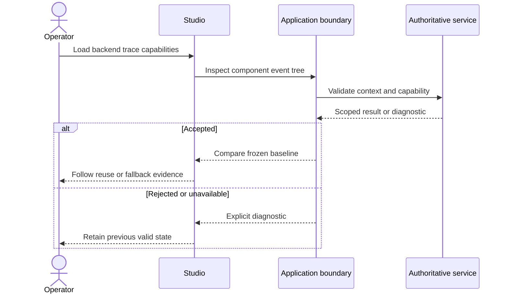
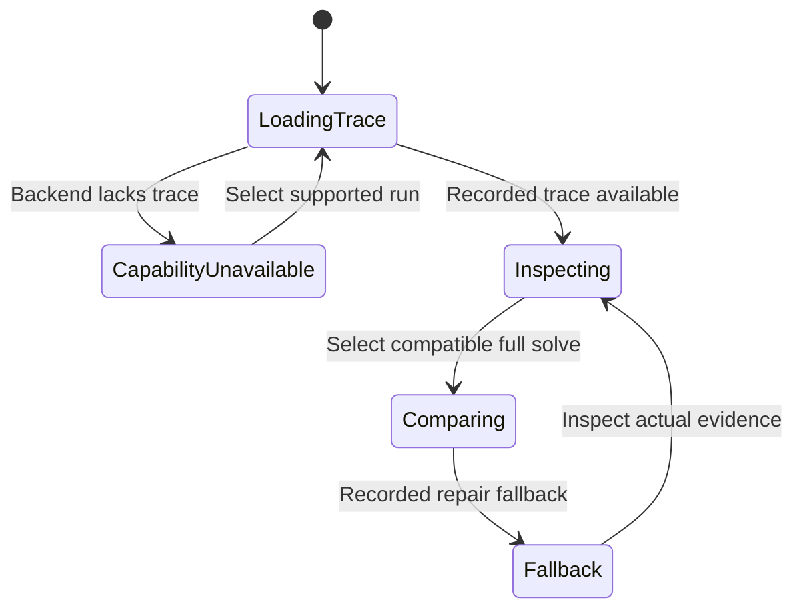

# UI12 — detailed specification review

Source: [functional scope](../../UI12.md) · [wireframe](../studies/wireframes/UI12.svg) · [reviewed high-fidelity study](../studies/UI12.svg) · [accepted field dictionary](../../../pilot-field-dictionary-v1.md).

Visual variants: [loading](../studies/states/UI12-loading.svg) · [empty](../studies/states/UI12-empty.svg) · [invalid](../studies/states/UI12-invalid.svg) · [unavailable](../studies/states/UI12-unavailable.svg) · [failed](../studies/states/UI12-failed.svg) · [actions](../studies/states/UI12-actions.svg) · [Arabic RTL](../studies/rtl/UI12.svg).

**Implementation gates:** UI11 (#100), X05 (#42), SP02 (#160). No feature coding before its claimed dependencies close.

## User journey and component/data flow

The operator navigates through Load backend trace capabilities → Inspect component event tree → Compare frozen baseline → Follow reuse or fallback evidence. The application boundary, not Studio, owns authoritative mutation, validation and storage.

## Fields and ports

| Module | Existing binding | Direction and validation | Remaining owner seam |
|---|---|---|---|
| UI12 | G:revision impact; S:SolverResult identity/Solver; P:F-REV,F-RUN,F-EVID | Read recorded backend/reuse evidence; no graph reachability used as a certificate | X05 decomposition/invalidation/reuse/fallback trace and comparability contract; native search capability |

### Approved pilot field definitions applicable to this module

| Field ID / JSON key | Type, units, presence | Source and relationship | Valid representation / rejected condition |
|---|---|---|---|
| F-REV / revisionId | R, nonblank immutable text | Registry → frozen revision within tenant and model; scopes every model read | `"r17"` / mutable alias or foreign revision |
| F-RUN / runId | R, opaque text | Job registry → run key unique in tenant; referenced by evidence and cancellation | `"run-7"` / foreign tenant lookup |
| F-EVID / evidenceDigest | R on evidence export, lowercase SHA-256 hex text | Exact immutable bundle bytes → digest linked to revision and run | hash of exported bytes / malformed digest or changed bytes |

Ledger pilot field IDs: F-REV, F-RUN, F-EVID. Approved logical ports: API-RUN. Read inherited type, unit, requiredness, defaults, relationship and classification rules in the field profiles; do not invent wire DTOs or physical storage.

## Operation sequence

## Interaction states and recovery

| Module | Navigation and loading | Invalid / unavailable | Keyboard and recovery |
|---|---|---|---|
| UI12 | Load run capability and component trace; compare full solve. | Search events not exposed, missing invalidation proof, incompatible baseline. | Navigate component tree and evidence link; show unavailable trace, not synthetic events; retry fetch without re-running solver implicitly. |

Initial loading, empty, denied, invalid, unavailable and failed are separate presentation states; the owner result determines which is shown. Explicit retry never implies mutation.

## Acceptance and test trace

| Requirement | Review case | Action | Observable oracle | Feature acceptance IDs |
|---|---|---|---|---|
| UI12-01 Backend-exposed search | SP02-UI12-01 | Inspect backend-exposed search | Only emitted search events; absence means unavailable, never synthetic tree | TC-UI12-A, TC-UI12-B |
| UI12-02 Decomposition | SP02-UI12-02 | Inspect decomposition | Component identities and boundaries come from owner evidence, not visual grouping | TC-UI12-A, TC-UI12-B |
| UI12-03 Incremental reoptimization | SP02-UI12-03 | Inspect incremental reoptimization | Disconnected edit linked to recorded input revision and observed reuse | TC-UI12-A, TC-UI12-B |
| UI12-04 Reused and invalidated components | SP02-UI12-04 | Inspect reused and invalidated components | New coupling invalidates affected set; every claim has provenance | TC-UI12-A, TC-UI12-B |
| UI12-05 Full-solve fallback | SP02-UI12-05 | Inspect full-solve fallback | Show actual reason and terminal evidence, not claimed speedup | TC-UI12-A, TC-UI12-B |
| UI12-06 Algorithm comparison | SP02-UI12-06 | Compare algorithm runs | Same fixture/budget/scope and measured counters; incomparable comparison suppressed | TC-UI12-A, TC-UI12-B |

Feature-level acceptance:

- TC-UI12-A: Compare a disconnected edit and a new coupling edge. Link each reuse or fallback to its recorded evidence.
- TC-UI12-B: Display capability unavailable when native search events are absent.

## Visual, localization and accessibility gates

Use approved DS01 tokens and DS02 components, with English LTR and Arabic RTL in separate scenarios. Isolate exact IDs, source spans and units; preserve logical focus order and named controls. Test keyboard and pointer equivalence for the actions above, focus recovery on errors and explicit unavailable/empty state. Compare common chrome with the reference and pin viewport, font, DPI, renderer and fixture. Static design approval is not executed screenshot acceptance. Pin the runtime fixture before establishing a screenshot baseline. Native monitor, screen-reader and feature-specific functional evidence belong to implementing issues.

**Disposition:** specification and logical contract reviewed against merged #190. Concrete provider payload/conformance and feature execution remain separate implementation gates. See [final visual disposition](../FINAL-DISPOSITION.md) for the accepted UI design specification.
