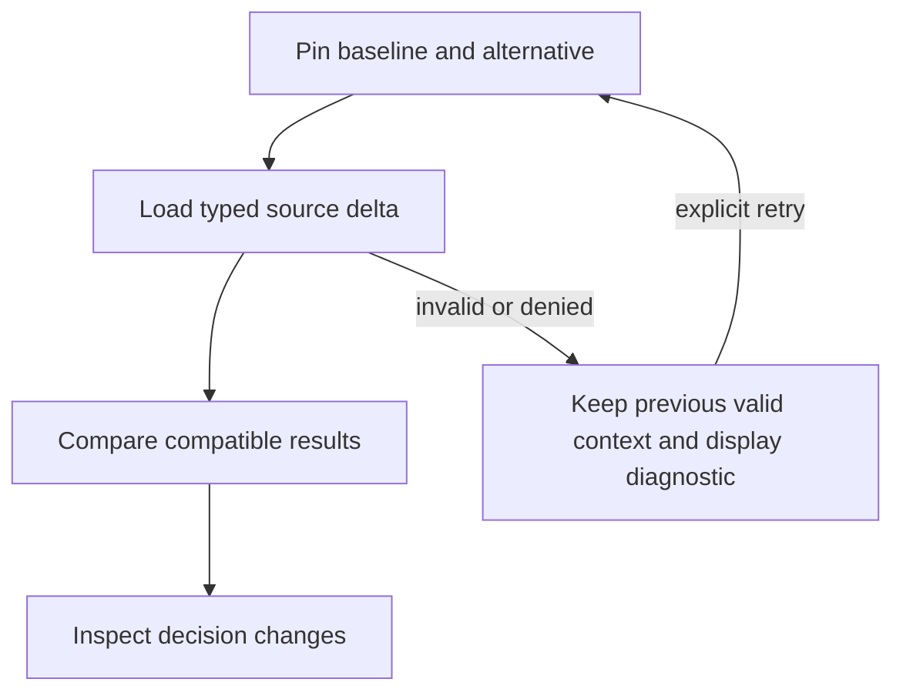
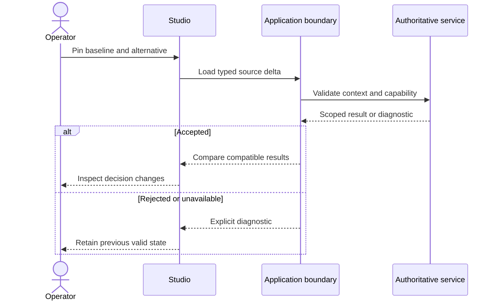
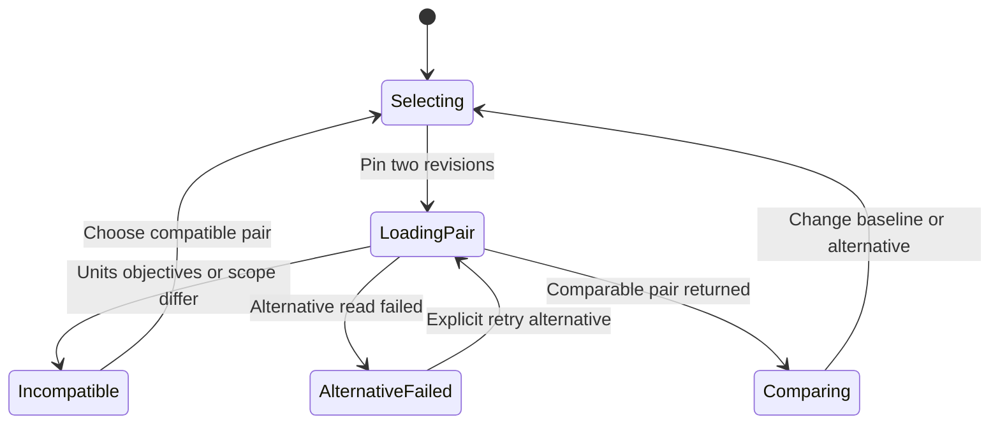

# UI13 — detailed specification review

Source: [functional scope](../../UI13.md) · [wireframe](../../drafts/UI13-wire.svg) · [proposed high-fidelity study](../studies/UI13.svg) · [accepted field dictionary](../../../pilot-field-dictionary-v1.md).

**Implementation gates:** UI01 (#90), A01 (#64), SP02 (#160). No feature coding before its claimed dependencies close.

## User journey and component/data flow

The operator navigates through Pin baseline and alternative → Load typed source delta → Compare compatible results → Inspect decision changes. The application boundary, not Studio, owns authoritative mutation, validation and storage.

## Fields and ports

| Module | Existing binding | Direction and validation | Remaining owner seam |
|---|---|---|---|
| UI13 | U:Scenario.Id/ParentId/Stage/InformationSet/Probability/Overrides/Span, ScenarioValue.SymbolId/Value; S:ObjectiveObservation; P:F-REV,F-MACHINE,F-OBJ | Compare compatible frozen revisions; override only parameter/resource exact value; probability absent distinct from zero | A01 scenario fork, delta, comparative risk and common budget/metric context |

Approved pilot field IDs: F-REV, F-MACHINE, F-OBJ. Baseline logical ports: API-SCENARIO. Read inherited type, unit, requiredness, defaults, relationship and classification rules in the field profiles; do not invent wire DTOs or physical storage.

## Operation sequence

## Interaction states and recovery

| Module | Navigation and loading | Invalid / unavailable | Keyboard and recovery |
|---|---|---|---|
| UI13 | Choose baseline and alternative, load each frozen result; compare. | Missing baseline, incompatible units/objectives, unavailable risk estimate or failed alternative. | Keyboard choose revisions, inspect changed input and evidence; disable incomparable delta; preserve baseline when alternative fails. |

Initial loading, empty, denied, invalid, unavailable and failed are separate presentation states; the owner result determines which is shown. Explicit retry never implies mutation.

## Acceptance and test trace

| Requirement | Review case | Action | Observable oracle | Feature acceptance IDs |
|---|---|---|---|---|
| UI13-01 Baseline and alternative scenarios | SP02-UI13-01 | Choose baseline and alternative | Full immutable revision/run context retained; missing baseline prevents comparison | TC-UI13-A, TC-UI13-B |
| UI13-02 Input changes | SP02-UI13-02 | Inspect input delta | Show changed source IDs and exact typed override values; cross-unit conversion explicit | TC-UI13-A, TC-UI13-B |
| UI13-03 Decision changes | SP02-UI13-03 | Inspect changed decisions | Compare owner-provided assignments in compatible scope; failed alternative distinct from unchanged | TC-UI13-A, TC-UI13-B |
| UI13-04 Cost and risk comparisons | SP02-UI13-04 | Compare cost and risk | Same objective units/currency and risk definition; no unsupported savings or probability claim | TC-UI13-A, TC-UI13-B |

Feature-level acceptance:

- TC-UI13-A: Compare two frozen revisions, show changed inputs and report comparable cost deltas with units.
- TC-UI13-B: Suppress savings on incompatible objectives or missing baselines.

## Visual, localization and accessibility gates

Use approved DS01 tokens and DS02 components, with English LTR and Arabic RTL in separate scenarios. Isolate exact IDs, source spans and units; preserve logical focus order and named controls. Test keyboard and pointer equivalence for the actions above, focus recovery on errors and explicit unavailable/empty state. Compare common chrome with the reference and pin viewport, font, DPI, renderer and fixture. Do not use proposed mockups as approved screenshot baselines. Native monitor, screen-reader and feature-specific functional evidence belong to implementing issues.

**Disposition:** review proposal with implementation-specific acceptance cases. Domain-source bindings are checked, but owner seams are not approved by this document. No feature execution or final visual approval claimed.
