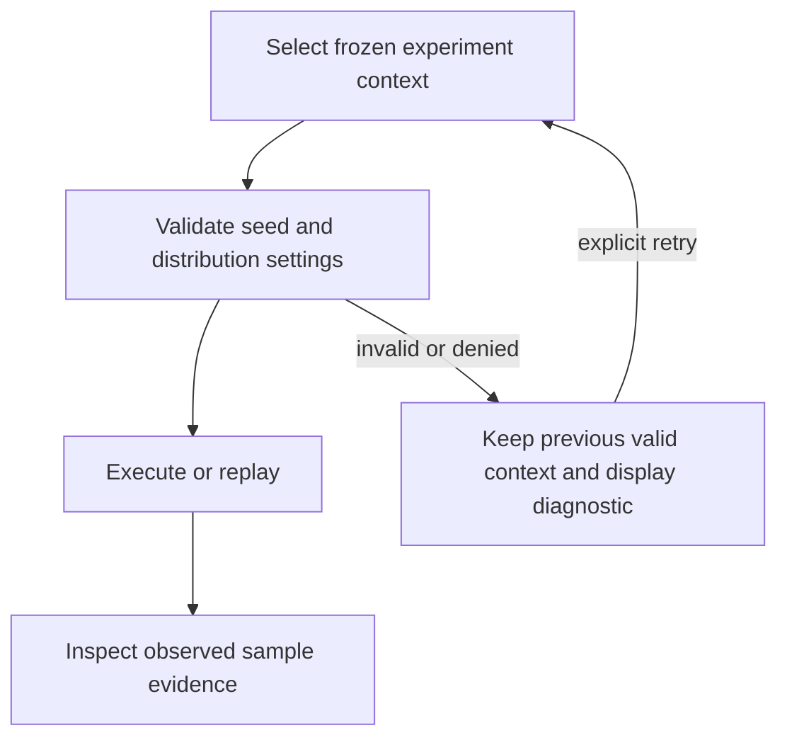
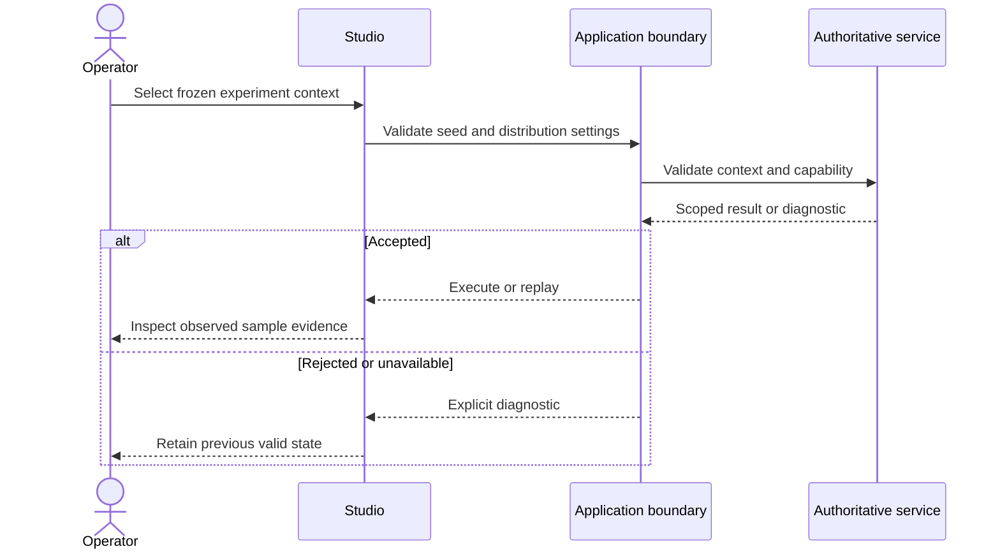
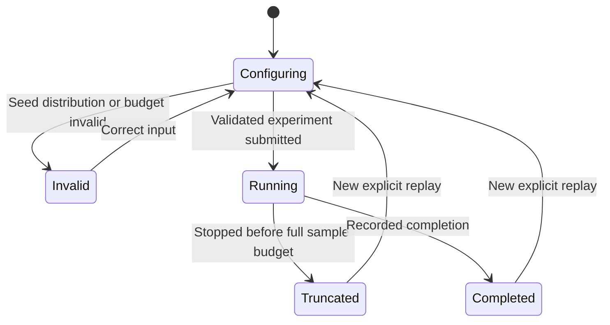

# UI14 — detailed specification review

Source: [functional scope](../../UI14.md) · [wireframe](../../drafts/UI14-wire.svg) · [proposed high-fidelity study](../studies/UI14.svg) · [accepted field dictionary](../../../pilot-field-dictionary-v1.md).

**Implementation gates:** UI01 (#90), A04 (#67), SP02 (#160). No feature coding before its claimed dependencies close.

## User journey and component/data flow

The operator navigates through Select frozen experiment context → Validate seed and distribution settings → Execute or replay → Inspect observed sample evidence. The application boundary, not Studio, owns authoritative mutation, validation and storage.

## Fields and ports

| Module | Existing binding | Direction and validation | Remaining owner seam |
|---|---|---|---|
| UI14 | U:Scenario tree and TimeBasis; P:F-REV,F-OBJ | Read frozen context, validate config through owner; never infer distribution from probabilities | A04 simulation configuration/seed/RNG/actual samples/quantile/termination; proposed API-SIMULATION in #190 |

Approved pilot field IDs: F-REV, F-OBJ. Baseline logical ports: API-SCENARIO. Proposed replacement API-SIMULATION remains subject to #190 merge/owner review. Read inherited type, unit, requiredness, defaults, relationship and classification rules in the field profiles; do not invent wire DTOs or physical storage.

## Operation sequence

## Interaction states and recovery

| Module | Navigation and loading | Invalid / unavailable | Keyboard and recovery |
|---|---|---|---|
| UI14 | Load experiment, seed and distribution schema; validate then start/replay. | Invalid distribution/budget/seed, no samples, truncated or cancelled experiment. | Keyboard correct config, replay seed and inspect sample/quantile table; display actual completed sample count and termination; never extend distribution with synthetic observations. |

Initial loading, empty, denied, invalid, unavailable and failed are separate presentation states; the owner result determines which is shown. Explicit retry never implies mutation.

## Acceptance and test trace

| Requirement | Review case | Action | Observable oracle | Feature acceptance IDs |
|---|---|---|---|---|
| UI14-01 Discrete-event simulation | SP02-UI14-01 | Configure discrete-event replay | Compare recorded event trace and model revision; no events fabricated | TC-UI14-A, TC-UI14-B |
| UI14-02 Monte Carlo experiments | SP02-UI14-02 | Run Monte Carlo experiment | Compare actual sample count and quantiles against seeded owner result | TC-UI14-A, TC-UI14-B |
| UI14-03 Configuration and seeds | SP02-UI14-03 | Edit seed and budget | Reject invalid parameters; same accepted config/seed retains replay settings | TC-UI14-A, TC-UI14-B |
| UI14-04 Uncertainty and distributions | SP02-UI14-04 | Inspect uncertainty distribution | Show actual sample count and truncation/termination; unavailable distribution not zero | TC-UI14-A, TC-UI14-B |

Feature-level acceptance:

- TC-UI14-A: Replay identical seeds and compare quantiles, sample counts and event traces against recorded simulation output.
- TC-UI14-B: Reject invalid distribution parameters and disclose truncated runs.

## Visual, localization and accessibility gates

Use approved DS01 tokens and DS02 components, with English LTR and Arabic RTL in separate scenarios. Isolate exact IDs, source spans and units; preserve logical focus order and named controls. Test keyboard and pointer equivalence for the actions above, focus recovery on errors and explicit unavailable/empty state. Compare common chrome with the reference and pin viewport, font, DPI, renderer and fixture. Do not use proposed mockups as approved screenshot baselines. Native monitor, screen-reader and feature-specific functional evidence belong to implementing issues.

**Disposition:** review proposal with implementation-specific acceptance cases. Domain-source bindings are checked, but owner seams are not approved by this document. No feature execution or final visual approval claimed.
