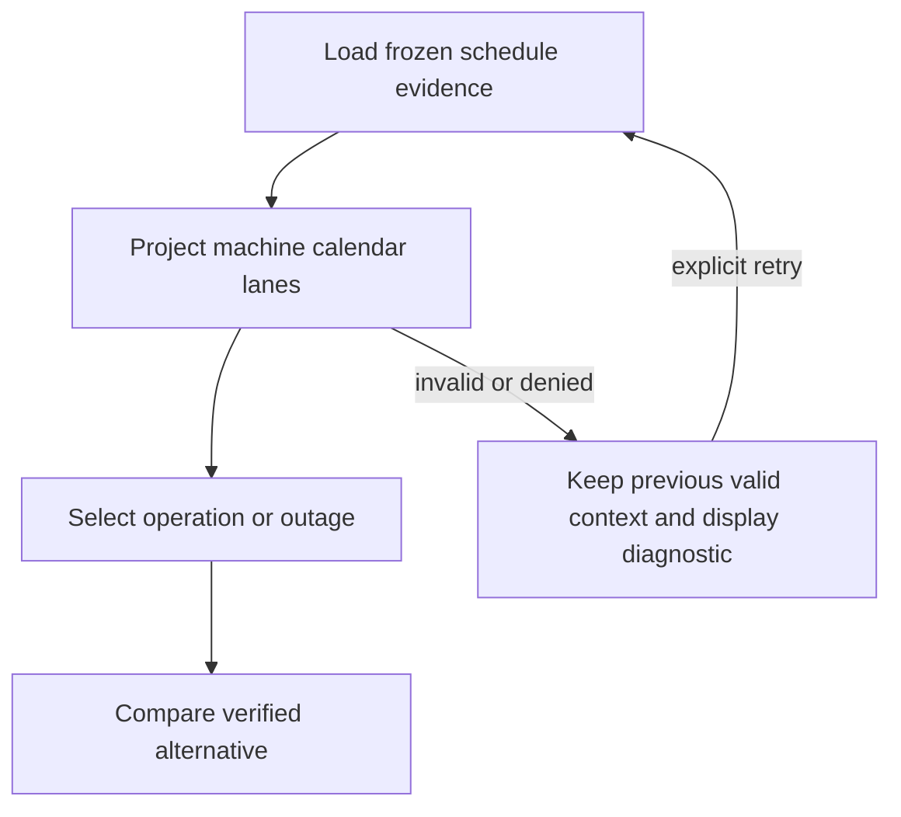
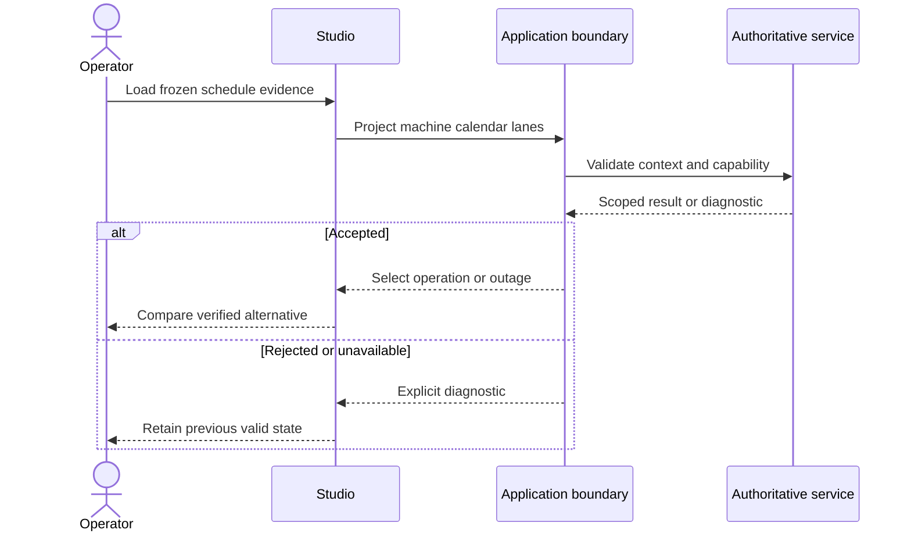
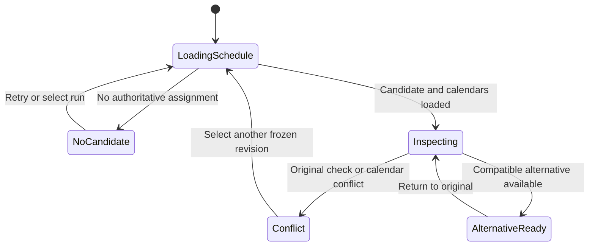

# UI15 — detailed specification review

Source: [functional scope](../../UI15.md) · [wireframe](../studies/wireframes/UI15.svg) · [reviewed high-fidelity study](../studies/UI15.svg) · [accepted field dictionary](../../../pilot-field-dictionary-v1.md).

Visual variants: [loading](../studies/states/UI15-loading.svg) · [empty](../studies/states/UI15-empty.svg) · [invalid](../studies/states/UI15-invalid.svg) · [unavailable](../studies/states/UI15-unavailable.svg) · [failed](../studies/states/UI15-failed.svg) · [actions](../studies/states/UI15-actions.svg) · [Arabic RTL](../studies/rtl/UI15.svg).

**Implementation gates:** UI01 (#90), V03 (#50), V04 (#51), SP02 (#160). No feature coding before its claimed dependencies close.

## User journey and component/data flow

The operator navigates through Load frozen schedule evidence → Project machine calendar lanes → Select operation or outage → Compare verified alternative. The application boundary, not Studio, owns authoritative mutation, validation and storage.

## Fields and ports

| Module | Existing binding | Direction and validation | Remaining owner seam |
|---|---|---|---|
| UI15 | P:F-REV,F-MACHINE,F-OP,F-START,F-DURATION,F-RELEASE,F-DUE,F-WEIGHT; G:TimeWindow/SourceStamp | Half-open intervals, same horizon origin, preserve exact input; independently checked outcome before feasible label | V03/V04 calendars, order/assignment records and scenario scheduling; S04/S10 verified row projection |

### Approved pilot field definitions applicable to this module

| Field ID / JSON key | Type, units, presence | Source and relationship | Valid representation / rejected condition |
|---|---|---|---|
| F-REV / revisionId | R, nonblank immutable text | Registry → frozen revision within tenant and model; scopes every model read | `"r17"` / mutable alias or foreign revision |
| F-MACHINE / machineId | R, nonblank text | Resource import → machine key unique in revision; operation references it | `"M1"` / missing referenced machine |
| F-OP / operationId | R, nonblank text | Order import → operation key unique in revision; assignment references it | `"A"` / duplicate operation within revision |
| F-START / startMinute | R per assigned operation, integer minutes | Candidate → start for run, revision and operation; occupies [start,start+duration) on machine | `3` / before release, end beyond horizon or resource overlap |
| F-DURATION / durationMinutes | R, integer minutes | Operations → source interval length in frozen model | `3` / zero, negative or above horizon |
| F-RELEASE / releaseMinute | R, integer minutes from horizon origin | Operation availability → source lower limit on start | `0` / outside closed interval [0,horizon] |
| F-DUE / dueMinute | R, nonnegative integer minutes from the same origin | Order commitment → source due time for tardiness | `4` / missing or negative; no upper horizon bound specified |
| F-WEIGHT / tardinessWeight | R, nonnegative exact cost per minute | Order cost snapshot → objective coefficient in the fixture's single currency | `2` / negative or implicit currency change |

Ledger pilot field IDs: F-REV, F-MACHINE, F-OP, F-START, F-DURATION. Approved logical ports: API-EVIDENCE. Read inherited type, unit, requiredness, defaults, relationship and classification rules in the field profiles; do not invent wire DTOs or physical storage.

## Operation sequence

## Interaction states and recovery

| Module | Navigation and loading | Invalid / unavailable | Keyboard and recovery |
|---|---|---|---|
| UI15 | Load machine calendar and assignment; compare alternative interval. | Overlapping downtime, missing machine, unassigned operation, unavailable feasibility result. | Keyboard inspect schedule table and operation/Gantt equivalent; show original model checks; failed load distinct from verified absence of feasible plan. |

Initial loading, empty, denied, invalid, unavailable and failed are separate presentation states; the owner result determines which is shown. Explicit retry never implies mutation.

## Acceptance and test trace

| Requirement | Review case | Action | Observable oracle | Feature acceptance IDs |
|---|---|---|---|---|
| UI15-01 Interactive Gantt | SP02-UI15-01 | Select Gantt operation by keyboard | Same selection in schedule table, half-open start/end and exact operation ID | TC-UI15-A, TC-UI15-B |
| UI15-02 Machine calendars | SP02-UI15-02 | Inspect machine calendar | Use exact calendar and horizon origin; missing calendar unavailable | TC-UI15-A, TC-UI15-B |
| UI15-03 Production orders | SP02-UI15-03 | Inspect production order | Resolve owner-provided order/operation identity and original release/due/duration | TC-UI15-A, TC-UI15-B |
| UI15-04 Maintenance windows | SP02-UI15-04 | Inspect maintenance window | Half-open interval; reject reversed/overlapping downtime under owning rules | TC-UI15-A, TC-UI15-B |
| UI15-05 Resource conflicts | SP02-UI15-05 | Inspect resource conflict | Original-model checks expose conflict; no infeasible plan rendered as verified feasible | TC-UI15-A, TC-UI15-B |
| UI15-06 Alternatives | SP02-UI15-06 | Compare alternative schedule | Before/after outage uses frozen compatible revisions and evidence | TC-UI15-A, TC-UI15-B |

Feature-level acceptance:

- TC-UI15-A: Select an operation before and after an outage, confirm its half-open interval and expose its machine and original-model checks.
- TC-UI15-B: Handle overlapping downtime and blocked schedules without drawing a feasible plan.

## Visual, localization and accessibility gates

Use approved DS01 tokens and DS02 components, with English LTR and Arabic RTL in separate scenarios. Isolate exact IDs, source spans and units; preserve logical focus order and named controls. Test keyboard and pointer equivalence for the actions above, focus recovery on errors and explicit unavailable/empty state. Compare common chrome with the reference and pin viewport, font, DPI, renderer and fixture. Static design approval is not executed screenshot acceptance. Pin the runtime fixture before establishing a screenshot baseline. Native monitor, screen-reader and feature-specific functional evidence belong to implementing issues.

**Disposition:** specification and logical contract reviewed against merged #190. Concrete provider payload/conformance and feature execution remain separate implementation gates. See [final visual disposition](../FINAL-DISPOSITION.md) for the accepted UI design specification.
