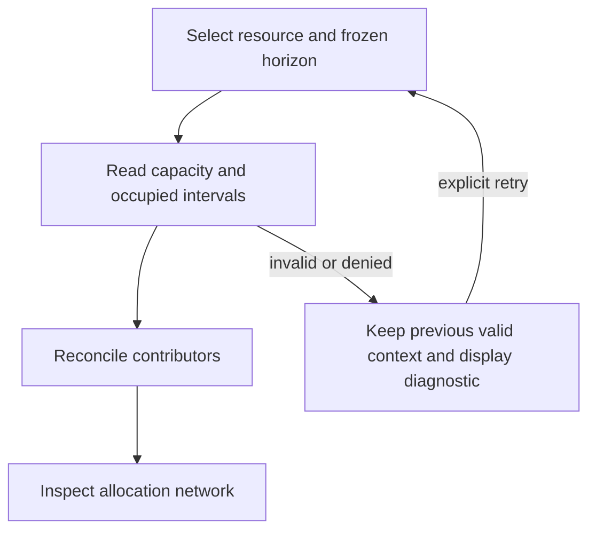
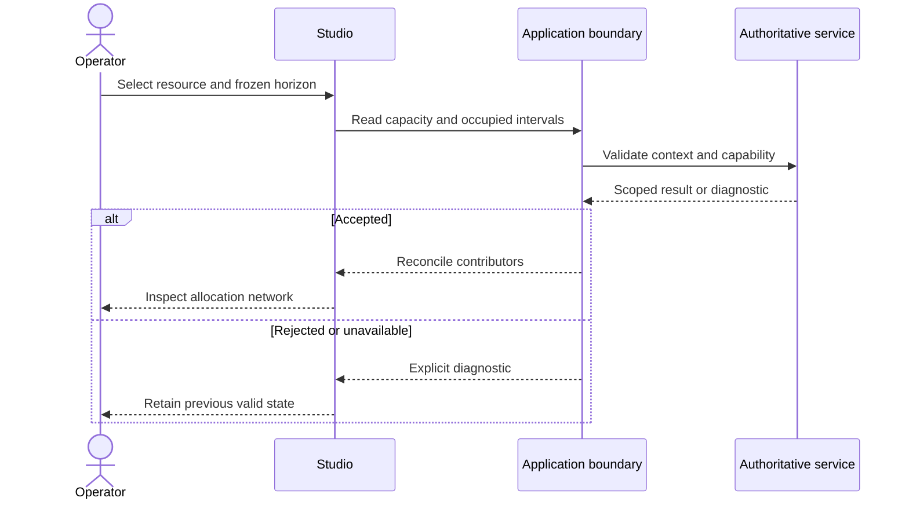
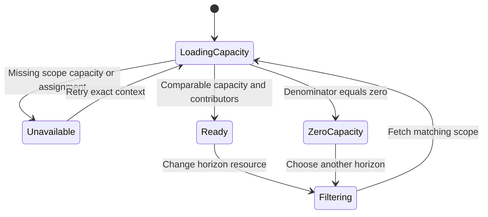

# UI16 — detailed specification review

Source: [functional scope](../../UI16.md) · [wireframe](../studies/wireframes/UI16.svg) · [reviewed high-fidelity study](../studies/UI16.svg) · [accepted field dictionary](../../../pilot-field-dictionary-v1.md).

Visual variants: [loading](../studies/states/UI16-loading.svg) · [empty](../studies/states/UI16-empty.svg) · [invalid](../studies/states/UI16-invalid.svg) · [unavailable](../studies/states/UI16-unavailable.svg) · [failed](../studies/states/UI16-failed.svg) · [actions](../studies/states/UI16-actions.svg) · [Arabic RTL](../studies/rtl/UI16.svg).

**Implementation gates:** UI01 (#90), V03 (#50), SP02 (#160). No feature coding before its claimed dependencies close.

## User journey and component/data flow

The operator navigates through Select resource and frozen horizon → Read capacity and occupied intervals → Reconcile contributors → Inspect allocation network. The application boundary, not Studio, owns authoritative mutation, validation and storage.

## Fields and ports

| Module | Existing binding | Direction and validation | Remaining owner seam |
|---|---|---|---|
| UI16 | P:F-MACHINE,F-START,F-DURATION; G:CapacityLimit, TimeWindow, GraphRevision | Same horizon/unit; zero capacity undefined utilization, not idle; read contributing assignment identities | V03 allocation/capacity/horizon and occupied intervals; approved logical API-ALLOCATION in merged #190 |

### Approved pilot field definitions applicable to this module

| Field ID / JSON key | Type, units, presence | Source and relationship | Valid representation / rejected condition |
|---|---|---|---|
| F-MACHINE / machineId | R, nonblank text | Resource import → machine key unique in revision; operation references it | `"M1"` / missing referenced machine |
| F-START / startMinute | R per assigned operation, integer minutes | Candidate → start for run, revision and operation; occupies [start,start+duration) on machine | `3` / before release, end beyond horizon or resource overlap |
| F-DURATION / durationMinutes | R, integer minutes | Operations → source interval length in frozen model | `3` / zero, negative or above horizon |

Ledger pilot field IDs: F-MACHINE, F-START, F-DURATION. Approved logical ports: API-ALLOCATION. Specialized logical design baseline approved in #190; concrete provider payload and conformance remain required. Read inherited type, unit, requiredness, defaults, relationship and classification rules in the field profiles; do not invent wire DTOs or physical storage.

### Approved specialized logical field profile

| Port / Studio | Owning issues | Required inputs and output profile | Acceptance and failure oracle |
|---|---|---|---|
| API-ALLOCATION / UI16 | V03 #50 | Frozen revision, resource ID, horizon origin/calendar and half-open start/end in same unit; return available capacity, occupied amount, contributing operation/assignment IDs and intervals; optional utilization derived only with positive comparable denominator. | Independently sum occupied machine minutes against finite capacity; reject mismatched horizon, resource, unit, or foreign assignment. Zero capacity gives null utilization; over-capacity remains visible, not clipped. |

## Operation sequence

## Interaction states and recovery

| Module | Navigation and loading | Invalid / unavailable | Keyboard and recovery |
|---|---|---|---|
| UI16 | Load resource and horizon; compute/display authorized allocation evidence. | Zero denominator, incompatible unit, missing capacity or incomplete assignment. | Select resource and contributor by keyboard; change horizon and reconcile totals; undefined utilization is not idle or zero. |

Initial loading, empty, denied, invalid, unavailable and failed are separate presentation states; the owner result determines which is shown. Explicit retry never implies mutation.

## Acceptance and test trace

| Requirement | Review case | Action | Observable oracle | Feature acceptance IDs |
|---|---|---|---|---|
| UI16-01 Utilization | SP02-UI16-01 | Inspect utilization | Reconcile occupied minutes and capacity; denominator zero yields unavailable | TC-UI16-A, TC-UI16-B |
| UI16-02 Capacity analysis | SP02-UI16-02 | Inspect capacity | Same horizon and unit; missing capacity distinct from measured zero | TC-UI16-A, TC-UI16-B |
| UI16-03 Bottlenecks | SP02-UI16-03 | Inspect bottleneck | Only owner-defined bottleneck criterion with provenance; no inferred mathematical cause | TC-UI16-A, TC-UI16-B |
| UI16-04 Heatmaps | SP02-UI16-04 | Read heatmap with keyboard | Text/numeric equivalent of exact values and missing state; color not sole encoding | TC-UI16-A, TC-UI16-B |
| UI16-05 Allocation networks | SP02-UI16-05 | Inspect allocation network | Select contributing operation and resource IDs; reconcile totals with owner records | TC-UI16-A, TC-UI16-B |

Feature-level acceptance:

- TC-UI16-A: Reconcile occupied machine minutes with capacity in the same frozen horizon and drill into each contributing operation.
- TC-UI16-B: Report unavailable utilization for zero capacity.

## Visual, localization and accessibility gates

Use approved DS01 tokens and DS02 components, with English LTR and Arabic RTL in separate scenarios. Isolate exact IDs, source spans and units; preserve logical focus order and named controls. Test keyboard and pointer equivalence for the actions above, focus recovery on errors and explicit unavailable/empty state. Compare common chrome with the reference and pin viewport, font, DPI, renderer and fixture. Static design approval is not executed screenshot acceptance. Pin the runtime fixture before establishing a screenshot baseline. Native monitor, screen-reader and feature-specific functional evidence belong to implementing issues.

**Disposition:** specification and logical contract reviewed against merged #190. Concrete provider payload/conformance and feature execution remain separate implementation gates. See [final visual disposition](../FINAL-DISPOSITION.md) for the accepted UI design specification.
