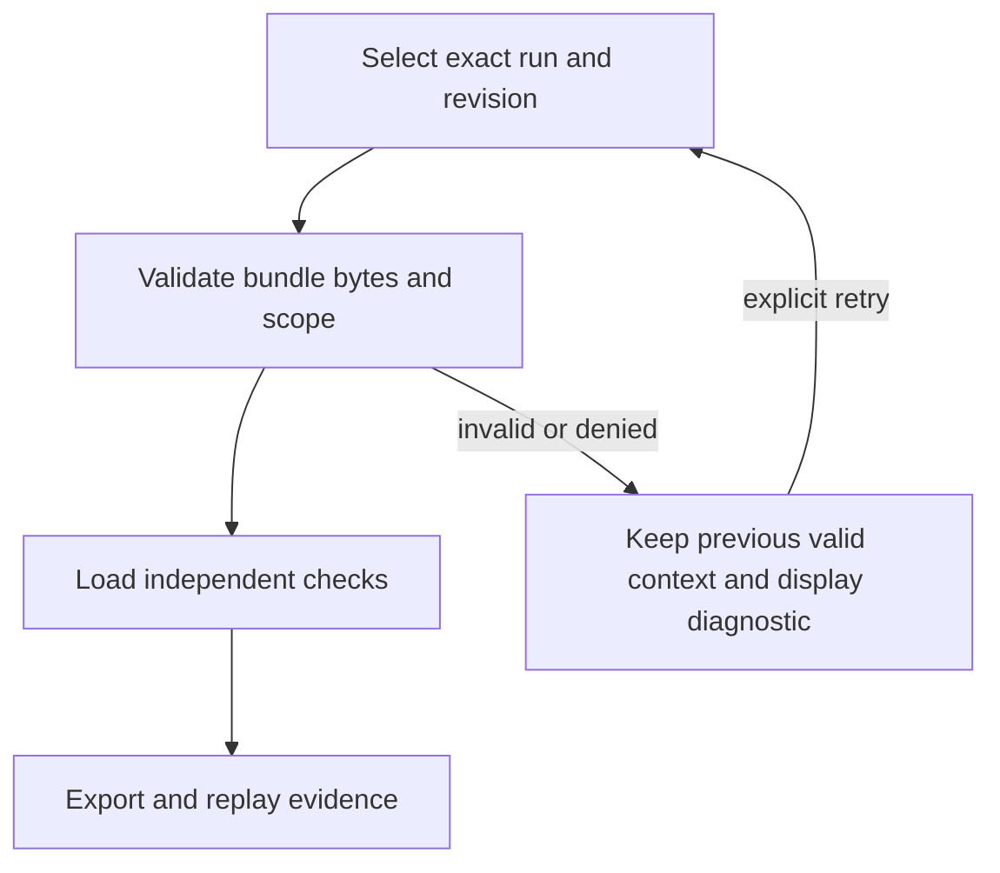
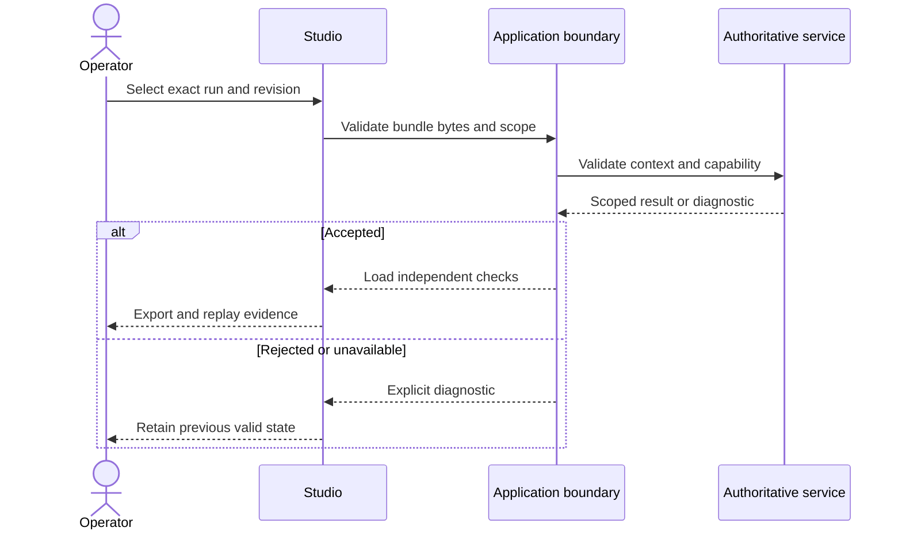
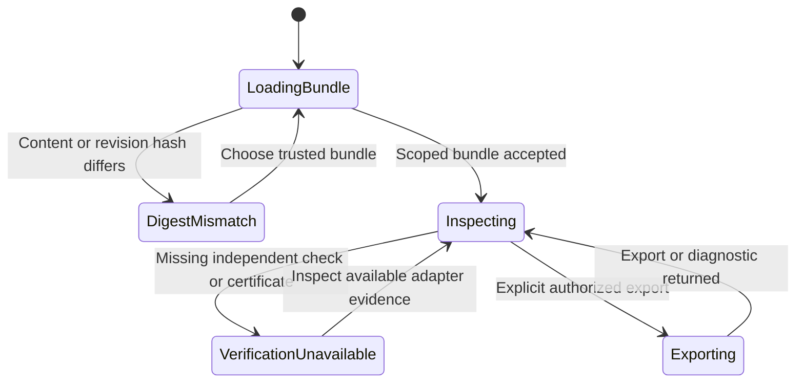

# UI17 — detailed specification review

Source: [functional scope](../../UI17.md) · [wireframe](../studies/wireframes/UI17.svg) · [reviewed high-fidelity study](../studies/UI17.svg) · [accepted field dictionary](../../../pilot-field-dictionary-v1.md).

Visual variants: [loading](../studies/states/UI17-loading.svg) · [empty](../studies/states/UI17-empty.svg) · [invalid](../studies/states/UI17-invalid.svg) · [unavailable](../studies/states/UI17-unavailable.svg) · [failed](../studies/states/UI17-failed.svg) · [actions](../studies/states/UI17-actions.svg) · [Arabic RTL](../studies/rtl/UI17.svg).

**Implementation gates:** UI01 (#90), S10 (#35), SP02 (#160). No feature coding before its claimed dependencies close.

## User journey and component/data flow

The operator navigates through Select exact run and revision → Validate bundle bytes and scope → Load independent checks → Export and replay evidence. The application boundary, not Studio, owns authoritative mutation, validation and storage.

## Fields and ports

| Module | Existing binding | Direction and validation | Remaining owner seam |
|---|---|---|---|
| UI17 | P:F-RUN,F-REV,F-STATUS,F-TERM,F-EVID,F-OBJ,F-BOUND; S:SolverResult/StatusEvidence/ObjectiveObservation; U:SourceSpan | Validate exact bundle bytes and full scope; separate adapter evidence, independent checks, and absent certificate | S10 bundle/audit/replay; S04/S05 original row checks and verified certificate/claim mapping |

### Approved pilot field definitions applicable to this module

| Field ID / JSON key | Type, units, presence | Source and relationship | Valid representation / rejected condition |
|---|---|---|---|
| F-RUN / runId | R, opaque text | Job registry → run key unique in tenant; referenced by evidence and cancellation | `"run-7"` / foreign tenant lookup |
| F-REV / revisionId | R, nonblank immutable text | Registry → frozen revision within tenant and model; scopes every model read | `"r17"` / mutable alias or foreign revision |
| F-STATUS / mathematicalStatus | R, case-sensitive enum | Worker and proof policy → run's mathematical outcome | `"Feasible"` / unsupported Optimal assertion |
| F-TERM / termination | R, case-sensitive enum | Worker → reason the run ended, independent of mathematical status | `"Timeout"` / mathematical outcome in termination slot |
| F-EVID / evidenceDigest | R on evidence export, lowercase SHA-256 hex text | Exact immutable bundle bytes → digest linked to revision and run | hash of exported bytes / malformed digest or changed bytes |
| F-OBJ / objectiveValue | N, finite exact value in objective units | Original model verifier → checked objective of candidate | `12` or `null` before evaluation / nonnumeric value |
| F-BOUND / bestBound | N, finite value in same objective units | Adapter → scoped bound for direction, revision and evidence | `null` or evidenced bound / incompatible direction or scope |

Ledger pilot field IDs: F-RUN, F-REV, F-STATUS, F-TERM, F-EVID. Approved logical ports: API-EVIDENCE. Read inherited type, unit, requiredness, defaults, relationship and classification rules in the field profiles; do not invent wire DTOs or physical storage.

### Reviewed integration relationships

- RT01 (#129), capability: Read/export evidence through application runtime, not raw registry or filesystem bypass.

## Operation sequence

## Interaction states and recovery

| Module | Navigation and loading | Invalid / unavailable | Keyboard and recovery |
|---|---|---|---|
| UI17 | Load evidence by exact run/revision; verify digest, checks and certificate independently. | Digest mismatch, denied tenant, missing certificate, unverifiable proof. | Navigate constraint row to source; export and reverify; never upgrade math status from absent certificate; failed verification explicitly labeled. |

Initial loading, empty, denied, invalid, unavailable and failed are separate presentation states; the owner result determines which is shown. Explicit retry never implies mutation.

## Acceptance and test trace

| Requirement | Review case | Action | Observable oracle | Feature acceptance IDs |
|---|---|---|---|---|
| UI17-01 Math and verification status | SP02-UI17-01 | Inspect mathematical and verification status | Separate termination, adapter result and independent verifier; timeout may retain checked incumbent | TC-UI17-A, TC-UI17-B |
| UI17-02 Evidence level | SP02-UI17-02 | Inspect evidence level | Distinguish SolverAttestation from IndependentCertificate and verified original checks | TC-UI17-A, TC-UI17-B |
| UI17-03 Original constraint checks | SP02-UI17-03 | Inspect original constraint rows | Exact row identity/source span and original check outcome; missing row not pass | TC-UI17-A, TC-UI17-B |
| UI17-04 Objective recalculation | SP02-UI17-04 | Inspect recalculated objective | Compare independent original objective in own units, exact representation and stage | TC-UI17-A, TC-UI17-B |
| UI17-05 Certificates | SP02-UI17-05 | Inspect certificate | Absent certificate explicit; tampered/unsupported rejected without upgrading proof | TC-UI17-A, TC-UI17-B |
| UI17-06 Audit history | SP02-UI17-06 | Inspect audit history | Authorized scoped history only; redact secrets, missing history unavailable | TC-UI17-A, TC-UI17-B |
| UI17-07 Reproducibility | SP02-UI17-07 | Export and replay | Compare digest to immutable bytes/revision/run; reject mismatched frozen model | TC-UI17-A, TC-UI17-B |

Feature-level acceptance:

- TC-UI17-A: Open a timed-out run with verified incumbent and inspect source rows, objective and absent certificate separately.
- TC-UI17-B: Reject a bundle whose frozen model digest differs.

## Visual, localization and accessibility gates

Use approved DS01 tokens and DS02 components, with English LTR and Arabic RTL in separate scenarios. Isolate exact IDs, source spans and units; preserve logical focus order and named controls. Test keyboard and pointer equivalence for the actions above, focus recovery on errors and explicit unavailable/empty state. Compare common chrome with the reference and pin viewport, font, DPI, renderer and fixture. Static design approval is not executed screenshot acceptance. Pin the runtime fixture before establishing a screenshot baseline. Native monitor, screen-reader and feature-specific functional evidence belong to implementing issues.

**Disposition:** specification and logical contract reviewed against merged #190. Concrete provider payload/conformance and feature execution remain separate implementation gates. See [final visual disposition](../FINAL-DISPOSITION.md) for the accepted UI design specification.
