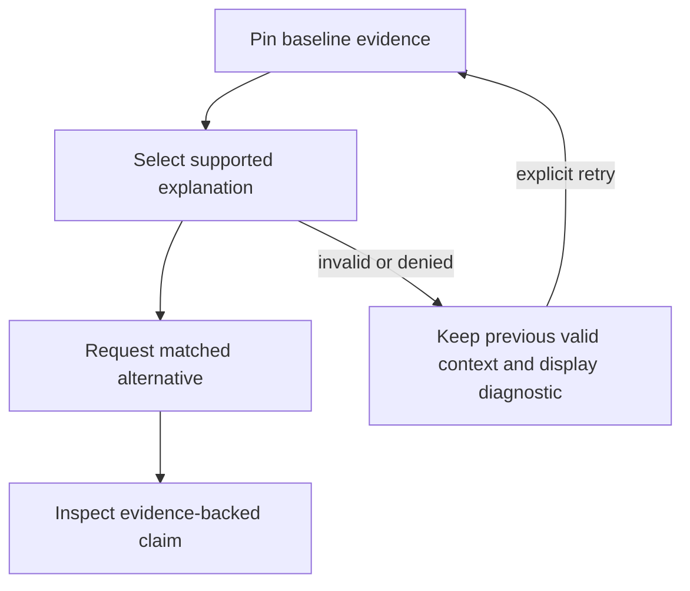
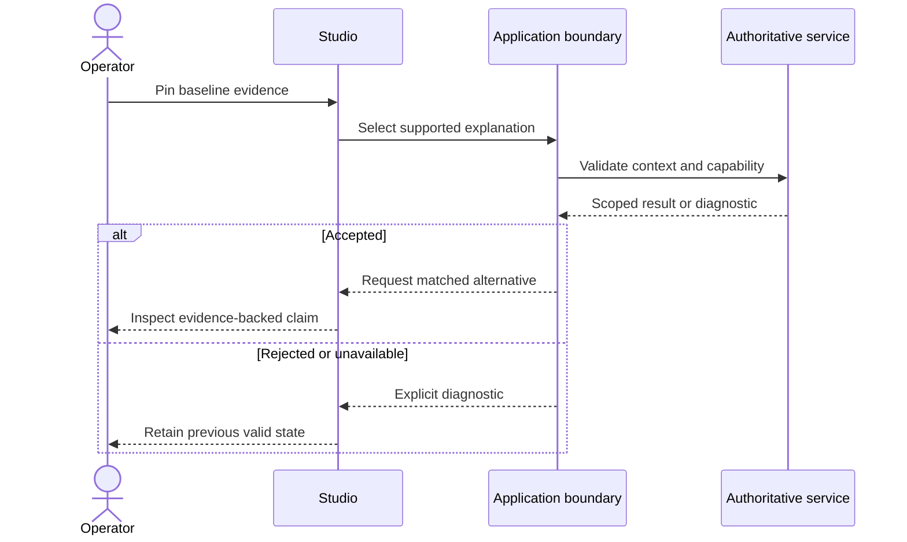
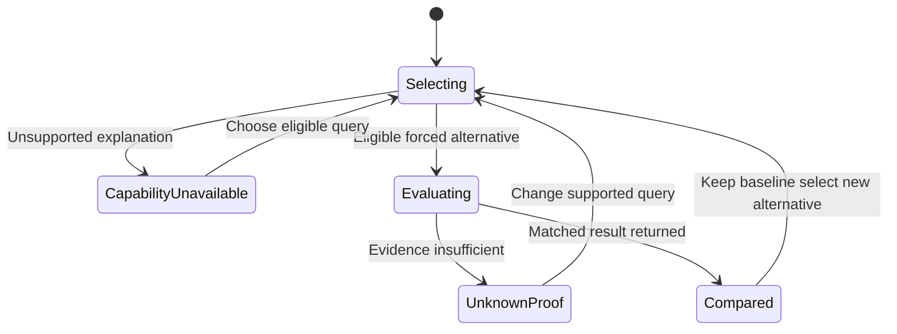

# UI18 — detailed specification review

Source: [functional scope](../../UI18.md) · [wireframe](../../drafts/UI18-wire.svg) · [proposed high-fidelity study](../studies/UI18.svg) · [accepted field dictionary](../../../pilot-field-dictionary-v1.md).

**Implementation gates:** UI17 (#106), A02 (#65), A03 (#66), SP02 (#160). No feature coding before its claimed dependencies close.

## User journey and component/data flow

The operator navigates through Pin baseline evidence → Select supported explanation → Request matched alternative → Inspect evidence-backed claim. The application boundary, not Studio, owns authoritative mutation, validation and storage.

## Fields and ports

| Module | Existing binding | Direction and validation | Remaining owner seam |
|---|---|---|---|
| UI18 | U:Constraint/Objective/SourceSpan; S:ObjectiveObservation/Bound/Evidence; P:F-REV,F-OBJ,F-BOUND,F-EVID | Read matched baseline/alternative and exact evidence; no marginal value for unsupported discrete models | A02/A03 counterfactual/reason/sensitivity/infeasibility result; proposed API-EXPLAIN in #190 |

Approved pilot field IDs: F-REV, F-OBJ, F-BOUND, F-EVID. Baseline logical ports: API-EVIDENCE. Proposed replacement API-EXPLAIN remains subject to #190 merge/owner review. Read inherited type, unit, requiredness, defaults, relationship and classification rules in the field profiles; do not invent wire DTOs or physical storage.

## Operation sequence

## Interaction states and recovery

| Module | Navigation and loading | Invalid / unavailable | Keyboard and recovery |
|---|---|---|---|
| UI18 | Load baseline and eligible explanation capabilities; request forced alternative. | Incompatible budget/revision, unsupported discrete sensitivity, unknown proof. | Select alternative and inspect binding row; cancel or retry without altering baseline; only evidence-backed claims shown as proven. |

Initial loading, empty, denied, invalid, unavailable and failed are separate presentation states; the owner result determines which is shown. Explicit retry never implies mutation.

## Acceptance and test trace

| Requirement | Review case | Action | Observable oracle | Feature acceptance IDs |
|---|---|---|---|---|
| UI18-01 Why and why-not | SP02-UI18-01 | Ask why or why-not | Claim links to recorded decision and evidence; no invented cause | TC-UI18-A, TC-UI18-B |
| UI18-02 Binding constraints | SP02-UI18-02 | Inspect binding constraints | Show exact source rows and verified values; unsupported binding query unavailable | TC-UI18-A, TC-UI18-B |
| UI18-03 Counterfactual comparison | SP02-UI18-03 | Compare counterfactual | Identical input and budget except explicit forced alternative; baseline remains intact | TC-UI18-A, TC-UI18-B |
| UI18-04 Sensitivity | SP02-UI18-04 | Inspect sensitivity | Reject LP marginal values for unsupported discrete model; label eligible scope | TC-UI18-A, TC-UI18-B |
| UI18-05 Infeasibility explanations | SP02-UI18-05 | Inspect infeasibility explanation | Only supported proof type labeled proven; heuristic warning clearly separate | TC-UI18-A, TC-UI18-B |

Feature-level acceptance:

- TC-UI18-A: Compare a forced alternative to the baseline using identical input and budget and trace any claim to its evidence.
- TC-UI18-B: Do not expose LP marginal values for unsupported discrete models.

## Visual, localization and accessibility gates

Use approved DS01 tokens and DS02 components, with English LTR and Arabic RTL in separate scenarios. Isolate exact IDs, source spans and units; preserve logical focus order and named controls. Test keyboard and pointer equivalence for the actions above, focus recovery on errors and explicit unavailable/empty state. Compare common chrome with the reference and pin viewport, font, DPI, renderer and fixture. Do not use proposed mockups as approved screenshot baselines. Native monitor, screen-reader and feature-specific functional evidence belong to implementing issues.

**Disposition:** review proposal with implementation-specific acceptance cases. Domain-source bindings are checked, but owner seams are not approved by this document. No feature execution or final visual approval claimed.
