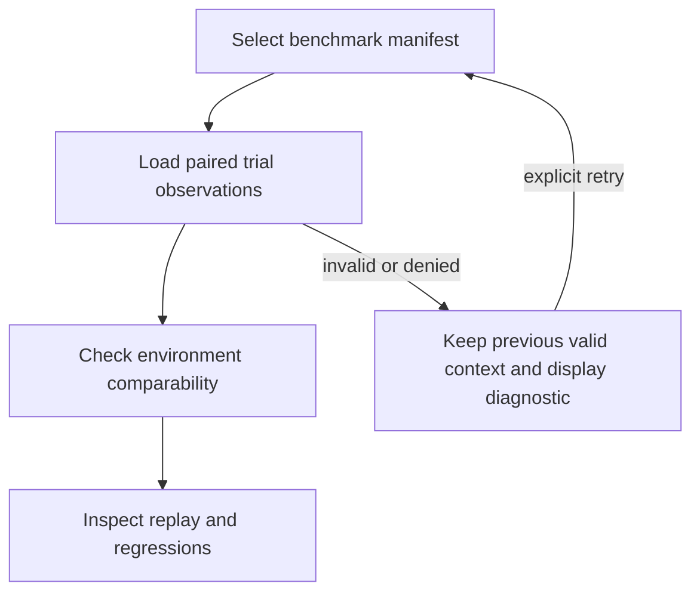
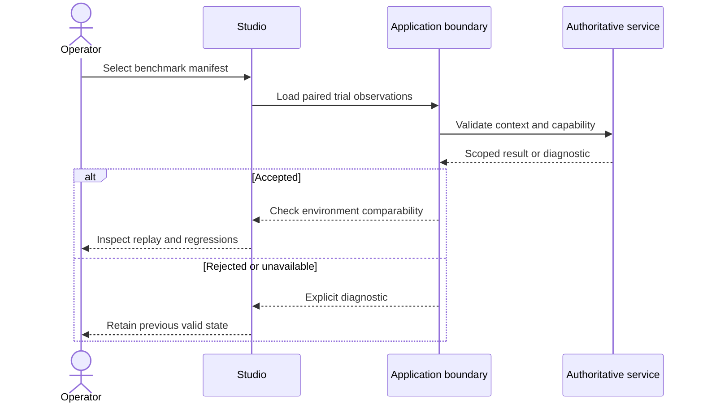

# UI19 — detailed specification review

Source: [functional scope](../../UI19.md) · [wireframe](../../drafts/UI19-wire.svg) · [proposed high-fidelity study](../studies/UI19.svg) · [accepted field dictionary](../../../pilot-field-dictionary-v1.md).

**Implementation gates:** UI01 (#90), X07 (#44), SP02 (#160). No feature coding before its claimed dependencies close.

## User journey and component/data flow

The operator navigates through Select benchmark manifest → Load paired trial observations → Check environment comparability → Inspect replay and regressions. The application boundary, not Studio, owns authoritative mutation, validation and storage.

## Fields and ports

| Module | Existing binding | Direction and validation | Remaining owner seam |
|---|---|---|---|
| UI19 | S:SolverIdentity, Measurement; P:F-RUN,F-CPU,F-MEM,F-ELAPSED | Compare measured values only in same scope/unit; keep failed or unmatched trial visible | X07 suite/instance/seed/budget/hardware/trial/failure/statistics manifest; proposed API-BENCHMARK in #190 |

Approved pilot field IDs: F-RUN, F-CPU, F-MEM, F-ELAPSED. Baseline logical ports: API-RUN. Proposed replacement API-BENCHMARK remains subject to #190 merge/owner review. Read inherited type, unit, requiredness, defaults, relationship and classification rules in the field profiles; do not invent wire DTOs or physical storage.

## Operation sequence

## Interaction states and recovery

| Module | Navigation and loading | Invalid / unavailable | Keyboard and recovery |
|---|---|---|---|
| UI19 | Load suite and paired observations, then environment manifest. | Missing failed trial record, incompatible unit/environment, unmatched instance or unsupported metric. | Keyboard choose paired samples and failed trial; export exact manifest; keep failures in counts and suppress incomparable statistics. |

Named states: LoadingSuite, Partial, Incomparable, Ready, Exporting. Initial loading, empty, denied, invalid, unavailable and failed are separate presentation states; the owner result determines which is shown. Explicit retry never implies mutation.

## Acceptance and test trace

| Requirement | Review case | Action | Observable oracle | Feature acceptance IDs |
|---|---|---|---|---|
| UI19-01 Benchmark execution | SP02-UI19-01 | Start benchmark execution | Use authorized suite, explicit budget/seed/manifest; failed trials retained | TC-UI19-A, TC-UI19-B |
| UI19-02 Solver comparison | SP02-UI19-02 | Compare solver trials | Pair same instance family and scope, report unmatched trials separately | TC-UI19-A, TC-UI19-B |
| UI19-03 CPU and memory | SP02-UI19-03 | Inspect CPU and memory | Measured process-tree scope and explicit units; null not zero | TC-UI19-A, TC-UI19-B |
| UI19-04 Historical performance | SP02-UI19-04 | Inspect historical performance | Stable trial ID and environment version; incompatible series not joined | TC-UI19-A, TC-UI19-B |
| UI19-05 Regression detection | SP02-UI19-05 | Inspect regression | Compare owner-approved baseline/criterion; no unsupported significance claim | TC-UI19-A, TC-UI19-B |
| UI19-06 Statistics and replay | SP02-UI19-06 | Inspect statistics and replay | Show actual paired sample count, failures, environment and seeds; replay exact manifest | TC-UI19-A, TC-UI19-B |

Feature-level acceptance:

- TC-UI19-A: Display paired samples, hardware, seeds, peak memory and failed trials from a benchmark manifest.
- TC-UI19-B: Reject incomparable units and highlight unmatched instance families.

## Visual, localization and accessibility gates

Use approved DS01 tokens and DS02 components, with English LTR and Arabic RTL in separate scenarios. Isolate exact IDs, source spans and units; preserve logical focus order and named controls. Test keyboard and pointer equivalence for the actions above, focus recovery on errors and explicit unavailable/empty state. Compare common chrome with the reference and pin viewport, font, DPI, renderer and fixture. Do not use proposed mockups as approved screenshot baselines. Native monitor, screen-reader and feature-specific functional evidence belong to implementing issues.

**Disposition:** review proposal with implementation-specific acceptance cases. Domain-source bindings are checked, but owner seams are not approved by this document. No feature execution or final visual approval claimed.
