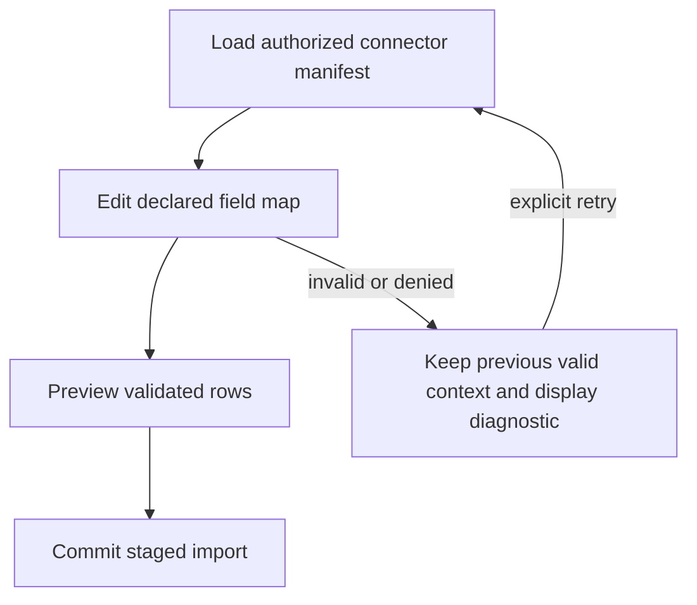
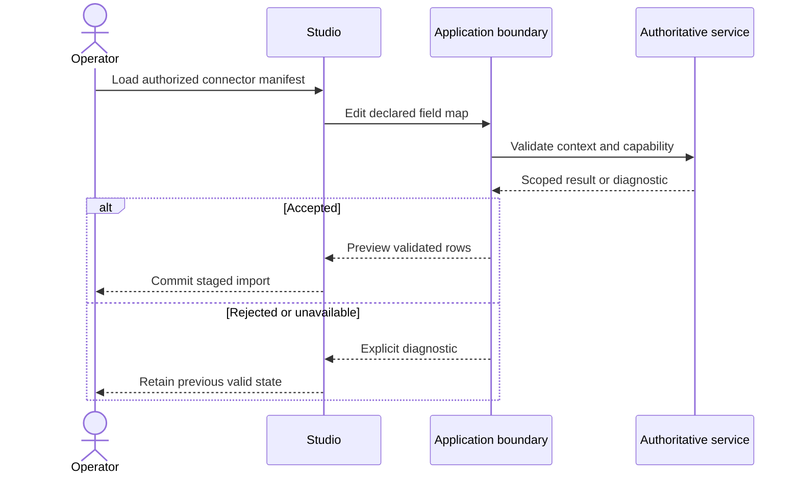
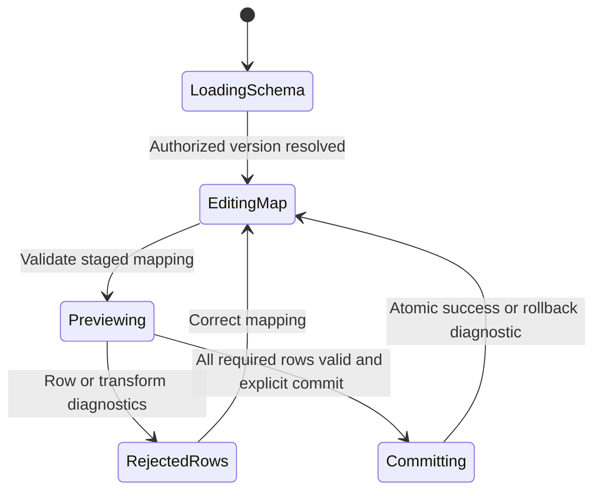

# UI20 — detailed specification review

Source: [functional scope](../../UI20.md) · [wireframe](../studies/wireframes/UI20.svg) · [reviewed high-fidelity study](../studies/UI20.svg) · [accepted field dictionary](../../../pilot-field-dictionary-v1.md).

Visual variants: [loading](../studies/states/UI20-loading.svg) · [empty](../studies/states/UI20-empty.svg) · [invalid](../studies/states/UI20-invalid.svg) · [unavailable](../studies/states/UI20-unavailable.svg) · [failed](../studies/states/UI20-failed.svg) · [actions](../studies/states/UI20-actions.svg) · [Arabic RTL](../studies/rtl/UI20.svg).

**Implementation gates:** UI01 (#90), I01 (#55), I02 (#56), SP02 (#160). No feature coding before its claimed dependencies close.

## User journey and component/data flow

The operator navigates through Load authorized connector manifest → Edit declared field map → Preview validated rows → Commit staged import. The application boundary, not Studio, owns authoritative mutation, validation and storage.

## Fields and ports

| Module | Existing binding | Direction and validation | Remaining owner seam |
|---|---|---|---|
| UI20 | C:ConnectorManifest, FieldMapping, ProvenancePolicy, CursorPolicy, RetryPolicy, ConnectorStreamIdentity, ConnectorReadBatch/SourceRow; P:F-REV,F-MACHINE,F-DURATION | Validate declaration, preview through importer; atomic commit only after admission; redact credential reference and cursor | I02/I04 normalized rows, staged commit, checkpoint/health; approved logical API-MAPPING in merged #190 |

### Approved pilot field definitions applicable to this module

| Field ID / JSON key | Type, units, presence | Source and relationship | Valid representation / rejected condition |
|---|---|---|---|
| F-REV / revisionId | R, nonblank immutable text | Registry → frozen revision within tenant and model; scopes every model read | `"r17"` / mutable alias or foreign revision |
| F-MACHINE / machineId | R, nonblank text | Resource import → machine key unique in revision; operation references it | `"M1"` / missing referenced machine |
| F-DURATION / durationMinutes | R, integer minutes | Operations → source interval length in frozen model | `3` / zero, negative or above horizon |

Ledger pilot field IDs: F-REV, F-MACHINE, F-DURATION. Approved logical ports: API-MAPPING. Specialized logical design baseline approved in #190; concrete provider payload and conformance remain required. Read inherited type, unit, requiredness, defaults, relationship and classification rules in the field profiles; do not invent wire DTOs or physical storage.

### Approved specialized logical field profile

| Port / Studio | Owning issues | Required inputs and output profile | Acceptance and failure oracle |
|---|---|---|---|
| API-MAPPING / UI20 | I01 #55, I02 #56, I04 #58 for sync | Authorized connector/schema/version, mapping version, source keys, target field/type/unit, required/allowNull independently, explicit preview scope; return staged normalized rows, source provenance and row diagnostics. Credential reference is opaque, never secret; cursor is not displayed raw. | Validate manifest and actual preview; reject ambiguous conversion, invalid/missing required rows and unauthorized scope; no partial commit. Synchronization checkpoint and health only with I04 capability. |

### Reviewed integration relationships

- I04 (#58), capability: Full synchronization health/checkpoint capability remains I04-owned; I01/I02 cover declaration and snapshot import.

## Operation sequence

## Interaction states and recovery

| Module | Navigation and loading | Invalid / unavailable | Keyboard and recovery |
|---|---|---|---|
| UI20 | Load connector schema; stage mapping, preview rows, validate before commit. | Invalid transform/unit, stale schema, unauthorized credential, row rejection. | Edit mapping by keys and inspect source-row diagnostics; cancel discards stage; atomic rejection leaves prior revision intact, credentials redacted. |

Initial loading, empty, denied, invalid, unavailable and failed are separate presentation states; the owner result determines which is shown. Explicit retry never implies mutation.

## Acceptance and test trace

| Requirement | Review case | Action | Observable oracle | Feature acceptance IDs |
|---|---|---|---|---|
| UI20-01 Connectors and schemas | SP02-UI20-01 | Inspect connector schema | Exact source/target schema and version; unknown schema disables mapping | TC-UI20-A, TC-UI20-B |
| UI20-02 Field mapping | SP02-UI20-02 | Map source to target field | Unique target ID, required and allowNull separately; reject stale schema | TC-UI20-A, TC-UI20-B |
| UI20-03 Transformations and units | SP02-UI20-03 | Apply declared transform | Resolve allowlisted transform/version; identity cannot change units/types; no arbitrary code | TC-UI20-A, TC-UI20-B |
| UI20-04 Synchronization health | SP02-UI20-04 | Inspect synchronization health | Use owner checkpoint/stream identity; redact cursor and credential references | TC-UI20-A, TC-UI20-B |
| UI20-05 Import validation | SP02-UI20-05 | Validate and commit staged import | Trace rejected row to source field; atomic rejection leaves current revision unchanged | TC-UI20-A, TC-UI20-B |

Feature-level acceptance:

- TC-UI20-A: Map a source quantity to an engine field, preview normalized values and trace rejected rows to source fields.
- TC-UI20-B: Abort invalid imports atomically and redact credentials.

## Visual, localization and accessibility gates

Use approved DS01 tokens and DS02 components, with English LTR and Arabic RTL in separate scenarios. Isolate exact IDs, source spans and units; preserve logical focus order and named controls. Test keyboard and pointer equivalence for the actions above, focus recovery on errors and explicit unavailable/empty state. Compare common chrome with the reference and pin viewport, font, DPI, renderer and fixture. Static design approval is not executed screenshot acceptance. Pin the runtime fixture before establishing a screenshot baseline. Native monitor, screen-reader and feature-specific functional evidence belong to implementing issues.

**Disposition:** specification and logical contract reviewed against merged #190. Concrete provider payload/conformance and feature execution remain separate implementation gates. See [final visual disposition](../FINAL-DISPOSITION.md) for the accepted UI design specification.
