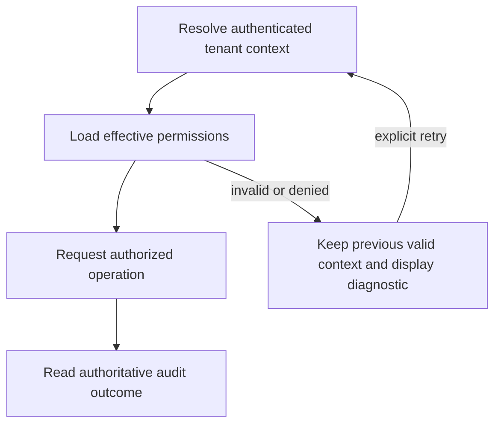
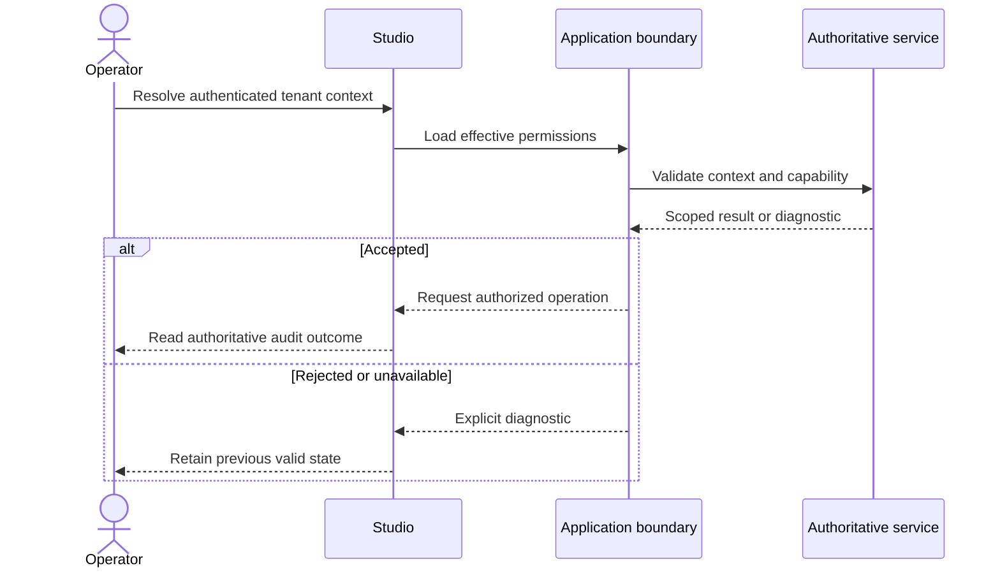
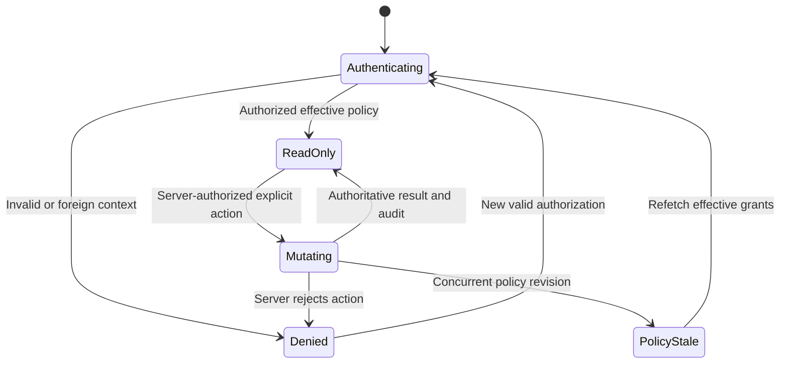

# UI21 — detailed specification review

Source: [functional scope](../../UI21.md) · [wireframe](../../drafts/UI21-wire.svg) · [proposed high-fidelity study](../studies/UI21.svg) · [accepted field dictionary](../../../pilot-field-dictionary-v1.md).

**Implementation gates:** UI01 (#90), E01 (#75), I01 (#55), SP02 (#160). No feature coding before its claimed dependencies close.

## User journey and component/data flow

The operator navigates through Resolve authenticated tenant context → Load effective permissions → Request authorized operation → Read authoritative audit outcome. The application boundary, not Studio, owns authoritative mutation, validation and storage.

## Fields and ports

| Module | Existing binding | Direction and validation | Remaining owner seam |
|---|---|---|---|
| UI21 | E:TenantActor/TenantResource/TenantPermission/TenantOidcOptions; C:manifest metadata; P:F-REV | Server authorization before read/mutation; never derive authorization from role display, no secrets in UI | E02/U06/S12 membership mutations, administrative audit, SDK/extension registry; proposed API-ADMIN in #190 |

Approved pilot field IDs: F-REV. Baseline logical ports: API-WORKSPACE. Proposed replacement API-ADMIN remains subject to #190 merge/owner review. Read inherited type, unit, requiredness, defaults, relationship and classification rules in the field profiles; do not invent wire DTOs or physical storage.

## Operation sequence

## Interaction states and recovery

| Module | Navigation and loading | Invalid / unavailable | Keyboard and recovery |
|---|---|---|---|
| UI21 | Load authorized tenant context and role matrix, then versioned SDK/extension details. | Expired token, denied permission, stale policy version, cross-tenant identity. | Navigate as read-only user and attempt privileged action; server rejection is observable, no optimistic success; refetch policy and restore safe focus. |

Initial loading, empty, denied, invalid, unavailable and failed are separate presentation states; the owner result determines which is shown. Explicit retry never implies mutation.

## Acceptance and test trace

| Requirement | Review case | Action | Observable oracle | Feature acceptance IDs |
|---|---|---|---|---|
| UI21-01 Tenants and users | SP02-UI21-01 | Inspect tenants and users | Server lookup bound to trusted tenant, foreign and missing resource indistinguishable | TC-UI21-A, TC-UI21-B |
| UI21-02 Roles and permissions | SP02-UI21-02 | Inspect or change role | View-only user denied mutation at server; effective permissions not inferred from token role | TC-UI21-A, TC-UI21-B |
| UI21-03 API configuration | SP02-UI21-03 | Inspect API configuration | HTTPS issuer/audience and redacted config; route/secret policy server-owned | TC-UI21-A, TC-UI21-B |
| UI21-04 SDK documentation | SP02-UI21-04 | Open versioned SDK docs | Match actual published SDK version; missing examples explicit | TC-UI21-A, TC-UI21-B |
| UI21-05 Extension management | SP02-UI21-05 | Inspect extension management | Manifest read does not authorize activation; denied mutation no optimistic success | TC-UI21-A, TC-UI21-B |

Feature-level acceptance:

- TC-UI21-A: Use two tenant accounts to check a read-only role, an administrative operation and versioned SDK examples in Blazor.
- TC-UI21-B: Reject a cross-tenant request at the server even if the client is modified.

## Visual, localization and accessibility gates

Use approved DS01 tokens and DS02 components, with English LTR and Arabic RTL in separate scenarios. Isolate exact IDs, source spans and units; preserve logical focus order and named controls. Test keyboard and pointer equivalence for the actions above, focus recovery on errors and explicit unavailable/empty state. Compare common chrome with the reference and pin viewport, font, DPI, renderer and fixture. Do not use proposed mockups as approved screenshot baselines. Native monitor, screen-reader and feature-specific functional evidence belong to implementing issues.

**Disposition:** review proposal with implementation-specific acceptance cases. Domain-source bindings are checked, but owner seams are not approved by this document. No feature execution or final visual approval claimed.
