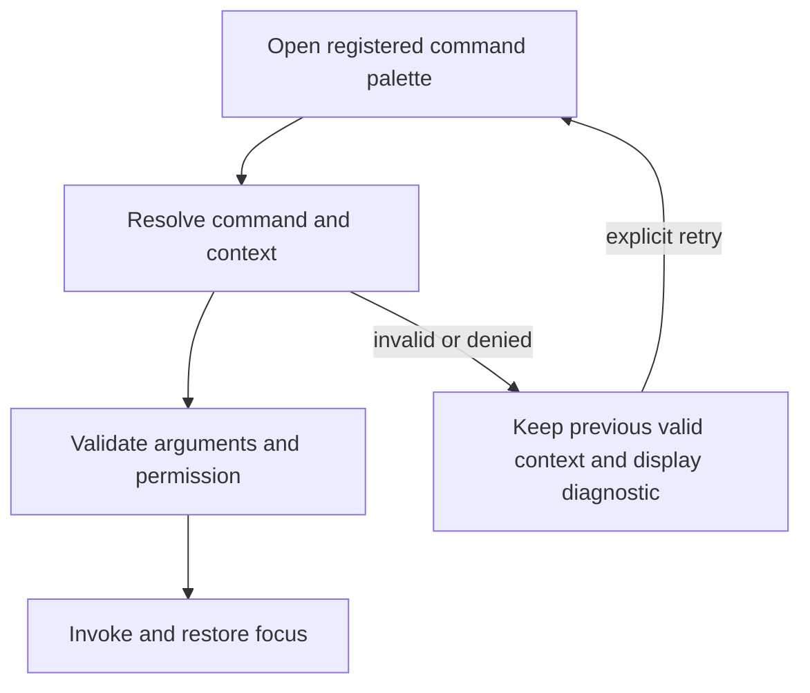
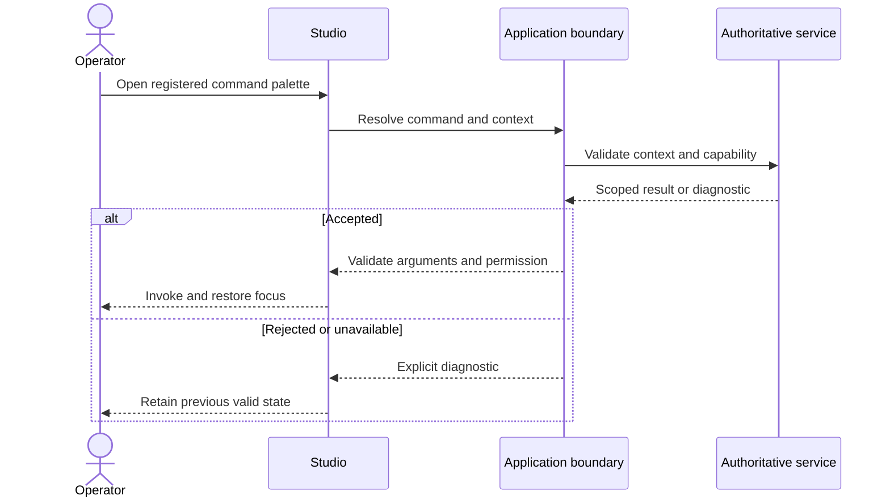
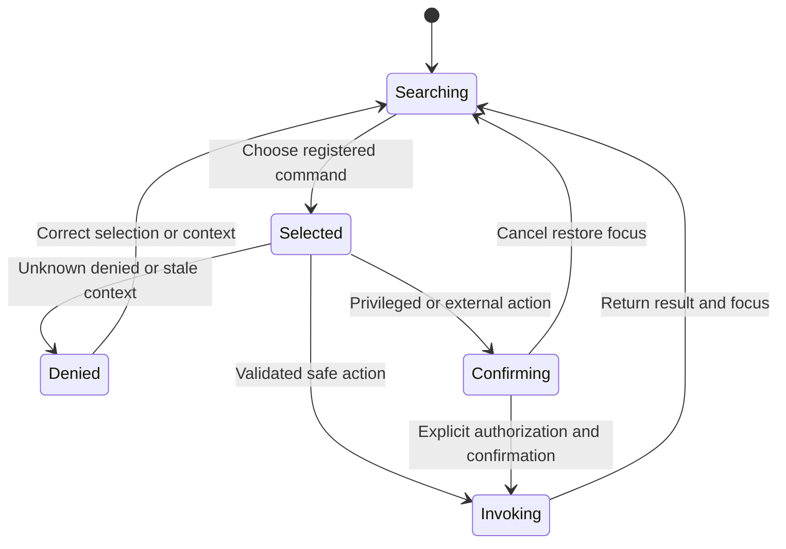

# UI22 — detailed specification review

Source: [functional scope](../../UI22.md) · [wireframe](../../drafts/UI22-wire.svg) · [proposed high-fidelity study](../studies/UI22.svg) · [accepted field dictionary](../../../pilot-field-dictionary-v1.md).

**Implementation gates:** UI01 (#90), SP02 (#160). No feature coding before its claimed dependencies close.

## User journey and component/data flow

The operator navigates through Open registered command palette → Resolve command and context → Validate arguments and permission → Invoke and restore focus. The application boundary, not Studio, owns authoritative mutation, validation and storage.

## Fields and ports

| Module | Existing binding | Direction and validation | Remaining owner seam |
|---|---|---|---|
| UI22 | L registered command and local history; P:F-REV; API-COMMAND logical vocabulary and cli-contract.md | Resolve registered command under same context/permission for shortcuts/menu/search; no arbitrary shell | CLI10/runtime command invocation schema, external capability policy and redacted history |

### Approved pilot field definitions applicable to this module

| Field ID / JSON key | Type, units, presence | Source and relationship | Valid representation / rejected condition |
|---|---|---|---|
| F-REV / revisionId | R, nonblank immutable text | Registry → frozen revision within tenant and model; scopes every model read | `"r17"` / mutable alias or foreign revision |

Ledger pilot field IDs: F-REV. Baseline logical ports: API-COMMAND. Read inherited type, unit, requiredness, defaults, relationship and classification rules in the field profiles; do not invent wire DTOs or physical storage.

## Operation sequence

## Interaction states and recovery

| Module | Navigation and loading | Invalid / unavailable | Keyboard and recovery |
|---|---|---|---|
| UI22 | Open palette, load registered commands for current capability/context. | Unknown or denied command, invalid arguments, stale workspace or restricted shell action. | Search and invoke same command via shortcut or palette; Escape restores opener; no unrestricted shell, privileged actions require explicit authorization. |

Initial loading, empty, denied, invalid, unavailable and failed are separate presentation states; the owner result determines which is shown. Explicit retry never implies mutation.

## Acceptance and test trace

| Requirement | Review case | Action | Observable oracle | Feature acceptance IDs |
|---|---|---|---|---|
| UI22-01 Search everywhere | SP02-UI22-01 | Search registered commands | Search by title/ID under current capability; no arbitrary execution | TC-UI22-A, TC-UI22-B |
| UI22-02 Keyboard shortcuts | SP02-UI22-02 | Invoke shortcut | Same registered command and permission as name invocation | TC-UI22-A, TC-UI22-B |
| UI22-03 Context menus | SP02-UI22-03 | Open context menu | Context actions match selected entity and revision; keyboard equivalent | TC-UI22-A, TC-UI22-B |
| UI22-04 Quick navigation | SP02-UI22-04 | Quick navigate | Resolve authorized target and restore prior focus on cancel | TC-UI22-A, TC-UI22-B |
| UI22-05 Command history | SP02-UI22-05 | Inspect command history | Only redacted bounded local history; secrets and raw payload excluded | TC-UI22-A, TC-UI22-B |
| UI22-06 Restricted terminal integration | SP02-UI22-06 | Invoke restricted terminal action | Explicit local capability and structured arguments; no shell interpolation or unapproved external command | TC-UI22-A, TC-UI22-B |

Feature-level acceptance:

- TC-UI22-A: Invoke a registered command by name and shortcut with the same permission and workspace context.
- TC-UI22-B: A command requiring an external shell must demand an explicit local capability and structured arguments.

## Visual, localization and accessibility gates

Use approved DS01 tokens and DS02 components, with English LTR and Arabic RTL in separate scenarios. Isolate exact IDs, source spans and units; preserve logical focus order and named controls. Test keyboard and pointer equivalence for the actions above, focus recovery on errors and explicit unavailable/empty state. Compare common chrome with the reference and pin viewport, font, DPI, renderer and fixture. Do not use proposed mockups as approved screenshot baselines. Native monitor, screen-reader and feature-specific functional evidence belong to implementing issues.

**Disposition:** review proposal with implementation-specific acceptance cases. Domain-source bindings are checked, but owner seams are not approved by this document. No feature execution or final visual approval claimed.
