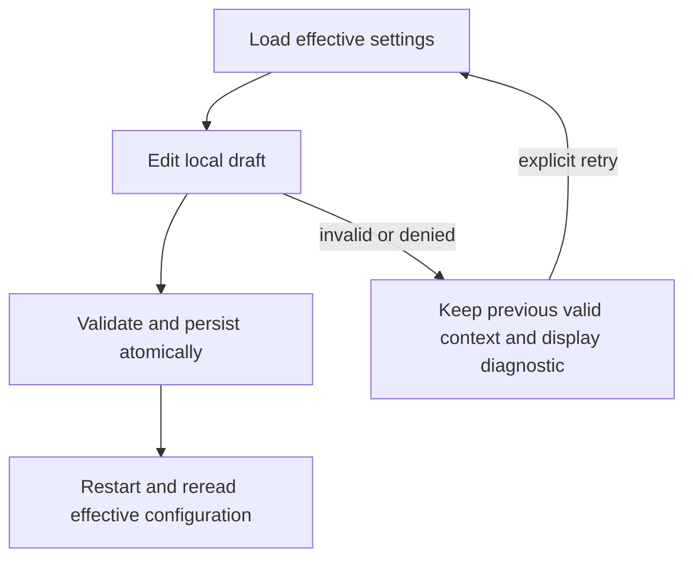
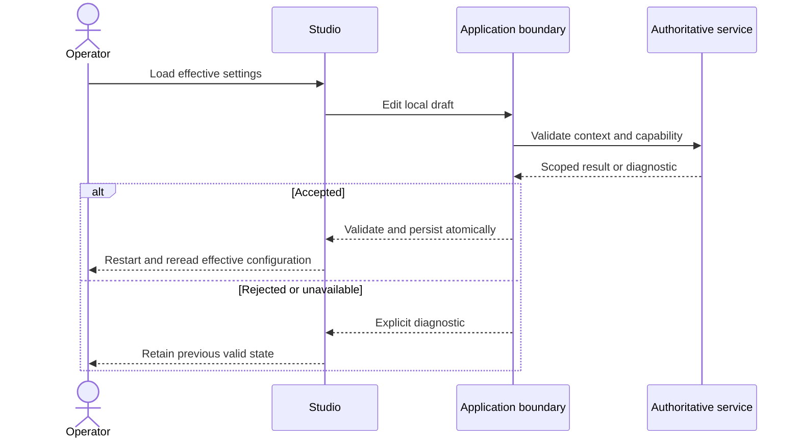
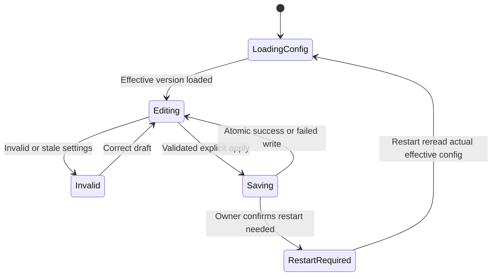

# UI23 — detailed specification review

Source: [functional scope](../../UI23.md) · [wireframe](../studies/wireframes/UI23.svg) · [reviewed high-fidelity study](../studies/UI23.svg) · [accepted field dictionary](../../../pilot-field-dictionary-v1.md).

Visual variants: [loading](../studies/states/UI23-loading.svg) · [empty](../studies/states/UI23-empty.svg) · [invalid](../studies/states/UI23-invalid.svg) · [unavailable](../studies/states/UI23-unavailable.svg) · [failed](../studies/states/UI23-failed.svg) · [actions](../studies/states/UI23-actions.svg) · [Arabic RTL](../studies/rtl/UI23.svg).

**Implementation gates:** UI01 (#90), CLI10 (#122), SP02 (#160), DS03 (#127). No feature coding before its claimed dependencies close.

## User journey and component/data flow

The operator navigates through Load effective settings → Edit local draft → Validate and persist atomically → Restart and reread effective configuration. The application boundary, not Studio, owns authoritative mutation, validation and storage.

## Fields and ports

| Module | Existing binding | Direction and validation | Remaining owner seam |
|---|---|---|---|
| UI23 | DS01 theme/density; DS03 language proposed until #127; E:diagnostic redaction policy; P:F-REV,F-RUN | Validate local draft, atomic write, reread effective config; never log credentials | RT01/CLI10 effective engine config/schema/health; approved logical API-SETTINGS in merged #190 |

### Approved pilot field definitions applicable to this module

| Field ID / JSON key | Type, units, presence | Source and relationship | Valid representation / rejected condition |
|---|---|---|---|
| F-REV / revisionId | R, nonblank immutable text | Registry → frozen revision within tenant and model; scopes every model read | `"r17"` / mutable alias or foreign revision |
| F-RUN / runId | R, opaque text | Job registry → run key unique in tenant; referenced by evidence and cancellation | `"run-7"` / foreign tenant lookup |

Ledger pilot field IDs: F-REV, F-RUN. Approved logical ports: API-SETTINGS. Specialized logical design baseline approved in #190; concrete provider payload and conformance remain required. Read inherited type, unit, requiredness, defaults, relationship and classification rules in the field profiles; do not invent wire DTOs or physical storage.

### Approved specialized logical field profile

| Port / Studio | Owning issues | Required inputs and output profile | Acceptance and failure oracle |
|---|---|---|---|
| API-SETTINGS / UI23 | RT01 #129, CLI10 #122, DS03 #127 for presentation | Explicit local workspace/user scope or authorized enterprise context, typed setting keys, expected config revision, requested changes; return effective values only from permitted allowlist, applied revision and redacted diagnostic state. Presentation settings separate from engine options and credentials. | Validate before atomic replace; re-open effective configuration on restart; preserve previous valid config on failure or stale revision. Do not expose tokens, connection strings or raw exception payload. Unsupported health remains not assessed. |

### Reviewed integration relationships

- RT01 (#129), capability: Effective engine/workspace settings and runtime health need actual runtime provider, not mock config.
- DS03 (#127), hard: Runtime language and native layout qualification are DS03-owned.

## Operation sequence

## Interaction states and recovery

| Module | Navigation and loading | Invalid / unavailable | Keyboard and recovery |
|---|---|---|---|
| UI23 | Load effective config into editable draft; validate, persist, restart and reread. | Invalid setting, stale config revision, unavailable diagnostic, redacted secret. | Keyboard switch language/theme, correct invalid field; failed apply keeps previous effective config; export redacted report, partial diagnostics explicit. |

Initial loading, empty, denied, invalid, unavailable and failed are separate presentation states; the owner result determines which is shown. Explicit retry never implies mutation.

## Acceptance and test trace

| Requirement | Review case | Action | Observable oracle | Feature acceptance IDs |
|---|---|---|---|---|
| UI23-01 Application and engine settings | SP02-UI23-01 | Edit app and engine settings | Validate owner schema/version; invalid edit retains last effective config | TC-UI23-A, TC-UI23-B |
| UI23-02 Theme and language | SP02-UI23-02 | Switch theme and language | Runtime change keeps focus and ID/unit legibility; restart restores effective setting | TC-UI23-A, TC-UI23-B |
| UI23-03 Logging | SP02-UI23-03 | Change logging level | Owner-approved level; no secret or raw tenant payload in diagnostic output | TC-UI23-A, TC-UI23-B |
| UI23-04 Health | SP02-UI23-04 | Inspect health | Unavailable measurement/source explicit; not silently healthy | TC-UI23-A, TC-UI23-B |
| UI23-05 Runtime diagnostics | SP02-UI23-05 | Export runtime diagnostics | Redacted exact manifest with partial data labeled; no credentials | TC-UI23-A, TC-UI23-B |

Feature-level acceptance:

- TC-UI23-A: Change theme and language, restart and inspect the effective configuration and redacted health report.
- TC-UI23-B: Keep the last valid configuration after invalid edits.

## Visual, localization and accessibility gates

Use approved DS01 tokens and DS02 components, with English LTR and Arabic RTL in separate scenarios. Isolate exact IDs, source spans and units; preserve logical focus order and named controls. Test keyboard and pointer equivalence for the actions above, focus recovery on errors and explicit unavailable/empty state. Compare common chrome with the reference and pin viewport, font, DPI, renderer and fixture. Static design approval is not executed screenshot acceptance. Pin the runtime fixture before establishing a screenshot baseline. Native monitor, screen-reader and feature-specific functional evidence belong to implementing issues.

**Disposition:** specification and logical contract reviewed against merged #190. Concrete provider payload/conformance and feature execution remain separate implementation gates. See [final visual disposition](../FINAL-DISPOSITION.md) for the accepted UI design specification.
