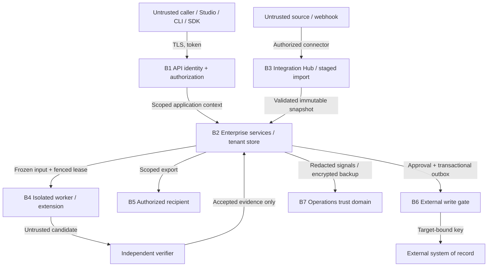

# F04 — Tenant threat model and trust boundaries

Status: design specification for #12 / REQ-F04 / TC-F04-A; not a production security attestation.
Baseline: ADR-001–005, contract compatibility F05, lifecycle, operating modes, pilot contracts and engine evidence semantics. This document adds security invariants, not new wire fields, mathematical semantics, roles or database schemas. Identity claim names, physical schema, limits and endpoint contracts are owned by subsequent issues.

## Assets, actors and scope

Tenant-confidential assets: source snapshots, model/revision and graph identity, solution/evidence, connector credentials, approval records, execution targets, job state, backups, audit and telemetry. Public assets: published synthetic fixtures and explicitly authorized public metadata. Credentials and customer data never enter public fixtures, logs or metrics.
Actors: anonymous caller, authenticated tenant member, service identity, tenant administrator, connector peer, native worker, extension publisher, platform operator, compromised tenant member and malicious data source. Authentication is not authorization. Operators and backup services are privileged trust domains, not implicit tenant members. Compromise of infrastructure administrators is residual risk, mitigated by separate keys, least privilege and operational audit.

## Trust boundaries and invariants

| Boundary | Threats | Mandatory control / fail-closed behavior | Owner |
|---|---|---|---|
| B1 identity | forged tokens, confused deputy, broken object authorization | Validate issuer/audience/signature/lifetime; resolve unambiguous tenant membership server-side; check operation and resource scope on each call. Missing context denies; caller tenant fields are not authorization. | E01, S12 |
| B2 persistence | ID collisions, cross-tenant FK, pooled context bleed, race | Tenant-inclusive entity, FK and unique keys; tenant predicates on reads and writes; no unscoped repository for tenant paths. Explicit scoped job context; concurrency and transaction checks. PostgreSQL row security is defense in depth subject to E02 design, not a substitute for authorization. | E01, E02, RT02 |
| B3 imports | tampered payload, injection, SSRF, zip bomb, replay, poisoned units | Bounded parsing, strict contract/version/required extensions, no DML execution; approved destinations and egress restrictions, authenticated webhooks, least privilege, validate provenance/units before commit. Atomic receipt/checkpoint; quarantine without advancing state. | I01–I04, M10, I08, SEC01 |
| B4 compute and plugins | supply-chain tampering, credential theft, exhaustion, forged results | Explicit capabilities and approval, isolated process tree, resource ceilings, no connector credentials or unrestricted network/filesystem, fenced lease, independent original-model verification. Treat candidate as untrusted. | E07, S07, S04, EXT01, SEC02 |
| B5 cache/evidence | cross-tenant hits, stale proof, disclosure, unsafe archives | Tenant-scoped cache keys and authorization even for identical digest; validate semantics/provenance and canonical content; reject stale proof. Export authorized scope, validate revision/digest, redact secrets, bound archives, reauthorize downloads. | X03, X04, S10, SEC01 |
| B6 write-back | forged approval, stale input, self-approval, repeated irreversible effect | Disabled by default for financial, industrial and sensitive decisions per lifecycle; require verified feasible revision, policy, authorization, separated actors for sensitive proposals, target/digest/expiry binding, transactional outbox, stable key and reconciliation. Unknown outcome remains Executing; no blind retry. | S11, E04, E03, I04 |
| B7 operations | sensitive logs, privileged backup access, restore leak, tampered updates | Redact and restrict logs, encrypt and scope backups, separate deployment keys, controlled restore with lease/outbox reconciliation, verify provenance and audit privileged actions. | E05, SEC02, SEC03 |

## Authorization and data lifecycle

Apply deny-by-default to all model/revision/run/evidence, connector and approval operations. Existing architecture roles cover view, write, propose, approve and execute; implementation must not infer permission from role names alone without tenant membership and resource scope. Service-to-service identity is separately authorized for the minimal operation. Denial responses must not distinguish existence of foreign tenant objects; audit only the authenticated actor, trusted tenant if known, action, safe outcome, correlation and time, without bearer tokens, secrets or raw imported content. Do not use telemetry as an authorization source.

For local mode, workspace filesystem permissions and explicit workspace selection replace enterprise identity; local data never implicitly becomes server-authorized. Hybrid transfer requires explicit destination and scope authorization; remote server reauthorizes independently. Tenant context is carried explicitly across asynchronous jobs and checked at publication, not derived from untrusted worker output. A cache hit is never evidence of authorization or mathematical correctness.

Connector secrets are reference-only in manifests; resolve within connector scope, rotate and revoke independently, and do not place in worker payloads. Treat imported source IDs, formulas, generated explanations and external error bodies as untrusted data. No mandatory dependency on WOW ERP or external vendor. Do not enable a vendor connector without authorized sandbox evidence.

## Defensive verification and downstream coordination

The companion register `tenant-threat-cases.json` defines reproducible negative-case stimuli and oracles. It is a specification, not an assertion that production tests passed. Each implementation issue must implement applicable cases, including both authorized control and denied cases, on its actual transport/store/process boundary. Record test command, environment, fixture IDs, observed result and side-effect counts; for concurrency use deterministic synchronization and test repeated executions. Do not substitute mocks for PostgreSQL isolation, real process fencing or authorized vendor qualification. Use synthetic tenants with identical resource IDs, separate identities and distinguishable secrets; assert both no unauthorized read and no unauthorized mutation. Verify logs and audit independently. The planning validator checks coverage, not security.

Direct downstream: #36 S11 approval lifecycle; #55 I01 manifest and credential boundaries; #75 E01 identity; #81 E07 isolation; #139 AI01 non-authoritative explanations; #148 SEC01 export and retention; #149 SEC02 provenance; #183 EP05 release review. Additional consumers E02/E03/E04/E05/SEC03, S12/RT02/QA04, X03/X04 and I02–I09 inherit these invariants. No shared contract change is introduced. Future SP01 fields and S12 endpoint contracts must preserve these constraints; any incompatible proposal needs explicit owner review before implementation.

Residual risks: malicious authorized insider, compromised infrastructure, unknown connector behavior, side channels and resource exhaustion despite limits. No claim of compliance certification, complete tenant isolation, or vendor support until implementation and qualification gates supply evidence. Sensitive write-back remains disabled per lifecycle.
