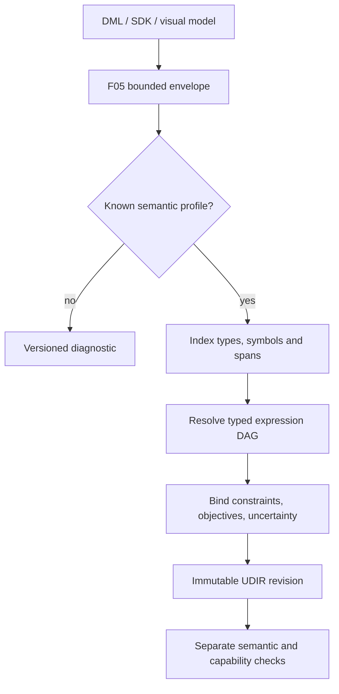

# M03 · Source-linked Universal Decision Intermediate Representation

**Boundary.** A model revision is encoded in the F05 envelope with contract `wowdi.udir`, wire version `1.0`. The semantic profile `udir/1` identifies the rules below independently of the envelope version. Successful decoding means the representation is structurally consistent. Dimensional algebra, general model feasibility, backend capability/lowering and independent verification have separate owners (M04, M07, M08, S01 and S04).

| Field group | Required fields and wire types | Rules, units and consumers |
|---|---|---|
| Identity | tenantId, modelId, revisionId, semanticsVersion: strings | Nonblank ordinal IDs. Any semantic change creates a new frozen revision. |
| Inputs | inputDigests: array of SHA-256 hex strings | Nonempty unique digest set identifying the frozen data. No raw enterprise data in diagnostics. |
| Source registry | sources[].id, sha256, utf16Length | Unique source IDs, lowercase 64-hex digest and nonnegative length in UTF-16 code units. |
| Source span | sourceId, start, length | Half-open UTF-16 range relative to a frozen source. Start and length are nonnegative; reject out-of-bounds without adding two 32-bit integers. |
| Types | types[].id, kind, unit?, currency? | Boolean, Integer, Rational, Instant, Duration, Quantity, Money and Rate. Time and physical types have explicit units. Money has a currency identifier. No implicit cross-unit conversion. |
| Time basis | calendarId, timeZoneId, origin, tickUnit | Offset-qualified origin and explicit tick unit; M04 validates calendar rules and timezone mappings. |
| Symbols | id, role, typeId, lower?, upper?, span | Distinct IDs. Roles Variable, Parameter, Resource. Null denotes an unbounded endpoint. Integer bounds must be integral. Boolean domains are implicit. |
| Expressions | id, op, typeId, arguments[], literal?, symbolId?, span | Tagged literal, symbol, unary or binary nodes. Resolve every reference, reject cycles and incorrect arity. Expression IDs allow DAG sharing. |
| Constraints | id, predicateId, hard, penalty?, span | Predicate has Boolean type. A hard row has no penalty; a soft row has a positive exact penalty. Retain all hard and soft rows. |
| Objectives | id, expressionId, direction, priority, weight, tolerance, span | Direction Minimize or Maximize. Unique positive lexicographic priority. Positive exact weight and nonnegative exact tolerance. Unsupported multi-objective policies require a new profile. |
| Scenario tree | scenarios[].id, parentId?, stage, informationSet, probability?, span | Empty for deterministic input. For branching models use one root, explicit increasing stage and a nonblank information set. A supplied conditional probability lies in [0,1]. Sibling calibration and nonanticipativity are solver/semantic admission checks. |
| Capability requirements | requires[] | Unique ordinal names, including unknown requirements. A reader preserves these; the planner must reject an unsupported required capability. |
| Exact numeric literal | string | Canonical signed integer or reduced numerator/positive denominator. No floating-point conversion. At most 256 ASCII digits in each part. An integer has no /1 suffix. |

Model data are tenant-confidential by default. The source, owner, model and revision travel together through SDK, CLI, Studio and REST. Use versioned JSON camelCase field names for storage/export and the C# PascalCase equivalents in the domain. Null optional members serialize as absent. Locally created fixtures use synthetic identities. Unknown optional envelope metadata is retained; unknown payload fields and unknown semantic profiles are rejected to prevent silent loss.

**Round-trip fixture.** A factory resource budget uses a revisioned source, bounded integer decision, an exact rational parameter, a typed capacity predicate and an objective. The fixture carries two stages of uncertainty, currency and duration metadata, a required scheduling capability and optional display metadata. Serialize, reopen and compare every semantic field and extension; a second export is byte-stable for this reader/writer pair. Never treat byte equality from arbitrary producers as proof of semantic equivalence.

Acceptance includes rejection fixtures for dangling references, malformed rational numbers, cycles, invalid source spans, duplicate priority, unsupported semantics, invalid uncertainty and inconsistent hard/soft rows. Persist no partial document after a rejection. يربط التمثيل الوسيط كل قيد وهدف بموضعه في المصدر. صحة البنية وحدها لا تعني أن النموذج قابل للحل أو أن محركاً بعينه يدعمه.
