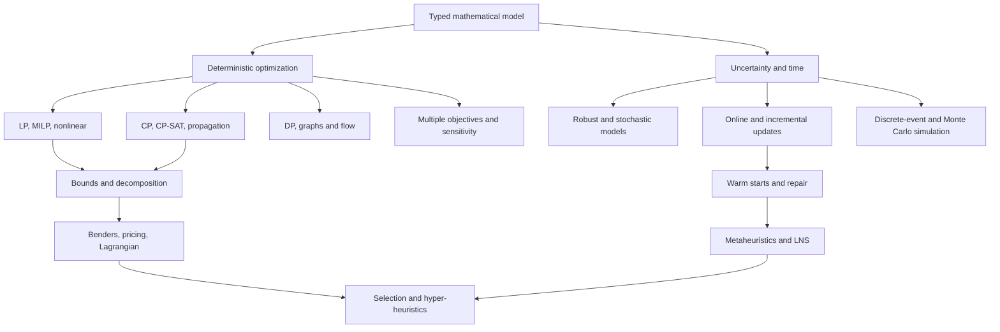

# Scientific map and admission criteria

P0 means design or baseline now, P1 means after a validated scheduling slice, P2 means experimental. Costs describe a formulation or algorithm under stated assumptions. No universal RAM or runtime estimate follows from a method name. Record native and managed peak RSS, wall and CPU time, input scale, threads and termination. Let n be variables, m rows, z nonzeros, d maximum finite-domain size, S scenarios, N events or samples as specified.

| Method | Appropriate problem | Work, memory, CPU driver | Guarantee and principal failure | How it enters WOW DI / priority |
|---|---|---|---|---|
| LP | Continuous allocation with linear rows | Interior point polynomial in input bit length under standard models; numerical factorizations can densify sparse matrices. Simplex worst case exponential. | Primal/dual optimality within documented tolerances; ill conditioning can invalidate naive comparisons. | HiGHS, residuals and objective check, P1 |
| MILP | Discrete setup or shift choice with linear costs | NP-hard in general; tree, cuts and LP bases dominate RAM and CPU. | Incumbent and dual bound where available; large big-M weakens bounds and stability. | Workforce from UDIR; interval bounds before lowering, P1 |
| CP | Scheduling/global constraints over finite domains | Up to d^n leaves; propagation per node and domain storage dominate. | Complete search can prove optimum/infeasibility, limited search may be unknown. | Typed no-overlap and cumulative signatures, P0 |
| CP-SAT | Integer scheduling with logical decisions | Combinatorial worst case; clauses, cuts, presolve and parallel workers drive RAM. | Native status and bounds conditional on settings incl. gap limits; scaling can overflow. | Primary native scheduling candidate, P0 |
| Nonlinear programming | Smooth nonlinear costs or physics | Iterative derivatives, Jacobian/Hessian and factorization; dense Hessian O(n²) storage. | Local stationary points for general NLP; convexity and qualifications needed for global conclusions. | Declare curvature/unsupported requirements, P2 |
| Dynamic programming | Small reusable state space | O(states × transitions per state); memory O(states) or rolling layers; state explosion. | Exact with sufficient state and valid optimal substructure. | Reference or a specialized adapter, P1 |
| Graph optimization | Precedence DAG, paths, assignment structure | DAG traversal O(V+E) with adjacency lists; weighted/general graph problems have different complexities. | Exact for matching subtype; cycles invalidate a DAG pass. | EDG impact and critical path, P0 |
| Network flow | Conservation with capacities and linear arc costs | Polynomial algorithms for min-cost flow; graph/residual arc representation O(V+E) plus working space. | Integral optimal flow with appropriate integer data. Side constraints may destroy flow structure. | Recognizer and oracle on eligible submodels, P1 |
| Multi-objective | Cost, tardiness, plan stability | Lexicographic search takes successive solves; Pareto frontier may be exponential. | Exact lex order needs a certified preceding optimum or explicit tolerances; weighted sums miss unsupported efficient points. | Version objective hierarchy and comparison, P0 |
| Robust optimization | Capacity/demand in an explicit uncertainty set | Reformulation depends on set geometry, may add dual variables or conic constraints. | Protection only against the defined set; excessive conservatism has cost. | Typed uncertainty and stress replay, P2 |
| Stochastic programming | Recourse with shared first-stage decisions | Scenario expansion often O(S(n+m)); scenario tree grows with stages. | Sample model optimum only; enforce nonanticipativity. | Scenario tree extension, out-of-sample audit, P2 |
| Online optimization | Decisions before future data are known | Repeated bounded-time policy calls; state history and remaining budget matter. | Competitive guarantees require an arrival/adversary model; future-aware benchmarks can mislead. | Event stream simulator and rolling horizon, P2 |
| Incremental optimization | Small edits over repeated model revisions | Index reachability plus subsolve; worst case equals full solve plus overhead. | Exact under product feasibility and separable objectives or another valid certificate. | Certified components, escalation, global check, P0 research |
| Discrete-event simulation | Queues, failures, setup and repair | Priority queue often O(N log Q) for N events with Q pending; memory tracks Q and state. | Samples consequences of model and event order; validate tie-breaking and distributions. | Post-plan simulator, P1 |
| Monte Carlo simulation | Cost distribution under uncertain demand | Standard error O(1/√N) under independent finite-variance draws; replicates parallelizable. | Statistical uncertainty, sensitive to tails and dependence; no exact optimum certificate. | Seeded scenario comparison with intervals, P1 |
| Metaheuristics | Large discrete problems with quick feasible plans | Roughly moves × evaluation cost; population methods retain multiple solutions. | Feasible incumbent after checking; no generic optimality guarantee. | Heuristic runner with hard verifier, P1 |
| Large neighborhood search | Schedule repair with many frozen choices | Neighborhood subsolve exponential in free variables worst case; repeated models may cost RAM. | Exact neighborhood optimum does not imply global optimum. | Bounded repair competitor, P1 |
| Branch and bound | Global discrete optimization via relaxations | Exponential worst-case tree; best-bound stores frontier, depth-first reduces frontier memory. | Sound bounds plus exhaustion/gap closure establish result; wrong pruning breaks correctness. | Consume native solver evidence, P0 |
| Benders decomposition | Linking decisions and tractable conditional recourse | Master iterations, cuts and repeated subproblem solves; cut pool grows. | Standard LP recourse needs valid extreme-point/ray cuts, master bounds and feasibility handling. | Qualify block form first, P2 |
| Dantzig–Wolfe | Block polyhedra joined by linking rows | Potential exponentially many extreme columns, restricted master and pricing. | LP reformulation equivalent with full column/ray coverage; integer problem needs more. | Detect genuine linking rows, P2 |
| Column generation | Cutting stock, assignments with implicit patterns | Master plus repeated pricing, itself possibly NP-hard; pool consumes RAM. | No improving column from exact pricing proves LP relaxation under assumptions; integer optimality requires branch-and-price or other proof. | Compare to monolithic LP, P2 |
| Lagrangian relaxation | Coupling constraints with tractable subproblems | Repeated decomposed solves and multiplier updates; memory tracks multipliers and subproblems. | Dual bound can survive primal infeasibility; integer duality gap may remain. | Bound provider with direction tag, P2 |
| Warm starts | Similar revisions in eligible solver | Hint remapping O(n) for direct IDs; basis repair and solver improvement unpredictable. | Start is a suggestion; stale incumbent or bound must never be accepted by identity alone. | Check and map incumbent, P0 |
| Sensitivity analysis | LP marginal values or explicit counterfactuals | Basis/dual lookup or repeated solves; degeneracy and basis changes matter. | LP shadow prices local to assumptions/range; no direct marginal price for general integer models. | Evidence API and forced alternative, P1 |
| Algorithm selection | Several eligible algorithms on different families | Feature extraction, inference and trial runs consume same budget; historical records grow. | Empirical generalization only; feature leakage can invert ranking. | Rule baseline then held-out evaluation, P1 |
| Constraint propagation | Tighten domains prior to branching | Repeated propagator calls until fixpoint; per-constraint consistency costs vary substantially. | Sound propagation removes no feasible assignments; incomplete propagation cannot prove feasibility. | Exact presolve rules with differential oracle, P0 |
| Hyper-heuristics | Select or compose search moves | Search over heuristics multiplies evaluation cost; policies sensitive to domain shift. | Empirical incumbent quality; no universal dominance claim. | Offline ablation only after simple policy, P2 |

Primary references and teaching sources: [NEOS Guide](https://neos-guide.org/guide/types/robust/), [Bertsimas & Sim](https://www.mit.edu/~dbertsim/papers/Robust%20Optimization/The%20price%20of%20Robustness.pdf), [SCIP optimization textbook](https://scipbook.readthedocs.io/en/latest/index.html), [Dantzig & Wolfe](https://doi.org/10.1287/opre.8.1.101), [Shaw on LNS](https://neo.lcc.uma.es/vrp/wp-content/data/articles/CP4VRPshaw98.pdf), [CP-SAT](https://developers.google.com/optimization/cp/cp_solver), [job shop](https://developers.google.com/optimization/scheduling/job_shop), [ASlib](https://arxiv.org/abs/1506.02465).
