# فهم خوارزمية UADIE — من الصفر إلى الفهم الرياضي والهندسي الكامل

طبعة مراجعة بحثية R4 · مشروع WOW Decision Intelligence · القضية 236 · 28 نوفمبر 2026 · الأدلة 7efb1d6، والطبعة R3 محفوظة عند 9a58359

**كيف تقرأ هذا الكتاب؟** يبدأ من قرار مصنع صغير يمكن حسابه يدوياً، ثم يبني مفهوم الدليل الرياضي تدريجياً. كل نتيجة مذكورة إما برهان بشروط محددة، أو نتيجة تجربة قابلة للمراجعة، أو تصميم مقترح. لا تعني كلمة «خوارزمية» هنا أنها تتفوق على جميع محركات التحسين في جميع المشكلات. لا يتطلب فهم الأمثلة معرفة سابقة بالبرمجة الرياضية.

## 1. لماذا نحتاج إلى هندسة القرار؟

تخيل مصنعاً لديه ثلاث طرق لتشغيل مرحلتين إنتاجيتين. يستطيع المدير استخدام آلة X للمرحلة الأولى وآلة Z للمرحلة الثانية، أو استخدام آلة Y المشتركة بدلاً منهما. كل آلة لها تكلفة تشغيل. لا يجوز تشغيل بديلين للمرحلة نفسها ولا يجوز ترك مرحلة بلا تشغيل.

يمكن للمدير أن يحسب يدوياً هذه المشكلة الصغيرة. لكن المصنع الحقيقي قد يحتوي على آلاف القرارات: من يعمل في كل وردية؟ أي آلة تشغّل كل أمر إنتاج؟ من أين نشتري المواد؟ وما المخزون الذي يجب الاحتفاظ به؟ وكل ساعة قد يتغير السعر أو يتوقف مورد أو يتعطل جهاز.

محرك التحسين التقليدي يحاول إيجاد أفضل قرار وفق المعلومات الحالية. أما سؤال UADIE فهو: إذا كنا قد حللنا المسألة قبل قليل، فهل يمكن أن نستفيد من ذلك الحل ومن البرهان الذي يثبت جودته، بدلاً من إعادة الحساب من البداية؟ يجب أن نميز بين الاستفادة من المعلومات السابقة وتكرار القرار السابق دون تحقق. قد يكون القرار القديم خاطئاً بعد تغير الظروف.

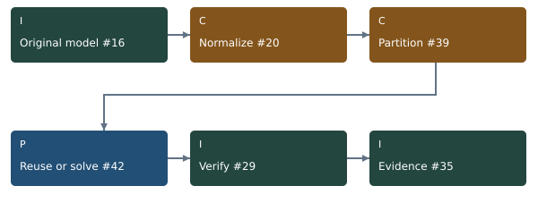

## 2. المتغيرات والقيود والهدف

نعطي كل آلة متغيراً ثنائياً (Binary Variable). القيمة 1 تعني تشغيلها، والقيمة 0 تعني عدم تشغيلها.

- x: اختيار الآلة X.
- y: اختيار الآلة المشتركة Y.
- z: اختيار الآلة Z.

شرط المرحلتين هو تشغيل آلة واحدة بالضبط لكل مرحلة. يسمى هذا الشرط Exactly-One.

```
(E1) x + y = 1
(E2) y + z = 1
(E3) x,y,z ∈ {0,1}
```

إذا اختيرت Y، فإن x و z يجب أن يساويا صفراً. وإذا لم تختر Y، فيجب تشغيل X و Z معاً. تكلفة X تساوي 2 وحدة مالية، وY تساوي 6، وZ تساوي 1. الهدف هو تخفيض تكلفة التشغيل، لا زيادة عدد الآلات.

```
(E4) f(x,y,z) = 2x + 6y + z
```

المعامل 2 يعني أن تشغيل X يضيف وحدتين إلى التكلفة. والمتغير 0 يجعل مساهمته صفراً. ويفترض المثال أن الوحدات متوافقة وأن الحساب صحيح تماماً، وليس تقريباً عشرياً.

## 3. الحل الصالح والحل الأمثل

الحل الصالح (Feasible Solution) يحترم كل القيود؛ أما الحل الأمثل (Optimal Solution) فهو صالح ولا يوجد حل صالح أفضل منه وفق الهدف المحدد. لا يكفي فحص التكلفة وحدها.

| الاختيار | قيد المرحلة الأولى | قيد المرحلة الثانية | التكلفة | الحالة |
|---|---|---|---:|---|
| 0,0,0 | 0 | 0 | 0 | غير صالح |
| 1,0,0 | 1 | 0 | 2 | غير صالح |
| 0,1,0 | 1 | 1 | 6 | صالح |
| 0,0,1 | 0 | 1 | 1 | غير صالح |
| 1,1,0 | 2 | 1 | 8 | غير صالح |
| 1,0,1 | 1 | 1 | 3 | صالح |
| 0,1,1 | 1 | 2 | 7 | غير صالح |
| 1,1,1 | 2 | 2 | 9 | غير صالح |

هناك حلان صالحان فقط. تكلفة تشغيل X و Z هي 3، وتكلفة Y هي 6. إذن الحل الأمثل هو (1,0,1)، والتكلفة الدنيا 3. قيمة الصفر ليست حلاً جيداً رغم أنها الأرخص حسابياً، لأنها لا تحقق القيود.

في مثال صغير كهذا يكفي التعداد الكامل (Exhaustive Enumeration). لكن مع 20 قراراً ثنائياً توجد أكثر من مليون حالة؛ ومع 100 قرار توجد حالات كثيرة جداً لا يمكن فحصها جميعاً عملياً.

## 4. الحدود الرياضية وشهادة الأمثلية

تخيل أننا نعرف أن أي قرار صالح لا يمكن أن تكلفته أقل من 3. يسمى الرقم 3 حداً أدنى (Lower Bound). وإذا عثرنا على قرار صالح تكلفته 3، أصبح لدينا أيضاً حد أعلى (Upper Bound) للمشكلة التي نقلل تكلفتها.

```
(E5) L ≤ optimum ≤ U
(E6) U = L  ⇒  optimal
```

الرمز L هو الحد الأدنى المضمون لجميع الحلول، والرمز U تكلفة حل صالح محدد. إذا تساويا فلابد أن القيمة المثلى بينهما مساوية لهما. يسمى الفرق بينهما فجوة الأمثلية (Optimality Gap). وإذا كان L=2 وU=3، فلا نستطيع أن نقول إن 3 مثلى، حتى لو كان الحل صالحاً.

الشهادة (Certificate) هي معلومات يمكن فحصها لتثبت صحة الحد. في المثال يمكن أن تكون قائمة بكل الحلول الصالحة، أو برهاناً يحصر الخيارات في حالتين فقط. في الأنظمة الأكبر قد تكون برهاناً مستخرجاً من المترجم الرياضي أو محرك الحل، مع مدقق مستقل. مجرد قول المحرك إنه وجد الحل ليس الشهادة الرياضية نفسها.

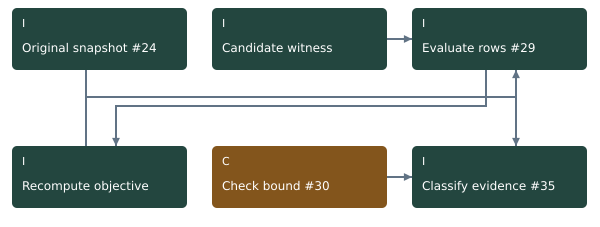

## 5. كيف تعمل طرق الحل التقليدية؟

التعداد الكامل يفحص كل الحالات أو كل الفروع حتى يجد الأفضل. طريقة Branch and Bound تقسم فضاء البحث إلى فروع وتستبعد الفرع عندما يثبت أن كل حل فيه لن يحسن الحل الموجود. مثال: إذا كانت أفضل تكلفة معروفة 3 وكان أقل ما يمكن أن يحققه فرع معين هو 6، فلا داعي لاستكشافه.

في المختبر الحالي توجد استراتيجية Full Solve التي تستخدم حداً بسيطاً على معاملات المتغيرات غير المسندة. توجد أيضاً Warm Start، حيث نبدأ بالحل السابق إذا كان لا يزال صالحاً، ونستخدم تكلفته الجديدة كحد أعلى. لا تعني Warm Start أن الحل السابق ما زال أمثل؛ إنها مجرد نقطة بداية لتقليص البحث.

أما CP-SAT وHiGHS ومحركات MILP فتستخدم تقنيات أكثر تقدماً. المقارنة العادلة يجب أن تحتسب إعداد النموذج، التهيئة، البحث، إعادة بناء القرار والتحقق، لا أن تقارن عملية جمع بسيطة بمدة كاملة لمحرك آخر دون توضيح الاختلاف.

## 6. ماذا يحدث عندما يتغير السعر؟

نفترض أن المورد رفع الأسعار. أصبحت تكلفة X تساوي 3، وY تساوي 10، وZ تساوي 2. لا تتغير القيود.

```
(E7) g(x,y,z) = 3x + 10y + 2z
(E8) Δ = (1,4,1)
(E9) g(x) - f(x) = x + 4y + z
```

الرمز Δ (دلتا) يعني الفرق بين السعر الجديد والقديم. فرق X يساوي 3−2=1، وY يساوي 10−6=4، وZ يساوي 2−1=1. إذا شغّلنا الحل القديم (1,0,1)، تصبح التكلفة الجديدة 3+2=5.

السؤال الآن ليس هل يظل الحل صالحاً فحسب، وإنما هل نستطيع إثبات أنه أمثل دون استكشاف القرار البديل مرة أخرى؟

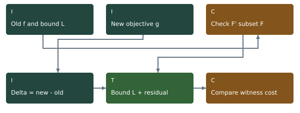

## 7. اكتشاف أثر التغيير قبل الحساب

يجب على النظام تثبيت نسخة القرار (Revision) ومصدر البيانات والوحدات. قد يكون التغيير سعراً فقط، أو قيداً جديداً، أو حذف قيد، أو تغيير مجال متغير. لا يمكن استخدام نفس البرهان لجميع أنواع التغيير.

إذا أضفنا قيداً، فإن مجموعة الحلول قد تصبح أصغر؛ كل حل جديد كان مسموحاً سابقاً، بشرط عدم تغيير المعاني. وإذا حذفنا قيداً، فقد تظهر حلول لم تكن مسموحة من قبل، ولذلك قد يصبح الحد الأدنى القديم غير صحيح.

مثال مستقل صغير: كان x مجبوراً على 1 وتكلفته 7، فالحل الأمثل تكلفته 7. حذفنا القيد فأصبح x=0 صالحاً وتكلفته 0. لو استخدمنا 7 حداً أدنى بعد الحذف لكان البرهان خاطئاً.

محرك اكتشاف التأثير يقرأ العلاقات القديمة والجديدة؛ فحذف علاقة قد يغير مكونات النموذج. يجب ألا يعتمد على بصمة ملف فقط أو يفترض أن تطابق الرقم التعريفي يثبت تطابق المعنى.

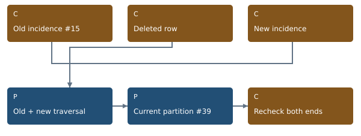

## 8. إعادة استخدام الحل أو المكون

إذا كانت مشكلة المصنع تحتوي على مرحلتين مستقلتين تماماً ولا يوجد بينهما مخزون مشترك أو مورد أو هدف يربط قراراتهما، يمكن حل كل جزء بشكل مستقل. لنفترض أن القسم A أقل تكلفته 3، والقسم B أقل تكلفته 4، ولا يوجد ارتباط. الحد الكلي 3+4=7 ويمكن جمع الحلين.

لكن إذا أضفنا قيداً يمنع القسمين من استعمال الآلة المشتركة في الوقت نفسه، فلا يجوز جمع الحلين تلقائياً. يجب إعادة اكتشاف المكونات باستخدام جميع العوامل، بما فيها الهدف والموارد والقيود المحسوبة.

Component Partition يقسم النموذج الحالي إلى مكونات رياضية مستقلة. Exact Component Reuse يعيد استعمال نتيجة مكون إذا ثبت أن كل مدخلاته الرياضية لم تتغير. لا يكفي تشابه الاسم أو الـHash. في المنتج يجب تثبيت النموذج والوحدات والحقائق وهوية المستأجر ودليل الحل. المختبر الحالي يحتفظ بذاكرة بحثية محلية بسيطة، وليس مخزناً إنتاجياً آمناً.

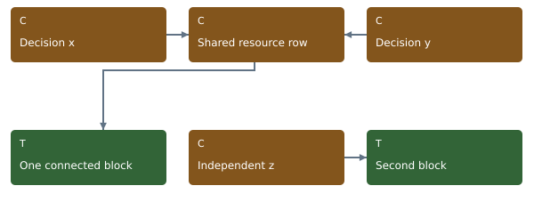

## 9. الفكرة الرياضية لنقل شهادة الأمثلية

لدينا قاعدة قديمة صحيحة: كل حل صالح سابقاً تكلفته على الأقل 3. إذا لم نوسع مجموعة الحلول، فهذه القاعدة تنطبق أيضاً على الحلول المسموحة الآن عند تقييمها بالسعر القديم.

إذا استطعنا حساب أقل زيادة ممكنة في التكلفة بين الأسعار القديمة والجديدة، ولنسمها B، نضيفها إلى الحد الأدنى السابق.

```
(E10) f(x) ≥ L_old
(E11) g(x) - f(x) ≥ B
(E12) g(x) ≥ L_old + B
```

حصلنا على حد جديد مضمون. إذا كانت تكلفة الحل الحالي المعروف مساوية لهذا الحد، تنتهي المهمة الرياضية من دون حل كامل. وإذا لم تتساويا، فلا يعني ذلك أن الحل القديم ليس أمثل؛ يعني فقط أن البرهان المتاح غير كافٍ.

مثال المصنع: نحتاج إثبات أن أي حل صالح زادت تكلفته بمقدار لا يقل عن 2. إذا أثبتنا ذلك، فإن الحد الجديد يصبح 3+2=5. والحل القديم بعد التغيير تكلفته 5. عندئذ يصبح أمثل بشكل مؤكد.

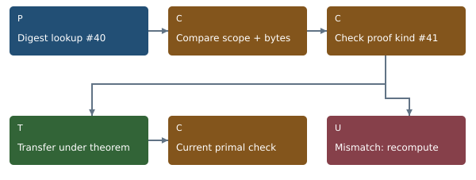

## 10. الجيل الأول: Box Certificate

تدرس Box كل متغير منفرداً وتتجاهل علاقته ببقية المتغيرات. إذا كانت الزيادة موجبة، فإن أقل مساهمتها صفر؛ لأننا نستطيع في الاسترخاء أن نفترض أن الآلة متوقفة. وإذا كانت الزيادة سالبة، فإن أقل مساهمتها هي الزيادة نفسها باختيار الآلة.

```
(E13) B_box = Σ min(0, Δ_i)
(E14) min(0,1)+min(0,4)+min(0,1)=0
(E15) L_new = 3 + 0 = 3
```

المدخلات هي فروق الأسعار. المخرجات حد أدنى آمن للزيادة. القاعدة صحيحة حتى لو لم تكن جميع اختيارات الصفر صالحة معاً، لأننا نستخدم فضاء أوسع من الفضاء الحقيقي.

في مثالنا تعطينا Box الحد 3، والحل الحالي تكلفته 5. الفجوة تساوي 2. لا نستطيع إغلاق الشهادة. فشلها في إثبات الحل لا يجعلها خاطئة؛ إنها ضعيفة في هذا المثال.

مثال فرق سالب: إذا كان Δ=-4 لمتغير ثنائي، فإن أقل مساهمة هي -4 عند تشغيله. يجب عدم حذف هذه القيمة أو استبدالها بالصفر، وإلا قد يصبح الحد أعلى من الحقيقة.

## 11. الجيل الثاني: Pair Certificate

لاحظنا أن x+y=1 يمنع إيقاف الآلتين معاً. نستطيع استخدام هذا القيد لنعرف أن الزيادة من هذين المتغيرين ستكون إما 1 أو 4. أقلها 1.

```
(E16) B_pair = min(Δ_x,Δ_y) + min(0,Δ_z)
(E17) B_pair = min(1,4)+0 = 1
(E18) L_new = 3 + 1 = 4
```

تحسن الحد من 3 إلى 4 ولكنه ما زال أقل من تكلفة الحل الحالي 5. إذا اخترنا الزوج y,z بدلاً من x,y نحصل أيضاً على 1. يجب أن تكون الأزواج غير متداخلة. لا يجوز احتساب y مرتين.

مثال خطر: Δ=(1,1,1). إذا جمعنا الحد الأدنى لقيد x+y والحد الأدنى لقيد y+z دون منع التداخل، نحصل على 2. ولكن الحل الصالح (0,1,0) يضيف 1 فقط. لذلك أصبح الرقم 2 غير صحيح رياضياً. المشكلة ليست في إيجاد الحد الأدنى، بل في العد المزدوج.

في حالة أخرى، عندما نرفع سعر بديلين في قيد Exactly-One بمقدار 2 لكل منهما، فإن أي اختيار منهما يزيد التكلفة 2. هنا Pair تعرف الزيادة الصحيحة، بينما Box تعطي صفراً إذا كانت الزيادة موجبة.

## 12. الجيل الثالث: Parity Graph

بدلاً من اختيار زوج واحد نتعامل مع جميع العلاقات باعتبارها شبكة. نمثل كل متغير بعقدة وكل قيد Exactly-One بين متغيرين بحافة.

تبدأ الخوارزمية بعقدة x وتضع لها اللون A. العقدة y المرتبطة بها تأخذ اللون B، والعقدة z المرتبطة بـ y تأخذ اللون A. الألوان لا تعني تشغيل الآلات مباشرة؛ إنها تحدد مجموعات يجب أن تتبدل قيمها معاً.

لدينا اتجاهان (Orientations) للمكون:
- تشغيل جميع عقد اللون A: x=1، y=0، z=1.
- تشغيل جميع عقد اللون B: x=0، y=1، z=0.

```
(E19) residual A = 1+1 = 2
(E20) residual B = 4
(E21) B_graph = min(2,4) = 2
(E22) L_new = 3 + 2 = 5
(E23) U_new = 5
```

تساوى الحد الأدنى مع تكلفة القرار الصالح! إذن يمكن إثبات أمثلية القرار القديم بعد التغيير. لم نحتج إلى فحص 8 تركيبات؛ استعملنا العلاقات لاستنتاج الحد الصحيح. في نموذج صغير قد تكون تكلفة إنشاء الشبكة أكبر من البحث نفسه، ولذلك الاختبارات مهمة.

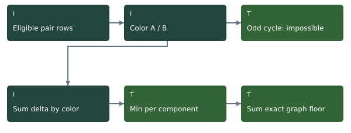

### 12.1 لماذا يفشل الرسم البياني عند دورة فردية؟

إذا أضفنا x+z=1، يصبح لدينا مثلث. نفرض x=0، فيجب أن تكون y=1 ثم z=0؛ لكن القيد الثالث يطلب x+z=1 ومجموعهما الآن 0. إذا بدأنا بـ x=1 نحصل على y=0 وz=1 فيصبح المجموع 2. لا توجد حالة صحيحة.

عند رؤية حافة تصل بين عقدتين من اللون نفسه، تكتشف الخوارزمية تناقضاً. هذه ليست مشكلة أداء بل دليل رياضي على استحالة تحقيق القيود الزوجية نفسها. أما إذا نجح التلوين فلا يثبت ذلك وحده صلاحية النموذج الكامل؛ ربما توجد قيود موارد أخرى تمنع كلا الاتجاهين.

### 12.2 لماذا الجيل الثالث أقوى رياضياً؟

Box تفترض كل تركيبات المتغيرات، Pair تحتفظ ببعض القيود، وParity تحتفظ بجميع العلاقات الزوجية. كلما ضيّقنا مجموعة الاحتمالات دون إزالة حل صالح حقيقي، لا يمكن أن ينخفض الحد الأدنى الذي حسبناه من المجموعة. لهذا يكون حد Parity أكبر من أو مساوياً لحد Pair وBox، طالما الشبكة متوافقة.

لكن قوة الحد ليست هي سرعة الخوارزمية. بناء الشبكة وحساب الألوان ونسخ البيانات والتحقق يستهلك وقتاً وذاكرة. إذا كانت القيود كلها أزواج مستقلة فلن يزيد الحد على Pair، وربما يكلف أكثر.

## 13. الجيل الرابع: ضغط المكونات إلى اتجاه واحد

لاحظ أن نموذجنا يحتوي على ثلاثة متغيرات، لكن بعد فهم العلاقات يمكن تمثيله بمتغير اتجاه واحد t. إذا كان t=0 نختار X وZ، وإذا كان t=1 نختار Y.

```
(E24) x = 1-t
(E25) y = t
(E26) z = 1-t
(E27) g = 3(1-t)+10t+2(1-t)
(E28) g = 5+5t
```

الآن نبحث في قيمتين فقط:
- t=0: التكلفة 5.
- t=1: التكلفة 10.

نختار t=0، ثم نعيد بناء قيم الآلات الأصلية. هذا ليس نقل شهادة فحسب؛ بل حل مباشر للمشكلة الحالية بعد اختزال فضائها الرياضي. وإذا كان النموذج يحتوي على 4,096 متغيراً داخل سلسلة زوجية واحدة، فقد نحتاج اتجاهين فقط بدلاً من 2 مرفوعة للأس 4,096 احتمالاً نظرياً.

إذا كان هناك k مكونات مستقلة في الرسم، فلدينا حتى 2 مرفوعة للأس k اتجاهات. إذا كانت جميع القيود من النوع الزوجي فقط، يمكن اختيار الاتجاه الأرخص لكل مكون بشكل مستقل دون تعداد جميع التركيبات. أما إذا وجد قيد عام يربط المكونات، فيجب فحصه عند البحث أو استخدام محرك مؤهل.

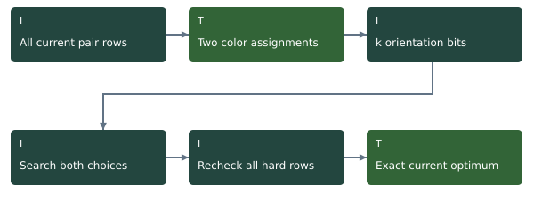

### 13.1 مثال لقيد عام يربط المكونات

أضف في المصنع عاملاً مستقلاً w يمكن تشغيله بتكلفة 2. إذا اشترطنا أن يعمل على الأقل عامل واحد من مجموعة معينة مرتبطة بـ x و w، فقد لا نستطيع اختيار أرخص اتجاه للمكون الأول وأرخص حالة للمكون الثاني دون فحص القيد. لابد من إعادة بناء x,y,z,w وفحص الشرط كاملاً.

يستخدم نموذج Orientation Search حداً أدنى لكل اتجاه متبقٍ ويزور الاتجاه الأقل تكلفة أولاً. إذا كانت أفضل تكلفة صالحة معروفة أقل من أو مساوية للحد الأدنى لفرع كامل، يمكن حذف الفرع دون أن نفقد قيمة أمثلية أفضل. لا نضمن تعداد كل الحلول المتساوية في التكلفة؛ نحتاج فقط واحداً أمثل في هذا الملف البحثي.

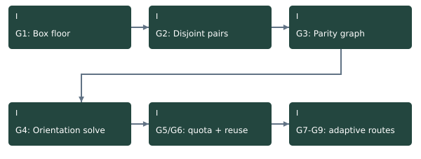

## 14. من الجيل الخامس إلى التاسع

### 14.1 الجيل الخامس: تطبيع الحصة العددية

بعد أن فهمنا أن كل مجموعة مرتبطة بعلاقات زوجية لها اتجاهان فقط، نتخيل ثلاث محطات إضافية في المصنع. في كل محطة خياران متعارضان، ونريد اختيار عاملين بالضبط من نوع معين عبر المحطات. تكلفة الخيار الأول هي 4 و7 و2، وتكلفة الخيار الثاني 6 و3 و8. نعد الخيار الأول فقط ضمن الحصة.

نبدأ بالخيار الثاني في المحطات الثلاث، فالتكلفة الأساسية 6+3+8=17. الانتقال إلى الخيار الأول في كل محطة يزيد العدد بواحد، ويغير التكلفة بمقدار -2 أو +4 أو -6. نختار أصغر فرقين، -6 و-2، لأننا نحتاج عاملين. التكلفة الجديدة 17-6-2=9. تحقق: 4+3+2=9، والعدد المطلوب تحقق تماماً.

عندما يعطي اتجاهان العدد نفسه، لا يؤثر اختيار الأرخص منهما على الحصة. وعندما تكون زيادات العدد جميعها مضاعفات 2، نقسم الهدف والزيادات على 2. هذا هو القاسم المشترك الأكبر. إذا كانت الزيادات 2 و3 والهدف 1، فلا يكفي أن يكون القاسم المشترك 1، لأن العدد 1 غير قابل للتحقيق. لذلك يلزم التحقق من الأعداد الممكنة فعلاً.

البرمجة الديناميكية تحفظ أرخص تكلفة لكل عدد ممكن. مثلاً تبدأ حالة العدد صفر بتكلفة صفر، وبقية الحالات غير ممكنة. لكل مكون ننتقل من عدد قديم إلى العدد القديم زائد زيادة المكون، ونحفظ الأقل. نحدث الأعداد من الأكبر إلى الأصغر حتى لا نستخدم المكون نفسه مرتين. عندما تكون الزيادات كلها واحداً، يكفي الترتيب كما في مثال المحطات.

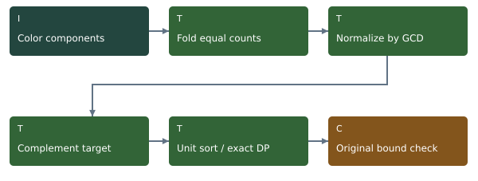

هذا الحساب قد يكون حدّاً رياضياً فقط إذا تجاهلنا قيوداً أخرى. يجب أن يكون الحل صالحاً للنموذج الأصلي وأن تساوي تكلفته الحد حتى نعلن الأمثلية. لا نستنتج صلاحية المصنع كاملاً من حصة واحدة.

### 14.2 الجيل السادس: إعادة استخدام البنية

عندما تتغير الأسعار فقط، قد تبقى علاقات المحطات ومجموعات الحصة كما هي. نخزن قوائم العلاقات والعضوية والعدد المطلوب واتجاهي كل مكون، وليس تكلفة الحل القديمة. نقارن جميع هذه البيانات فعلياً؛ البصمة وحدها ليست دليلاً على التطابق. بعد القبول نعيد حساب تكلفة كل اتجاه من الأسعار الحالية.

في مثال المحطات، إذا صارت تكلفة الخيار الأول 5 و7 و1، تبقى البنية ذاتها، لكن الفروق تصير -1 و+4 و-7. نعيد اختيار الفرقين الأقل من الأسعار الجديدة. إذا تغير العدد المطلوب من 2 إلى 1، أو حذفنا علاقة، يعاد بناء الخطة. قد تكون إعادة البناء أغلى من حل المسألة مباشرة عند كثرة التعديلات.

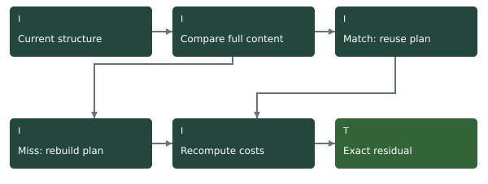

### 14.3 الجيل السابع: محاولة اختيار الشهادة الأقل تكلفة

لنفرض أن الحل يستغرق 100 ميكروثانية وأن محاولة الشهادة تستغرق 20. إذا نجحت الشهادة في 30 من كل 100 مرة، نتوقع دفع 20 دائماً و100 في 70 حالة، أي متوسط 90. إذا ارتفعت تكلفة الشهادة إلى 40، يصبح المتوسط 110، فتكون المحاولة أسوأ من الحل المباشر. المعادلة المبسطة هي تكلفة المحاولة أقل من احتمال النجاح مضروباً في تكلفة الحل المتجنب، إذا تساوت بقية التكاليف.

في المرشح المنفذ، نتحقق أولاً من صلاحية الحل القديم ومن أن القيود لم توسع الخيارات. إذا لم يتغير الهدف يمكن أن يثبت النقل مباشرة. وإلا قد نحاول Box ثم شهادة أقوى واحدة، ثم نرجع إلى Warm أو Orientation. يعتمد الاختيار على تقدير بنيوي بسيط وسجل نجاح Box، وليس نموذج تعلم مثبتاً. الخطأ في تقدير السرعة لا يجعل شهادة غير صالحة صحيحة.

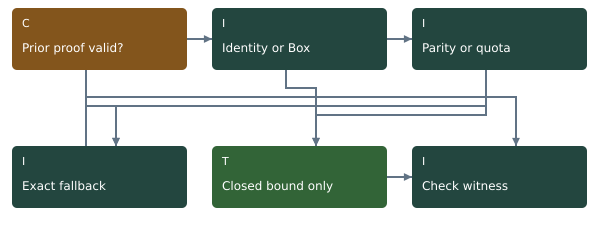

### 14.4 الجيل الثامن: اكتشاف الاختيارات الإجبارية

افترض أن ثلاث محطات تحقق القيد x+y+z=2. إذا تعطلت المحطة x فتصبح قيمتها صفراً، ويلزم تشغيل y وz؛ لا داعي لتجربة كل احتمال لهما. عند كل خطوة نحسب عدد المتغيرات المختارة وعدد المتغيرات التي لم نحددها بعد. إذا تجاوز المختار الحد الأعلى أو لم يعد العدد المتاح كافياً للحد الأدنى، نستبعد الفرع. إذا وصلنا إلى الحد الأعلى نثبت الباقي صفراً، وإذا احتجنا كل الباقي للوصول إلى الحد الأدنى نثبته واحداً. نكرر حتى لا نجد اختياراً إجبارياً جديداً.

هذا أسلوب معروف في حل القيود، ووضعناه كمرشح داخل UADIE بعد أن أظهرت G7 كلفة محاولات الشهادات. إذا كانت القيود مرنة فلن يكتشف الأسلوب كثيراً من القيم، وقد تصبح كلفته غير مجدية. لهذا نحتفظ بـ Warm Start ونختبر اختياراً رخيصاً بينهما مستقبلاً.

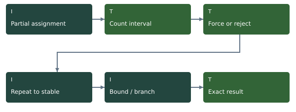

### 14.5 الجيل التاسع: اختيار المسار والحل المباشر

لنفترض أن عاملين x و y يحققان x+y=1، وعاملين z و w يحققان z+w=1. التكلفة عند اختيارهم هي 3 و7 و5 و2 على الترتيب. إذا كان x غير متاح، يصبح x=0 و y=1 إجبارياً. في المجموعة الثانية نختار w لأنه أرخص من z. التكلفة المثلى 7+2=9، دون تجربة جميع الخيارات. إذا أضيف قيد يربط y و w مثل y+w<=1، فلا يجوز اختيار كل مجموعة منفردة؛ يتوقف المسار المباشر ويستدعي النظام البحث الدقيق.

يفحص G9 القيود كلها: يهمل القيود التي لا تستبعد أي حل، ويجمع المتغيرات المجبرة، ويفحص العلاقات الزوجية. إذا لم توجد قيود أخرى، يختار الاتجاه الأرخص المتوافق مع التثبيت في كل مكون. وإذا وجدت قيود عامة، يستخدم مؤشراً بسيطاً من تغطية العلاقات والمتغيرات المثبتة لاختيار G8 أو Warm. هذا المؤشر لا يتنبأ بالزمن بدقة، لكنه لا يغير قواعد صحة الحل. الحل المباشر هنا حساب جديد، وليس إعادة استخدام برهان قديم.

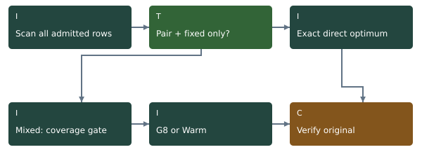

## 15. كيف يختار النظام الاستراتيجية المناسبة؟

يجب أن يبدأ الاختيار بالصحة قبل السرعة. يفحص نوع المتغيرات والقيود والوحدات والإمكانات المؤهلة للمحرك، ثم يتحقق من الوقت والذاكرة المتبقيين.

إذا ثبت أن المسألة زوجية بالكامل، فإن اختيار اتجاه المكون الأرخص له برهان رياضي مباشر. إذا كان لدينا دليل قديم صحيح ومجموعة الحلول الجديدة أضيق أو مساوية، يمكن تجربة النقل. إذا لم يغلق الحد الفجوة نستخدم الحل السابق كمرشح صالح أو نرجع إلى حل كامل. إذا لم تعد شروط الدليل القديم صالحة، لا نحاول فرضها.

في المختبر يوجد مرشح تكيفي بسيط يختار Warm Start عندما يكون النموذج أصغر من 8 متغيرات أو لا يحتوي على ما يكفي من العلاقات الزوجية أو يكون الاختزال ضعيفاً جداً. هذا حد تجريبي محدد مسبقاً، وليس قراراً نهائياً يصلح للمصنع الحقيقي. أضافت G7 محاولة محدودة للشهادات مع رجوع آمن، لكنها لم تتفوق على Warm إجمالاً. أضافت G8 نشر القيود، فنجحت في النماذج ذات الاختيارات الإجبارية والتناقضات. في G9 نفذنا مساراً مباشراً واختياراً بنيوياً بسيطاً بين المسارات، لكن الاختيار التكيفي لا يزال بحثاً، ولا يدعي المشروع أنه يعرف أسرع استراتيجية دائماً.

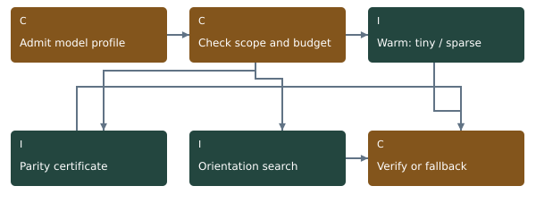

## 16. كيف يتم التحقق من الحل فعلياً؟

نعود إلى النموذج الأصلي، لا إلى النموذج المختزل وحده. إذا أعادت الخوارزمية (1,0,1)، نعيد حساب x+y=1، وy+z=1، والتكلفة 3+2=5. يثبت هذا صلاحية الحل وتكلفته، لكنه لا يثبت أن الحل أمثل ما لم نتحقق من الحد أو نقارنه بمرجع دقيق.

في المختبر توجد طريقة تعداد مستقلة تراجع جميع الحالات الصغيرة، ومقارنة مع CP-SAT تترجم القيود الأصلية بطريق مختلف. في الإنتاج يجب أن يعرف المدقق مصدر البيانات والنسخة والوحدات ودليل الحد. حتى لو كانت البصمة مطابقة، فقد يكون دليل مخزن غير صحيح أو غير مصرح باستخدامه.

اكتشفنا أثناء التدقيق مثالاً عملياً على خطأ دقيق: أعاد CP-SAT قيمة معروضة 9.999999999999998، بينما تكلفة الحل الصحيح كانت 10. تحويل الرقم مباشرة إلى Int32 أنتج 9. أصلحنا المقارنة بإعادة حساب التكلفة من المتغيرات والمعاملات الأصلية كأعداد صحيحة، مع التحقق من أن القيمة المعروضة وحد المحرك قريبان منها ضمن هامش محدد. لا نستخدم الهامش لتجاوز خطأ في حساب التكلفة الصحيحة أو القيود.

## 17. متى نرجع إلى الحل الكامل؟

إذا تغير معنى متغير أو وحدة تكلفة، أو حُذف قيد مما وسع الخيارات، أو فشل فحص الحل القديم، أو لم يغلق الحد الفجوة، أو لم تتوافر ذاكرة ووقت كافيان لفحص الدليل، يجب عدم ادعاء الأمثلية.

الرجوع إلى الحل الكامل (Fallback) لا يعني فشل المشروع؛ بل يحمي صحته. قد يحل المحرك كل النموذج أو يتوقف عند انتهاء الوقت. إذا توقف مع حل صالح ودون دليل أمثلية، نعيد حالة «حل صالح فقط». وإذا لم يتوافر حل ولا دليل نعيد حالة «غير معروف» أو «غير مدعوم» بحسب السبب. لا نختلق جواباً.

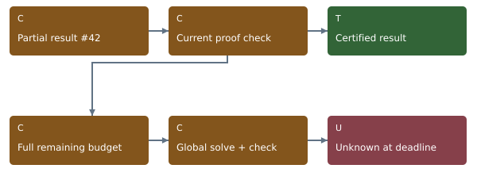

## 18. كيف تنفذ الخوارزميات برمجياً؟

تنفيذ المختبر الجديد باستخدام C# و.NET 10. الملف Candidates.cs يحتوي الطرق الأصلية؛ Parity.cs يحتوي حساب حد الشبكة ونقل الدليل؛ ParityAudit.cs يفحص الحد بالتعداد؛ OrientationSearch.cs يبني المكونات ويبحث في الاتجاهات؛ Corpus.cs وParityCorpus.cs يولدان نماذج صغيرة ببذور محددة؛ Program.cs يشغل المرشحين ويسجل الوقت والذاكرة والنتائج. توجد برامج منفصلة لمقارنة CP-SAT وتلخيص النتائج.

الخطوة البرمجية الأولى: قراءة n والقيود والأسعار، والتحقق من أن جميع المتغيرات والقيود ضمن المجال المحدد. الثانية: تثبيت نسخة خاصة من البيانات كي لا تغيرها جهة أخرى. الثالثة: تحديد نوع التغيير وفحص صلاحية الحل السابق. الرابعة: بناء قائمة جيران لكل متغير (Adjacency List). الخامسة: اجتياز الشبكة باستخدام Queue وتلوين العقد. السادسة: جمع تكلفة اللونين لكل مكون. السابعة: تكوين الحد ومقارنته بتكلفة الحل. الثامنة: إذا لم يغلق الحد، اختيار البحث المناسب والتحقق من النتيجة. التاسعة: تسجيل الدليل والميزانية والنسخة، وعدم النشر باسم نسخة جديدة إذا تغيرت أثناء الحساب.

```
Input: current model, previous exact result
Validate model and previous evidence
Compute signed coefficient difference
Check old constraints are retained
Build graph from eligible pair rows
Color each connected component
Compute the smaller residual per component
Verify old witness on current original rows
If exact bound equals verified cost: certify
Else: solve current model and verify
```

هذا وصف تعليمي لمسار النقل، ولا يعني أن المختبر ينتج اليوم شهادة إنتاجية متكاملة. يجب ربط أجزاء المنتج بمخزن النماذج والمدقق ومحركات الحل وحوكمة الموارد وفق قضاياها الخاصة.

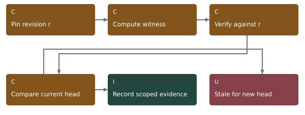

## 19. ماذا أظهرت التجارب الحقيقية؟

### 19.1 النتائج القديمة

في التجربة الأصلية كانت Warm Start الأسرع إجمالاً، بوسيط 21.73 ميكروثانية. كانت Box 70.38 وPair 57.91 ميكروثانية. وقد أغلق Box الشهادة في 14 حالة من 56، وPair في 22. هذه النتائج محفوظة ولا ينبغي إخفاؤها. جميع 3,360 صفاً قديماً حملت نجاحاً وفق اختبارها.

### 19.2 نتائج الجيل الثالث

اختبرنا كل الرسوم البسيطة على أربعة متغيرات وكل متجه فروق أسعار ضمن خمس قيم لكل متغير؛ 40,000 حالة رياضية. لم يظهر اختلاف بين حد الشبكة والتعداد، واكتشفنا 14,375 حالة تناقض، و7,320 حالة كان فيها الحد أقوى من Pair. أعيد التحقق بترتيب الحواف المعكوس والمكررة.

في مجموعة التحقق الجديدة ذات 80 مشكلة معدلة، نجح Box في 5، وPair في 8، وParity في 38. وكان وسيط الزمن Parity مع Warm fallback يساوي 28.18 ميكروثانية مقابل 37.53 لـ Warm. لكن في مجموعة التطوير كان Warm أسرع. اجتازت جميع الصفوف الجديدة البالغ عددها 7,680 فحصها الدقيق.

### 19.3 نتائج الجيل الرابع

| الاستراتيجية | وسيط الزمن بالميكروثانية في التحقق |
|---|---:|
| البحث الكامل | 46.46 |
| Warm Start | 32.66 |
| Parity مع Warm | 29.97 |
| Orientation Search | 28.88 |
| Orientation تكيفية | 31.89 |

نجحت 9,600 نتيجة ضمن تجربتي الجيل الرابع. لا تعني هذه الأرقام تفوقاً دائماً: في التطوير كان Warm أسرع، وفي تحليل الفروق المزدوجة كانت فواصل الثقة الاستكشافية تشمل الصفر. كما يستهلك الضغط ذاكرة تخصيص أكبر من Warm.

### 19.4 المقارنة بمحرك مستقل

اجتازت المقارنة المصححة مع CP-SAT 9,920 حكماً على 992 مشاهدة نموذج، بينها 512 مشاهدة من مولد آخر مستقل عن مولد التجارب الرئيسية. ليست هذه 9,920 مشكلة مختلفة تماماً؛ بعض المشاهدات والتكرارات تشترك في المصدر.

أجريت 48 تجربة إضافية على نماذج زوجية بحتة من 64 إلى 4,096 متغيراً، وتطابقت نتائج الخوارزمية الرياضية والمحرك المرجعي. مثال سلسلة زوجية من 4,096 متغيراً: كان الوسيط المحلي نحو 806.15 ميكروثانية، وCP-SAT نحو 70,751.46 ميكروثانية. لا نستنتج من ذلك أن UADIE أسرع بهذه النسبة في أي مصنع؛ إنها مشكلة ذات بنية خاصة يمكن اختزالها رياضياً. النتائج الأخرى، بما فيها حالات الفشل وتكاليف المعالجة، محفوظة في سجل الأدلة.

نفذت التجارب على سيرفر Linux بمعالج AMD EPYC 7713، مع قيد CPU لنواة واحدة وذاكرة قصوى 768 MiB. الوسيط يعني أن نصف المشاهدات كان أقل منه ونصفها أعلى منه، وليس أفضل وقت منفرد. القياس المخصص لا يعادل ذاكرة المنتج الكلية.

### 19.5 نتائج الجيلين الخامس والسادس

نجحت 15,570 نتيجة قياس لـ G5، منها 234 تعتمد على المقارنة مع التنفيذ السابق فقط لا على مرجع مستقل. في نماذج 4,096 متغيراً تراوح وسيط التسريع بين 3.50 و11.84 مرة في حساب الحد مقارنة بالتنفيذ السابق. تراجعت بعض النماذج الصغيرة والمتوسطة. لا تمثل هذه سرعة القرار الكامل.

نجحت 4,800 نتيجة لـ G6، وبلغت إعادة استخدام البنية 1,680 من أصل 2,400 محاولة في ذلك الاختبار، أي 70%. عند 4,096 متغيراً بلغ التسريع عبر تاريخ المراجعات 3.36 مرة للبنية البسيطة المستقرة و1.72 للمختلطة المستقرة، ونحو 1.005 عند تغير القيود مراراً. وفي تدقيق جديد متعمد كثرة التعديلات تطابقت 96 مراجعة مع CP-SAT، وكانت إعادة الاستخدام 12 فقط من 96. النسب مرتبطة بتصميم الاختبار، وليست احتمالات عامة.

### 19.6 نتائج الجيلين السابع والثامن

تم قياس قبول النموذج وبصمته واختيار الاستراتيجية والحل وفحص الشاهد وتجهيز الأدلة في الذاكرة. لم نقس التخزين الدائم أو مترجم الإنتاج الكامل. نجحت 16,800 نتيجة لـ G7، لكن التسريع المقترن أمام Warm بلغ 0.787 مرة؛ أي إن الطريقة التكيفية كانت أبطأ إجمالاً، رغم تجنبها 585 حلاً من 1,680 مراجعة لاحقة. هذه النتيجة توضح الفرق بين تجنب الحل وتوفير الوقت.

نجحت 10,800 نتيجة لـ G8. كان وسيط الزمن 30.67 ميكروثانية مقابل 37.55 لـ Warm في تجربة جديدة، لكن فاصل الثقة للتسريع المقترن العام يشمل الواحد. في عائلات القيود المثبتة والتناقضات ظهرت فائدة واضحة، وفي العائلات المرنة والمختلطة والحصص كان Warm أفضل. لا نختار طريقة لمجرد أنها تحمل اسماً أحدث.

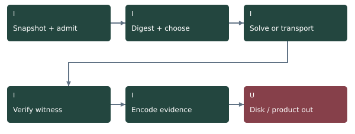

### 19.7 نتائج الجيل التاسع والتخزين

في 16,128 سجل قياس جديد وافقت النتائج التعداد الدقيق. بلغ وسيط التسريع المقترن لـ G9 أمام Warm نحو 1.943 مرة، وأمام G8 نحو 1.124 مرة. تفوق G9 على Warm في 259 من 288 سلسلة تحقق. لكن G8 تفوق في عائلة الدورات الفردية، وبلغ زمن G9 عند المئين 99 نحو 208 ميكروثانية مقابل 98 لدى G8. لا ينبغي إخفاء هذه الحالات.

في تجربة منفصلة، وافق G9 والمرجعان الآخران CP-SAT والتعداد في 288 نموذجاً و864 قراراً. حفظنا الأدلة في ملفات مع مزامنة كل قرار إلى القرص، ثم أعدنا قراءتها وفحص بصمتها وشاهدها. وسيط حساب وتجهيز G9 كان 41 ميكروثانية، لكن وسيط المزامنة نحو 500 ميكروثانية. لذلك بلغ التسريع المقترن مع التخزين أمام Warm نحو 1.098 مرة، وأمام G8 نحو 0.975 مرة. هذه نتيجة لبيئة ملفات واحدة وليست ضماناً لقاعدة بيانات إنتاجية أو استعادة بعد انقطاع الكهرباء.

فحصنا أيضاً كل الرسوم البسيطة على أربعة متغيرات، وكل حالات تثبيت المتغيرات، وكل التكاليف من القيم -1 و0 و1. عدد التركيبات 419,904؛ كلها مطابقة للمرجع ضمن هذا النطاق. لا تعني هذه النتيجة صحة كل نموذج صناعي أو اجتياز المراجعة البشرية المستقلة.

## 20. القيود العلمية والهندسية والخطوة إلى المنتج

ما ثبت رياضياً ضمن الشروط: قواعد النقل، حد Box وPair وParity، واختزال المكونات الزوجية، وتطبيع حصة واحدة، وصحة إعادة استخدام البنية المطابقة، ونشر القيود الإجبارية والرجوع إلى حل دقيق. لا يعني ذلك أن المراجعة المستقلة أو تأهيل الإنتاج مكتمل. ما تحقق تجريبياً: صحة نتائج النماذج المسجلة، وتفوق مرشحين في بعض مجموعات القياس لا كلها. ما لم يتأهل بعد: جميع أنواع مسائل التصنيع والجدولة والمخزون، الأعداد الكسرية العامة، القيود غير الخطية، السيناريوهات المتعددة، الإثبات الإنتاجي المستقل، التزامن والإلغاء والتخزين طويل الأمد، واختيار الاستراتيجية المثلى على بيانات صناعية حقيقية.

تحتاج مرحلة المنتج إلى القضايا #39 و#40 و#41 و#42 لإعادة الاستخدام والإصلاح، #44 و#45 لتوسيع مختبر الاختبارات والمقارنة، #46 للتقييم على عائلات غير مرئية، و#142 للمقارنة التشغيلية. لا تستبدل هذه الوثيقة مسؤوليات القضايا.

أهم درس: UADIE ليست طريقة لإجبار القرار على البقاء كما كان، بل إطار بحثي لإعادة استخدام ما يظل صحيحاً من الأدلة، وحساب ما تغير فقط عندما نستطيع إثبات أن ذلك آمن، والرجوع إلى طرق أخرى عند الحاجة. قد يكون التصميم الأقوى في المستقبل محفظة تكيفية من طرق صحيحة، لا خوارزمية واحدة.

## ملحق أ: تمرين للقارئ

ارجع إلى نموذج المصنع الأصلي (2,6,1)، وغيّر الأسعار إلى (4,8,3). فروق الأسعار كلها 2. احسب Box، ثم Pair، ثم Parity. ستجد Box=0، Pair=2، Parity=min(4,2)=2. الحد المنقول يصبح 5، لكن الحل القديم الجديد تكلفته 7. لم يغلق النقل الشهادة. احسب الاتجاهين الجديدين: تشغيل X وZ يكلف 7، وتشغيل Y يكلف 8، فالقديم ما زال أمثل. هذا مثال مهم على أن عدم إغلاق الدليل لا يعني خطأ الحل السابق. Orientation Search يستطيع إثبات الأمثلية مباشرة بفحص الاتجاهين.

تمرين ثان: أبق سعري X وZ عند 3 و2 بعد التغيير الأول، واجعل سعر Y الجديد 4. يصبح الحل البديل بتكلفة 4 أرخص من تشغيل X وZ بتكلفة 5. إذا تمسك النظام بالحل القديم دون فحص الحد فقد يختار قراراً غير أمثل. طبق الحساب على كل اتجاه لترى الفرق.

## ملحق ب: الوصول إلى الدليل العلمي

- [الأدلة والكود والمقارنات للأجيال الخامس إلى الثامن](https://github.com/ameenalqershi/wow-decision-intelligence/tree/ac2737cf3e2dd4c4a7434f68ebf61a4eaf05b9b5/docs/research/uadie/reviews)

- [المستودع الرسمي والقضية البحثية](https://github.com/ameenalqershi/wow-decision-intelligence/issues/236)
- [الكود الفعلي في C#](https://github.com/ameenalqershi/wow-decision-intelligence/tree/17450d931622a63c3812033a7ec317f59f2012a8/research/AlgorithmDiscoveryLab)
- [أدلة الجيل الثالث](https://github.com/ameenalqershi/wow-decision-intelligence/tree/17450d931622a63c3812033a7ec317f59f2012a8/docs/research/uadie/experiments/parity-v1)
- [أدلة الجيل الرابع](https://github.com/ameenalqershi/wow-decision-intelligence/tree/17450d931622a63c3812033a7ec317f59f2012a8/docs/research/uadie/experiments/orientation-v1)
- [التدقيق المرجعي وحالة الخطأ العددي المحفوظة](https://github.com/ameenalqershi/wow-decision-intelligence/tree/17450d931622a63c3812033a7ec317f59f2012a8/docs/research/uadie/evidence/orientation-native)

المراجع الأساسية للفكرة الرياضية: خوارزميات الرسم البياني في كتاب Algorithms لـ Sedgewick وWayne؛ إعادة التحسين في البحث العلمي Gamrath وHiller وWitzig (2015)؛ اختيار الخوارزميات في ASlib لـ Bischl وزملائه (2016)؛ والتوثيق الرسمي لـ Google OR-Tools. التفاصيل والمراجع الأوسع في الوثيقة العلمية الإنجليزية. لا تُنسب أي خوارزمية رسم بياني معروفة إلى WOW DI بوصفها اختراعاً جديداً.
