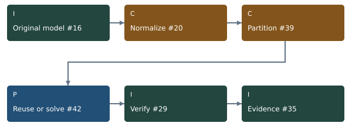
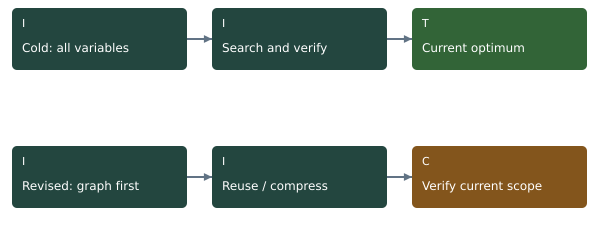
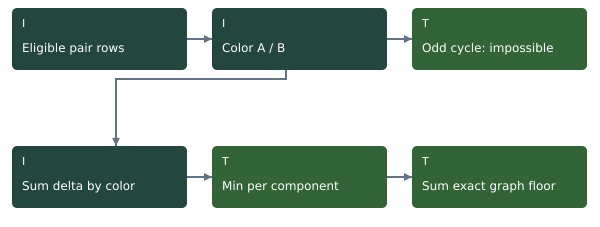
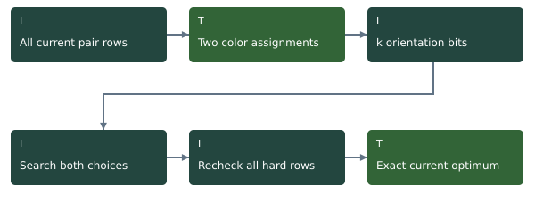
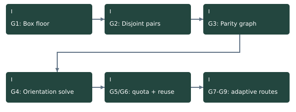
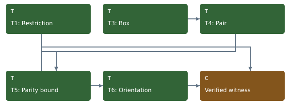
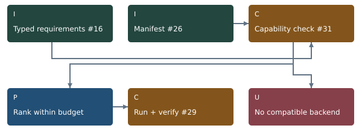
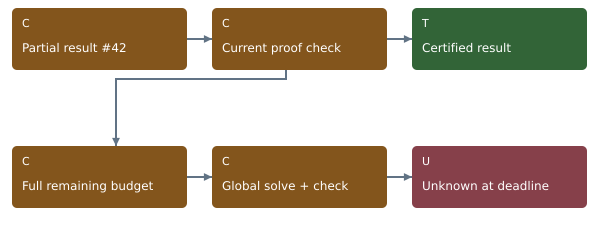
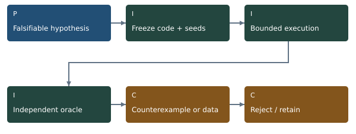

# WOW Decision Intelligence — UADIE: Scientific and Engineering Algorithm Specification

Research edition R2 · 28 November 2026 · Issue #236 · Evidence cut 17450d931622a63c3812033a7ec317f59f2012a8

**Release status:** research manuscript, not a production-qualified algorithm or peer-reviewed publication. Mathematical statements are conditional on explicit premises; measured results concern the stated fixtures and host. Independent human review, production integration, broad workload qualification and publication layout acceptance remain open.

## Abstract

Repeated decisions often require optimization of a revised mathematical model rather than an unrelated model. We study exact, conservative reuse of previous optimization evidence under domain restriction, objective perturbation and factor separability. We compare cold exhaustive search, warm search, component partitioning and exact reuse, coordinate-box and disjoint-pair residual certificates, graph-based parity certificates with alternative fallbacks, and exact orientation-compressed search. Four generations are distinguished from the unqualified architecture. For a minimization model with a validated previous lower bound and a revised feasible set contained in the original one, a lower bound on the objective difference transports the previous bound. Exactly-one constraints on Boolean pairs induce a graph. In a bipartite component exactly two complementary assignments satisfy every eligible edge. Their residual minima provide a valid lower bound dominating coordinate-box and disjoint-pair relaxations. Alternatively the two orientations can replace many original variables in a complete search over the current objective. General residual rows still require validation. The original 3,360 observations and all new experiments are retained. The parity and orientation studies produced 7,680 and 9,600 valid timed observations, respectively. A separately translated CP-SAT comparison of ten candidates produced 9,920 matching verdicts on 992 model observations, and a structural scaling study matched 48 native verdicts up to 4,096 binary variables in the pair-only profile. A native floating-point reporting counterexample was preserved and corrected without weakening exact feasibility or objective verification. No universally fastest strategy or new graph theorem is claimed.

## Executive summary

The engineering recommendation is a guarded portfolio, not compulsory use of certificate transport. In small models warm search can dominate expensive preprocessing; overlapping exactly-one structure can justify parity residual transport or direct orientation compression. Compression is particularly promising when the original variable count n is much larger than the number k of parity components. On the pair-only profile, optimization separates by orientation and needs no exponential search. In general mixed models, other constraints can couple the orientation variables and the problem remains combinatorial. The proof transport path is permitted only if model identity, old proof validity, semantic alignment, restriction and a current feasible witness are established. The new candidate code is isolated research; production verifier and orchestrator remain owned by #39–46 and #142 and require independent acceptance.



## 1. Problem definition, assumptions and objectives

A decision request contains a frozen source model, tenant-scoped fact snapshot, measurement catalog, policy/version information and an objective. The admitted finite laboratory model has n in {1,...,12}, Boolean variables indexed by stable positions, constraints specifying integer lower/upper cardinality on nonempty subsets, and one ordered unary integer price per variable. Every coefficient and sum has a declared exact integer envelope. There is no continuous domain, nonlinear objective, uncertain scenario or cross-tenant production certificate in this laboratory. The wide structural experiment relaxes the representation cap but admits only Boolean pair equations and unary integer cost.

Given an old revision and a revised revision, minimize the complete current source objective subject to all current source constraints. Return a feasible witness plus evidence that supports the claimed status, or a qualified unknown/unsupported/infeasible result. Distinguish an incumbent hint from a certified lower bound and distinguish a native solver attestation from a mathematical proof. The research objectives are to reduce verified end-to-end work, identify failure and crossover regimes, compare independent baselines, preserve all raw evidence, and make scientific claims falsifiable.



## 2. Literature review, prior art and research gap

Branch-and-bound (Land and Doig, 1960), cutting planes, propagation, exact component decomposition, MIP reoptimization, two-coloring, and portfolio selection are established techniques. A MIP reoptimizer can preserve a search tree and prune it using revised evidence; it is a stronger competing concept than restarting enumeration. Bipartite checking and finding an odd cycle are standard linear graph algorithms. ASlib supplies a methodological precedent for instance-level selection and separate training/evaluation. Proof logging and independent witness checking distinguish proof strength from optimizer reputation. The existing comparative technique matrix covers LP/MILP, constraint programming, SAT/SMT, Benders, Dantzig–Wolfe, Lagrangian relaxation, dynamic programming, decomposition, robust/stochastic/multi-objective methods, and learning-augmented algorithms.

Our research question is whether a guarded composition of these known ideas, with original-source revision lineage, exact residual transport, inexpensive structural checks and safe budgeted fallback, provides practically useful decision reoptimization in WOW DI. No priority, patentability, literature-exhaustiveness or invention of BFS/branch-and-bound is asserted. Direct native reoptimization, rational mixed models, representative industrial families, proof-carrying production integration and external replication are still gaps.

## 3. Formal objects and evidence taxonomy

Let X be the declared decision domain, F ⊆ X the old feasible set and F' ⊆ X the revised feasible set. Let f and g be exact scalar minimization objectives on compatible decisions. Let x* be a previous verified optimizer, L a valid old lower bound, xhat a currently feasible candidate and U = g(xhat). For unary binary objectives, a and c are old/new coefficient vectors; Δ is their difference, and β is any change in objective constant. The laboratory has no nonzero constant. The production definition must account for it exactly once.

```
(1) f(x) = a0 + Σ a_i x_i
(2) g(x) = c0 + Σ c_i x_i
(3) Δ_i = c_i - a_i ; β = c0 - a0
(4) g(x) - f(x) = β + Σ Δ_i x_i
(5) L ≤ f(x), for every x ∈ F
```

A bound is a universal statement, not an assertion about a single witness. Exact optimality of xhat follows when U equals a globally valid current lower bound. If the gap is positive, report only what is supported. For infeasibility no numerical optimum or gap is defined. An old optimum is stronger than needed: any checked lower bound is sufficient for transport, but may be too loose to certify a witness. Maximization can be reduced by negating objective and reversing bound direction; multi-objective, intervals and unit changes must be separately qualified, not coerced into this profile.

Evidence classes: Mathematically Proven (theorem under assumptions); Independently Experimentally Verified (external or genuinely separately implemented reference comparison on named inputs); Verified Within Explicit Limits (bounded finite or native observations); Implemented but Not Fully Qualified; Research Prototype; Proposed Hypothesis; Rejected; Unsupported. The current CP-SAT comparison is independent by implementation and engine, not independent human review. Historical separate-agent review is distinguished from the current author's comparator. Do not combine dependent counts as independent samples.

## 4. Core theorems and proof obligations

### 4.1 Restricted objective transport (Theorem T1)

Assume (a) identical compatible variable meanings, units and scalar objective direction; (b) F' ⊆ F; (c) L ≤ f(x) on F; and (d) d ≤ g(x)-f(x) on F'. For every x ∈ F', premise (b) licenses (c). Addition of the two inequalities gives g(x) ≥ L+d. If a current feasible witness satisfies g(xhat)=L+d, it attains the global lower bound and is optimal. This argument also yields a valid bound when a surviving old optimizer is absent, but cannot certify a primal result without a current witness. A syntactic row containment check suffices only for the fixed Boolean cardinality grammar, not arbitrary semantic equivalence. Domain expansion invalidates the implication unless a new proof establishes it.

Counterexample: F={1}, F'={0,1}, f=g=x. Reusing L=1 asserts a lower bound above the true revised minimum 0. Counterexample: keeping F={0,1} but changing f=0 to g=-2x invalidates L=0 without residual correction. Changing dollars to cents without scale conversion also invalidates the arithmetic.

### 4.2 Component product and exact reuse (Theorem T2)

Partition variables into disjoint blocks. Suppose all hard factors, including expanded derived references and global linking constraints, lie wholly in individual blocks, and the objective is additive across them plus a single constant. Then the feasible set is their Cartesian product. Every local lower bound sums to a global lower bound; combining local minimizing witnesses attains it. If a required block is infeasible, the product is infeasible. The proof fails if a hidden shared capacity or joint objective crosses blocks. Check variable-free constraints separately. A hash selects a cache lookup, not proof. Reuse requires complete canonical payload equality or a checked semantic transformation, relevant units/tenant/versions, and authentic replayable proof or protected evidence. No eviction or authentication is supplied by the fixture dictionary.

Counterexample: separately minimizing -x and -y gives x=y=1. Adding x+y≤1 makes that combination infeasible. Adding +3xy to the objective instead changes the optimum even if the old assignment remains feasible.

### 4.3 Generation 1: coordinate-box relaxation (Theorem T3)

For Boolean x_i, the independent minimum of Δ_i x_i is min(0,Δ_i). All feasible points satisfy the sum of these independent inequalities. The resulting bound may not be attainable simultaneously due to constraints.

```
(6) B_box = β + Σ_i min(0, Δ_i)
```

For a guaranteed finite interval [l_i,u_i], use min(Δ_i l_i,Δ_i u_i), accounting for direction and exact units. The implemented laboratory uses Boolean coordinates only.

### 4.4 Generation 2: disjoint exactly-one pairs (Theorem T4)

Select an arbitrary collection M of pairwise disjoint eligible rows x_i+x_j=1. Over a pair the residual has exactly two values Δ_i and Δ_j, so their minimum is exact on that row's relaxation. Unmatched coordinates retain Box floors.

```
(7) B_pair = β + Σ_(i,j)∈M min(Δ_i,Δ_j)
               + Σ_i unmatched min(0,Δ_i)
```

For same-sign nonzero coefficients a pair can strengthen Box. For opposite signs the bounds agree. The collection must be disjoint: x+y=y+z=1 with Δ=(1,1,1) would incorrectly give 2 if both minima were added; the feasible point (0,1,0) costs 1. Row order can affect a greedy matching but never the soundness of a disjoint matching. Pair certificate transport can skip reoptimization only when T1 closes the current gap.

### 4.5 Generation 3: parity-graph certificate transport (Theorem T5)

Create an undirected graph on every current Boolean variable, including isolated vertices. Add an edge for every validated exactly-one pair row. Its equation says adjacent bits are complements. From a chosen root, BFS assigns alternating color to every vertex. If an edge joins equally colored vertices, the graph contains an odd cycle and no binary assignment can satisfy all eligible edges: an odd number of complements returns a bit as its own complement. Conversely, if coloring succeeds, either root bit determines the unique assignment on its connected component. All non-tree edges are checked, so the two complementary assignments exhaust the pair relaxation. Different components are independent in that relaxation, even if other original rows link them.

For component C with color sets A and B, the exact minimum residual is the smaller of the sums of Δ over A and over B. An isolated vertex has an empty color set and yields min(0,Δ_i).

```
(8) B_graph = β + Σ_C min(Σ_i∈A(C) Δ_i, Σ_i∈B(C) Δ_i)
(9) B_box ≤ B_pair ≤ B_graph, when the graph is consistent.
```

Proof of dominance: let R_box be the Boolean cube, R_pair retain only the selected disjoint pair equations, and R_graph retain every eligible pair equation. Then F' ⊆ R_graph ⊆ R_pair ⊆ R_box. Minimizing the same residual on nested sets yields the inequality. The graph bound equals the exact minimum over R_graph by the component argument, not necessarily the exact residual minimum over F'. If R_graph is empty, all full feasible points are impossible; an infeasibility proof must retain a checked odd-cycle witness or replayable graph. The transport candidate currently falls back if the old witness is infeasible; the direct orientation candidate detects odd cycles independently. A finite graph bound never proves original feasibility.

Strict example: x+y=y+z=1, Δ=(1,4,1). Box=0, greedy Pair=1, graph=2, because the two assignments (1,0,1) and (0,1,0) cost 2 and 4. Equality regimes include disjoint pair graphs, all-zero residuals, and residual vectors whose Box/Pair minimizers already satisfy all pair rows. Additional cardinality, domain or resource constraints may strengthen the true residual and leave a strict graph gap. Proof transfer may lose tightness because old optimum and revised residual minima need not be achieved by the same point.



### 4.6 Generation 4: exact orientation-compressed search (Theorem T6)

Let k be the number of consistent graph components. Represent each component by one binary orientation t_C selecting either color class. Reconstruct each original x_i deterministically. This is a bijection from the k-bit cube to the set of assignments satisfying all pair equations: each component contributes two complementary assignments and each original feasible assignment must choose one. Therefore evaluating all remaining hard rows and original objective on each reconstructed assignment preserves every feasible original objective value. Branch on orientations, accumulating the selected orientation costs. An admissible suffix lower bound adds the minimum cost of each unassigned component, ignoring remaining rows. Prune only when the partial cost plus this lower bound cannot improve a verified feasible incumbent. All unpruned leaves must check every original cardinality constraint. This yields the exact optimum or infeasibility for the admitted finite grammar. Equal-cost pruning preserves one optimum, not all tied optima.

For pair-only models every orientation tuple is feasible, so select the cheaper orientation in each component without any search. This is ordinary exact substitution/decomposition on a special Boolean structure, not a new universal optimization algorithm. For mixed rows the worst case remains exponential in k; when k≈n, graph analysis is overhead. The proof does not authorize using a stale coloring after a constraint change.






### 4.7 Future generation hypotheses and rejection criteria

A candidate that conditions on current fixed-domain singleton rows can eliminate one component orientation or prove contradiction. A residual exact-minimum oracle over compressed orientations may tighten transport but performs essentially the same search as direct current-objective optimization; measure whether its extra cost is warranted rather than assume it is. For a single additional global cardinality quota, a dynamic program over component orientations and accumulated count can produce an exact constrained minimum: DP_j(q)=min over the two choices of component j of prior DP at q minus the selected count plus selected cost. This is pseudopolynomial in the reachable count range; multiple quotas cause state explosion. This design remains prospective in the principal lab; a companion reviewer has a separate study, which must not be conflated with this branch or accepted without reviewing its artifacts. Certified component reuse, adaptive repair, multi-level cache, learned selection and budget orchestration remain separate research hypotheses with own preregistration. Reject any candidate with an invalid status/witness, and do not promote a correct but slower arm merely because it is novel to the project.

## 5. Numerical safety and complexity

The historical model's value/mask representation uses signed Int32 and n≤12; the new transport checks the total positive and negative objective envelopes before admission. Subtract prices after promotion to Int64, and use checked additions. For Int32 endpoints the maximum coefficient difference magnitude is 4,294,967,295; twelve such terms fit in Int64, but the public product would need checked arbitrary precision or a formal bounded arithmetic profile. The current fallback remains a bounded fixture, not a general solver. Never cast a binary64 native objective to integer and treat it as exact evidence. Native report consistency can use a separately justified tolerance; witness and source objective are recalculated exactly. Error bounds, infinity, rounding direction, scaling and overflow need explicit contracts.

For input rows count m, eligible graph edges e, n variables, k components, and coefficient bit length b: building adjacency and coloring require O(n+e) graph operations and O(n+e) storage after row parsing; scanning/validating all rows is additional O(m) for fixed-width masks, more for variable-length incidence. Summation and comparison depend on b+log n bits. Source semantic parsing, row containment (the current simple implementation can be O(m_old m_new)), copying, old-witness checking, canonical identity, proof verification, cache lookup and fallback are additional costs, not hidden in O(n+e). Box is O(n) arithmetic; greedy disjoint Pair is O(m+n) for fixed-width masks. Full enumeration can take O(2^n (m+n)); branch-and-bound can prune but retains that worst case. Compressed search has at most 2^(k+1)-1 tree nodes and up to 2^k leaves, row checking O(m) per leaf in this representation, so O(n+m+e+2^k m) time plus arithmetic/reconstruction. DFS search state O(k); adjacency, orientation masks, row data and original snapshot add memory. Pair-only direct orientation selection takes O(n+e) graph and arithmetic operations after validation. General cardinality rows do not enjoy this linear guarantee.

## 6. Algorithms, pseudocode and data structures

### 6.1 Transport candidate

```
TRANSPORT(old, revised, witness, proof, policy):
  validate revised grammar, exact units, objective and scope
  if no accepted proof or no compatible old snapshot:
      return SOLVE_AND_VERIFY(revised, remaining_budget)
  if not proved_subset(revised.feasible, old.feasible):
      return SOLVE_AND_VERIFY(revised, remaining_budget)
  verify witness against every revised original constraint
  if witness not feasible: return SOLVE_AND_VERIFY(...)
  compute delta in checked wide exact arithmetic
  compute residual lower bound by admitted Box/Pair/Graph
  if graph inconsistent: prove contradiction or fallback
  lower = old_verified_lower + residual_lower
  upper = exact revised witness objective
  if lower == upper:
      bind proof premises to revised scope; return optimal
  else:
      pass verified incumbent and lower bound if backend admits
      return SOLVE_AND_VERIFY(revised, remaining_budget)
```

In the laboratory old evidence is implicit in a previous exact candidate result under the same private grammar; production must supply actual authenticated/replayable proof. The current candidate uses syntactic old-row containment and source cost check. It does not publish a serialized proof or enforce tenant semantics. On a cold revision no certificate gate can succeed.

### 6.2 Graph floor

```
PARITY_FLOOR(delta, rows):
  construct adjacency from validated exactly-one rows
  color[0..n-1] = UNVISITED
  total = 0
  for root in 0..n-1 if unvisited:
    queue root; color[root] = 0; sums[0..1] = 0
    while queue nonempty:
      v = dequeue
      sums[color[v]] += delta[v] (checked)
      for u in adjacency[v]:
        if color[u] == color[v]: return INCONSISTENT
        if unvisited u:
          color[u] = 1 - color[v]; enqueue u
    total += min(sums[0], sums[1]) (checked)
  return total
```

Invariants: each visited vertex is enqueued and counted exactly once; adjacent assigned colors differ or conflict is detected; each completed component owns every vertex of that component; sums account for both complementary assignments; no variable is charged twice. The direct implementation uses adjacency arrays, colors and a bounded queue; the wide orientation builder uses lists and arrays with explicit vertex indices.

### 6.3 Exact compressed solver

```
ORIENTATION_SOLVE(model, old_hint):
  parts = BuildParityPartition(validated current pairs)
  if conflict: return INFEASIBLE (with replayable evidence)
  create two disjoint masks and exact costs for each part
  suffix[i] = sum of cheapest costs of parts i..k-1
  best = independently feasible old_hint at current cost, or none
  Visit(i, partial_mask, partial_cost):
    if best exists and partial_cost+suffix[i] >= best.cost:
       prune
    if i==k:
       check all current rows on reconstructed mask
       if feasible: update best
       return
    visit both orientations (cheaper first)
  Visit(0,0,0); return best or infeasible
```

The implemented adaptive arm bypasses orientation on n<8, fewer than two eligible edges, or k≥n−1 and uses warm search. This threshold is a frozen research hypothesis, not a learned or optimal decision rule. The parity-warm ablation keeps the same mathematical gate but changes fallback from cached exact components to warm search. A fallback may reuse an older feasible hint; it must recheck it and prove current optimality. The next iteration should expose candidate version, eligibility and measured setup cost as explicit registry attributes.

## 7. System architecture and integration contract

The proposed production path is: source registry (#24) pins revision, tenant and facts; compiler (#16–21) proves typed units and exact lowering; impact analysis (#14–15) finds potentially changed factors from old and new incidence; partition and reuse (#39–41) validate complete factor scope; budgeted orchestrator (#32, #42, #44) chooses eligible methods, with qualified solver manifest (#26, #31) and backend; independent primal and bound verifier (#29–30) checks original rows and evidence; immutable evidence (#35) stores proof lineage; approval and publication (#36–37) accept only appropriately classified decisions. No shared production contracts are edited by this study.

Required production proof envelope: schema/algorithm/checker version, tenant/model/revision/facts/catalog IDs, canonical source bytes or content references, exact variable mapping/domain, objective sense/offset/units, original and revised proof identity, subset evidence, graph edge provenance and coloring/odd cycle, residual inputs and exact sums, witness with original cost, status and proof strength, solver capabilities, resource and timing evidence, independent verifier outcome, immutable lineage, cancellation/stale-revision fence. A digest is a locator, not a substitute for payload equality or proof authentication.

Cache keys require all mathematical and trust dependencies. Constraint removals, domain expansion, variable remapping, unit changes and coupling edits can invalidate prior certificates. Compute both old and new impact closures; never assume that deleted edges no longer matter. Enforce a bounded cache, scoped eviction, concurrent lifetime pinning and immutable records. Publish against an atomic expected-revision comparison; stale results may be retained historically but not promoted as current. Resource budget includes graph analysis, serialization, native initialization, fallback, cleanup and verification. If no safe backend remains, return unknown/unsupported or a clearly labeled feasible incumbent.




## 8. Experimental protocol and results

The historical frozen protocol ran six arms on 8–12 variables in its final split (56 revision pairs per arm, three rotations). It contained 2,016 final rows and 3,360 rows across stages. Warm's historical revised median was 21.73 μs vs Full 30.53, Pair 57.91, Box 70.38, Reuse 73.91 and Partition 79.22. Pair transported 22/56, Box 14/56; the common-shift family was 8/8 versus 0/8. Historical CP-SAT checks: 656 model observations, 3,936 verdicts, 112 infeasible, zero disagreements. The historical native review did not time CP-SAT. Raw rows are frozen and preserved; the old holdout is no longer blind.

New generation-three protocol was frozen at source 880d666 and protocol 4c0dc01. The development and evaluation splits have disjoint seeds and ten synthetic families, 80 pairs per arm, eight arms, three rotations and two revisions. Both 3,840-row splits passed. The common graph-shift families deliberately construct a constant residual over a component, so the mixture is not a population estimate. On holdout the parity arms transported 38/80, Pair 8/80, Box 5/80; parity-warm median 28.18 μs, Warm 37.53 μs. In development Warm 11.53 μs beat parity-warm 18.86 μs. Parity with component fallback had 55.22 μs holdout versus Pair 96.94 μs. These are verified candidate wall-time medians on this host, not universal speed ratios.

Generation four adds direct orientation and its adaptive variant. New seeds, ten arms, 80 pairs, two revisions and three rotations yield 4,800 rows per split; all 9,600 passed. Selected results on fresh seed holdout:

| Arm | Median μs | Median allocations B | Transfers / 80 |
|---|---:|---:|---:|
| Full | 46.46 | 384 | 0 |
| Warm | 32.66 | 368 | 0 |
| Partition | 104.75 | 28,284 | 0 |
| Reuse | 92.97 | 27,624 | 0 |
| Box | 115.19 | 28,360 | 3 |
| Pair | 109.88 | 28,360 | 4 |
| Parity | 58.33 | 13,660 | 37 |
| Parity + Warm | 29.97 | 1,896 | 37 |
| Orientation | 28.88 | 2,736 | 0 |
| Orientation adaptive | 31.89 | 2,648 | 0 |

Orientation is not a certificate transfer, so zero transfers is not a failure. Its exact search operates on a reduced orientation space. All times include candidate witness verification and internal setup, not external exhaustive audit. Peak RSS is process high-water mark, not per-revision memory. The measured three-dimensional Pareto frontier (median wall, allocation, peak RSS) contains Warm, Parity+Warm and Orientation on this holdout. Development frontier contains Full and Warm. No single arm dominates every measure. Seed-cluster bootstrap (8 clusters, 2,000 draws) for paired revised wall difference versus Warm: Orientation approximately [-31.21, 0.83] μs; Parity+Warm [-5.99, 5.08] μs; adaptive [-25.80, 5.59] μs. All include zero. These exploratory intervals are not a confirmatory statistical claim; shared generator, eight seed clusters and non-random host scheduling limit inference.

The actual server was Linux x86-64 AMD EPYC 7713, .NET SDK 10.0.115. Per-run resource policy used one CPU affinity, systemd CPUQuota=100% and MemoryMax=805,306,368 bytes, 15 s per candidate launch and 300 s per split; recorded environment files retain the executable digest and systemd settings. Other workstreams shared the host. Hard memory and CPU ceilings are evidenced for the user scope, not production worker qualification. All runs retained stdout, stderr, timings and launch records. See the experiment directories for cold, solve, gate, verification, audit, allocations, CPU ticks, peak process RSS and quantiles. Some individual preprocessing stages are not separately instrumented. Managed current-thread allocation is not total native allocation; CPU ticks are coarse, and peak process RSS includes runtime and previous runs.



## 9. Independent reference comparison and failure analysis

The C# audit builds CP-SAT 9.15.6755 independently from original cardinality rows and unary prices, one native worker, 2 s solver limit; checks returned witnesses separately and compares to the existing original-model exact enumeration for small models. It includes 480 repeated observations of the orientation evaluation set and 512 revision observations from 128 separately generated histories with arbitrary nonadjacent scopes, signed changes, duplicated/reordered/deleted rows and restored source. Corrected run: 992 model observations, 9,920 matching candidate verdicts. They are not all independent draws. Same-process native/candidate timing on revised orientation evaluation observations: CP-SAT cold 560.75 μs, hint 547.00 μs, Warm 29.69 μs, Parity+Warm 23.38 μs, Orientation 27.13 μs, adaptive 21.23 μs. These measure native model building, hints, native solve and independent witness check; candidate ordering, JIT and shared runtime may bias the descriptive comparison. Native hint is not persistent native search-tree reoptimization.

Attempt 1 aborted after 4,810 successful candidate rows because CP-SAT's binary64 objective and bound were 9.999999999999998 while exact witness cost was 10. Direct truncation yielded 9. The precise 9-variable model and mask 57 are preserved under attempt-1. Corrected reporting uses source integer reconstruction, exact enumeration, explicit finite report tolerance 1e-6 and no tolerance on integer feasibility, cost or candidate equality. Across the corrected small run, 20 nonzero reporting-error records were emitted; maximum observed error 2.842170943040401e-14. This is a concrete warning for #29–30/#134, not proof of a production vulnerability or an OR-Tools optimization error.

For the wide pair-only grammar, 64/256/1,024/4,096 variables, chains, 16-vertex blocks, disjoint pairs and odd cycles, three repetitions each: all 48 exact structural verdicts agreed with CP-SAT. At n=4,096 chain median local verified time 806.15 μs vs native 70,751.46 μs; blocks 859.83 vs 67,037.25 μs; disjoint pair 1,259.78 vs 45,194.03 μs; odd-cycle detection 266.61 vs 44,585.05 μs. These are specialized graph-only inputs, not general manufacturing MILPs. The direct wide candidate does not use the Int32 mask model, and does not certify arbitrary rows. Three repetitions per cell do not support a general speedup claim.

## 10. Research decision and production qualification roadmap

Keep Warm as the low-overhead baseline and fallback where appropriate. Retain parity transport as an exact restricted-certificate candidate, and direct orientation as a separate exact compression candidate. In the pair-only grammar the structural method has a mathematical linear graph path; admission must prove the absence of other coupling. For mixed models choose only after measuring graph sparsity, k/n, anticipated residual strength and budget. The adaptive threshold was not a stable winner and is not promoted to production. No statistical superiority is declared from confidence intervals crossing zero. A prospective policy needs representative independent family holdout, native reoptimization controls, separate cost instrumentation and an external checker.

Open qualification: #39 complete source factor separation; #40/41 versioned proof and cache reuse; #42 safe repair/portfolio; #44 reusable benchmark platform; #45 independent ablations and cost accounting; #46 genuinely held-out family selection; #142 operational comparison. #29, #30, #32 and #35 define verification, bound classification, budget and evidence interfaces; reviewed production extensions must coordinate with their owners. #236 is the publication/research supplement, not completion of any production issue. The topical issue figure is not the complete formal DAG. The authoritative issue-map and ledger are maintained by the planning owner.

Future steps: separately freeze singleton-propagation and quota-DP designs; compare against direct solve, not merely against Box. Add representative factory/workforce/inventory and scheduling models with qualified native adapters (CP-SAT and HiGHS when appropriate), use a separate generator and family-level split, calibrate time and memory limits, add metamorphic tests and counterexample minimization, verify source evidence with tamper, cancellation, concurrency, stale publication and exact arithmetic tests. Keep failed experiments. A bounded research cycle ends when correctness fails, resource cap is reached, gain fails the preregistered gate or dependencies are absent. No unbounded search or arbitrary percentage completion.

## 11. Reproducibility and raw evidence

All original evidence is preserved in commit dea48d9. New source and results cut 17450d9; the native comparator's initial and corrected commits are b58fcfa and 8904f78. Use a fresh detached worktree rather than overwriting the historical output directories. Build with .NET 10; no Python production component is introduced. Existing Python scripts are historical verification and publication tooling only. Node summary is offline research reporting, not runtime code.

```sh
dotnet build research/AlgorithmDiscoveryLab -c Release -m:1
dotnet research/AlgorithmDiscoveryLab/bin/Release/net10.0/AlgorithmDiscoveryLab.dll parity-audit
# From a clean copy with empty destination names:
systemd-run --user --scope -p MemoryMax=768M -p CPUQuota=100% \
  timeout 300s bash docs/research/uadie/experiments/parity-v1/run.sh parity-dev
# Same for parity-holdout, orientation-dev, orientation-holdout.
dotnet build docs/research/uadie/evidence/orientation-native/NativeAudit.csproj -c Release
# Run NativeAudit.dll small and wide serially under the stated resource policy.
# Inspect summaries and all attempt-1 failures; never overwrite published evidence.
```

Evidence pointers:
- [Original final raw data](https://github.com/ameenalqershi/wow-decision-intelligence/blob/dea48d9e1154fcdba4659ed8a01099ef4cf44533/docs/research/uadie/experiments/final/raw.jsonl.gz)
- [Parity experiment archive](https://github.com/ameenalqershi/wow-decision-intelligence/tree/17450d931622a63c3812033a7ec317f59f2012a8/docs/research/uadie/experiments/parity-v1)
- [Orientation experiment archive](https://github.com/ameenalqershi/wow-decision-intelligence/tree/17450d931622a63c3812033a7ec317f59f2012a8/docs/research/uadie/experiments/orientation-v1)
- [Native audit, raw runs, counterexample and summary](https://github.com/ameenalqershi/wow-decision-intelligence/tree/17450d931622a63c3812033a7ec317f59f2012a8/docs/research/uadie/evidence/orientation-native)
- [C# implementation](https://github.com/ameenalqershi/wow-decision-intelligence/tree/17450d931622a63c3812033a7ec317f59f2012a8/research/AlgorithmDiscoveryLab)

## 12. References and bibliography

R1. Land, A. H.; Doig, A. G. (1960). An Automatic Method of Solving Discrete Programming Problems. Econometrica 28(3), 497–520. https://doi.org/10.2307/1910129

R2. Sedgewick, R.; Wayne, K. (2011). Algorithms, 4th ed. Addison-Wesley. Bipartite graph implementation and complexity: https://algs4.cs.princeton.edu/code/javadoc/edu/princeton/cs/algs4/BipartiteX.html

R3. Gamrath, G.; Hiller, B.; Witzig, J. (2015). Reoptimization Techniques for MIP Solvers. Experimental Algorithms, LNCS 9125, 181–192. https://optimization-online.org/2015/05/4898/

R4. Bischl, B. et al. (2016). ASlib: A Benchmark Library for Algorithm Selection. Artificial Intelligence 237, 41–58. https://arxiv.org/abs/1506.02465

R5. Mackworth, A. K. (1977). Consistency in Networks of Relations. Artificial Intelligence 8(1), 99–118. https://www.cs.ubc.ca/~mack/Publications/AI77.pdf

R6. Google OR-Tools. CP-SAT solver and .NET CpSolver response API (reporting fields double). https://developers.google.com/optimization/cp/cp_solver/ ; https://or-tools.github.io/docs/dotnet/classGoogle_1_1OrTools_1_1Sat_1_1CpSolverResponse.html

R7. Practically Feasible Proof Logging for Pseudo-Boolean Optimization (CP 2025). https://doi.org/10.4230/LIPIcs.CP.2025.21

R8. The SCIP Optimization Suite 10.0 (2025). https://arxiv.org/abs/2511.18580

R9. SATzilla portfolio method: https://arxiv.org/abs/1111.2249 ; ParamILS: https://arxiv.org/abs/1401.3492 . These are selection/configuration comparators, not measured competitors in the present lab.

See the attached historical technique matrix, mathematical proofs and engineering evidence for the broader register. Source review does not establish priority or patent novelty. The listed sources support background methods, not the measured performance of WOW DI.

## 13. Mathematical and engineering appendices

Appendix A: historical independent-audit.md and finite checker sources, including 426,465 reported transfer checks, 5,265 finite restrictions, 2,000 pair cases and 432 component checks. These counts overlap in premises and are not independent samples. Appendix B: new parity finite audit: 64 undirected graphs on four vertices ×625 coefficient vectors =40,000 cases; 14,375 inconsistent cases; 15,344 strict Box and 7,320 strict Pair improvements on consistent cases; a second pass reverses and duplicates rows. The exact boundary and domain-expansion negative cases are retained in source. Appendix C: native numeric reporting failure and replay, machine-readable raw evidence. Appendix D: engineering roadmap, issue ownership and production-proof obligations. The appendices are normative only within their explicit models; claims about real production or future learned selection remain prospective.

## 14. Limitations and acceptance gate

The finite model uses bit masks and exact integer costs; it cannot represent general continuous, nonlinear, multi-objective or uncertain real-world decisions. The wide profile has only pair equations and unary objectives. Source data generators intentionally favor structural challenges and cannot establish typical industrial frequency. No independent human peer review, release-quality accessible PDF proof, full native reoptimization, representative long-run memory/cancellation/concurrency qualification, cross-platform run, production certificate acceptance, or global optimality of strategy selection is established. Do not close #236 based on a successful build, experiment count or manuscript alone. Any new mathematical contradiction blocks promotion, must retain an exact counterexample and requires replay after repair.
