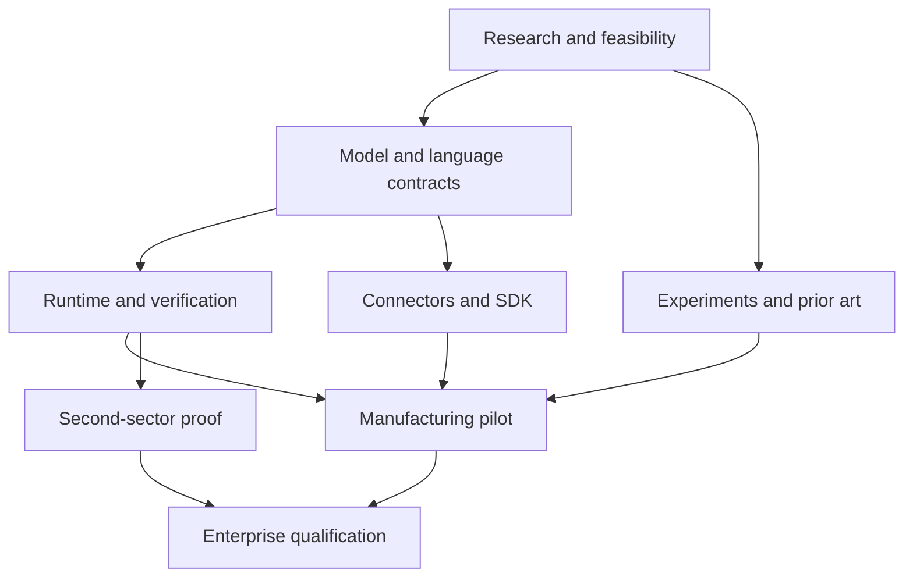

# From research to deployment

GitHub state and assignments are authoritative. Each ID below maps to one issue, an acceptance statement and explicit upstream tasks in [backlog.json](backlog.json). [issue-map.json](issue-map.json) records stable issue numbers. Run `node planning/validate.mjs` after a scope change. An issue may be parallelized when prerequisites have landed and shared contracts are stable. Review the [collaboration protocol](../CONTRIBUTING.md) before claiming.

| Brief | Coverage |
|---|---|
| 1–3: vision, scientific ownership, enterprise properties | F01–F05, S01–S12, E01–E08, Q01–Q04 |
| 4: research, competitors, all scientific methods and feasibility | R01–R08, X07 and X10 |
| 5: graph, compiler, selection, incremental/decomposition/cache, explanations and verification | M01–M12, S01–S10, X01–X10, A01–A06 |
| 6: language, SDK and visual modeling | M03–M10, U03, Q01 |
| 7–8: components, technology and native qualification | F01–F05, R07, E01–E08, U01–U06 |
| 9: first pilot, second sector and later verticals | V01–V07, P01 |
| 10: integrations and recoverability | I01–I09, E03–E05 |
| 11: lifecycle and execution policy | S01, S10–S12, E04, A02, Q02 |

Release gates G01–G06 select tier-specific prerequisites. Research evidence permits limited technical experiments. The first sellable release also requires historical replay with a design partner, verified feasibility, human review and installation qualification. The enterprise gate adds tenant isolation, durable workflow, recovery, operations and support. Cross-sector generality and scale claims require the later benchmark gates. Milestones group workstreams rather than predict delivery dates. Subtasks and scope may expand after customer discovery.

## Research

| Issue | Deliverable | Upstream |
|---|---|---|
| [#1 R01](https://github.com/ameenalqershi/wow-decision-intelligence/issues/1) | Map enterprise planning and decision platforms | — |
| [#2 R02](https://github.com/ameenalqershi/wow-decision-intelligence/issues/2) | Compare optimizers and modeling languages | — |
| [#3 R03](https://github.com/ameenalqershi/wow-decision-intelligence/issues/3) | Map optimization science and computational limits | — |
| [#4 R04](https://github.com/ameenalqershi/wow-decision-intelligence/issues/4) | Review prior art, publications and patent claims | R02 |
| [#5 R05](https://github.com/ameenalqershi/wow-decision-intelligence/issues/5) | Model pilot economics and select verticals | R01 |
| [#6 R06](https://github.com/ameenalqershi/wow-decision-intelligence/issues/6) | Validate demand and pilot data with a design partner | R05 |
| [#7 R07](https://github.com/ameenalqershi/wow-decision-intelligence/issues/7) | Qualify native adapters and redistribution | R02 |
| [#8 R08](https://github.com/ameenalqershi/wow-decision-intelligence/issues/8) | Approve the phase-zero evidence dossier | R01, R02, R03, R04, R05 |

## Foundation

| Issue | Deliverable | Upstream |
|---|---|---|
| [#9 F01](https://github.com/ameenalqershi/wow-decision-intelligence/issues/9) | Publish system boundaries and architecture decisions | — |
| [#10 F02](https://github.com/ameenalqershi/wow-decision-intelligence/issues/10) | Establish contributor intake and coordination | — |
| [#11 F03](https://github.com/ameenalqershi/wow-decision-intelligence/issues/11) | Build cross-platform validation pipeline | F02 |
| [#12 F04](https://github.com/ameenalqershi/wow-decision-intelligence/issues/12) | Design tenant threat model and trust boundaries | F01 |
| [#13 F05](https://github.com/ameenalqershi/wow-decision-intelligence/issues/13) | Version API, schema and extension contracts | F01 |
| [#89 T01](https://github.com/ameenalqershi/wow-decision-intelligence/issues/89) | Audit scope traceability and reconcile the engineering plan | — |
| [#138 EXT01](https://github.com/ameenalqershi/wow-decision-intelligence/issues/138) | Algorithm and solver extension registry | F05, S01, E07 |
| [#159 SP01](https://github.com/ameenalqershi/wow-decision-intelligence/issues/159) | Versioned field and contract dictionary | F01 |
| [#160 SP02](https://github.com/ameenalqershi/wow-decision-intelligence/issues/160) | Studio module specification and design review | F01 |
| [#161 SP03](https://github.com/ameenalqershi/wow-decision-intelligence/issues/161) | Editable architecture and subsystem diagrams | F01 |
| [#162 SP04](https://github.com/ameenalqershi/wow-decision-intelligence/issues/162) | Product and delivery specifications | F01 |
| [#179 EP01](https://github.com/ameenalqershi/wow-decision-intelligence/issues/179) | Studio design system and desktop experience | F01 |
| [#180 EP02](https://github.com/ameenalqershi/wow-decision-intelligence/issues/180) | Runtime modes and distribution contracts | F01 |
| [#181 EP03](https://github.com/ameenalqershi/wow-decision-intelligence/issues/181) | Product specifications and editable engineering diagrams | F01 |
| [#182 EP04](https://github.com/ameenalqershi/wow-decision-intelligence/issues/182) | Numerical, extension and research qualification | F01 |
| [#183 EP05](https://github.com/ameenalqershi/wow-decision-intelligence/issues/183) | Security and recovery controls | F04 |
| [#184 EP06](https://github.com/ameenalqershi/wow-decision-intelligence/issues/184) | Cross-product vertical slice acceptance | F01 |

## Model

| Issue | Deliverable | Upstream |
|---|---|---|
| [#14 M01](https://github.com/ameenalqershi/wow-decision-intelligence/issues/14) | Define revisioned entity and hyperedge graph | F05 |
| [#15 M02](https://github.com/ameenalqershi/wow-decision-intelligence/issues/15) | Index dependencies and impact across revisions | M01 |
| [#16 M03](https://github.com/ameenalqershi/wow-decision-intelligence/issues/16) | Implement typed UDIR and source spans | F05 |
| [#17 M04](https://github.com/ameenalqershi/wow-decision-intelligence/issues/17) | Validate dimensions, calendars and currency conversion | M03 |
| [#18 M05](https://github.com/ameenalqershi/wow-decision-intelligence/issues/18) | Specify DML grammar, AST and diagnostics | M03 |
| [#19 M06](https://github.com/ameenalqershi/wow-decision-intelligence/issues/19) | Build bounded declarative parser and binder | M05 |
| [#20 M07](https://github.com/ameenalqershi/wow-decision-intelligence/issues/20) | Implement semantic analysis and normalization | M04, M06 |
| [#21 M08](https://github.com/ameenalqershi/wow-decision-intelligence/issues/21) | Implement capability-checked solver lowering | M07 |
| [#22 M09](https://github.com/ameenalqershi/wow-decision-intelligence/issues/22) | Expose typed C# modeling SDK | M03, M04 |
| [#23 M10](https://github.com/ameenalqershi/wow-decision-intelligence/issues/23) | Deliver JSON Schema and versioned model import | M03, F05 |
| [#24 M11](https://github.com/ameenalqershi/wow-decision-intelligence/issues/24) | Implement immutable model registry and provenance | M01, M03 |
| [#25 M12](https://github.com/ameenalqershi/wow-decision-intelligence/issues/25) | Implement safe presolve and transformation ledger | M07 |
| [#134 NUM01](https://github.com/ameenalqershi/wow-decision-intelligence/issues/134) | Numerical invariants and reproducibility | M04, M07 |
| [#135 NUM02](https://github.com/ameenalqershi/wow-decision-intelligence/issues/135) | Multi-objective solving semantics | M07, S01, S04 |
| [#136 NUM03](https://github.com/ameenalqershi/wow-decision-intelligence/issues/136) | Robust and stochastic models | M03, S01 |
| [#137 NUM04](https://github.com/ameenalqershi/wow-decision-intelligence/issues/137) | Online reoptimization study | X05, S07 |

## Runtime

| Issue | Deliverable | Upstream |
|---|---|---|
| [#26 S01](https://github.com/ameenalqershi/wow-decision-intelligence/issues/26) | Define solver capability and result contracts | M03 |
| [#27 S02](https://github.com/ameenalqershi/wow-decision-intelligence/issues/27) | Integrate integer scheduling adapter | M08, S01, R07 |
| [#28 S03](https://github.com/ameenalqershi/wow-decision-intelligence/issues/28) | Integrate LP and MILP adapter | M08, S01, R07 |
| [#29 S04](https://github.com/ameenalqershi/wow-decision-intelligence/issues/29) | Implement independent feasibility and cost checker | M03, S01 |
| [#30 S05](https://github.com/ameenalqershi/wow-decision-intelligence/issues/30) | Validate bounds and classify evidence strength | S04 |
| [#31 S06](https://github.com/ameenalqershi/wow-decision-intelligence/issues/31) | Implement capability-first solver planning | S01, M08 |
| [#32 S07](https://github.com/ameenalqershi/wow-decision-intelligence/issues/32) | Govern worker CPU, memory, queues and deadlines | S01 |
| [#33 S08](https://github.com/ameenalqershi/wow-decision-intelligence/issues/33) | Implement budgeted solver portfolio | S06, S07 |
| [#34 S09](https://github.com/ameenalqershi/wow-decision-intelligence/issues/34) | Enable compatible hints and solver switching | S08, S04 |
| [#35 S10](https://github.com/ameenalqershi/wow-decision-intelligence/issues/35) | Persist evidence, lineage and audit reports | S04, S05, M11 |
| [#36 S11](https://github.com/ameenalqershi/wow-decision-intelligence/issues/36) | Implement decision state machine and approval policies | S10, F04 |
| [#37 S12](https://github.com/ameenalqershi/wow-decision-intelligence/issues/37) | Expose REST API and idempotent job worker | S07, S11, S06, S02, E01 |
| [#129 RT01](https://github.com/ameenalqershi/wow-decision-intelligence/issues/129) | Offline local runtime | F05, M11 |
| [#130 RT02](https://github.com/ameenalqershi/wow-decision-intelligence/issues/130) | Enterprise host conformance | S12, E01, E02 |
| [#131 RT03](https://github.com/ameenalqershi/wow-decision-intelligence/issues/131) | Headless execution conformance | RT01, CLI11 |
| [#132 RT04](https://github.com/ameenalqershi/wow-decision-intelligence/issues/132) | Embedded SDK distribution | M09, F05 |
| [#133 RT05](https://github.com/ameenalqershi/wow-decision-intelligence/issues/133) | Hybrid routing and credentials | RT01, S12, E01 |

## Research engineering

| Issue | Deliverable | Upstream |
|---|---|---|
| [#38 X01](https://github.com/ameenalqershi/wow-decision-intelligence/issues/38) | Run exhaustive separability and reuse experiment | R03, R04 |
| [#39 X02](https://github.com/ameenalqershi/wow-decision-intelligence/issues/39) | Detect exact components and certify separability | M02, M07, X01 |
| [#40 X03](https://github.com/ameenalqershi/wow-decision-intelligence/issues/40) | Produce canonical fingerprints and reuse permissions | M11, M07 |
| [#41 X04](https://github.com/ameenalqershi/wow-decision-intelligence/issues/41) | Validate cache entries and prevent stale bound reuse | X03, S05 |
| [#42 X05](https://github.com/ameenalqershi/wow-decision-intelligence/issues/42) | Implement bounded repair and full-solve fallback | X02, X04, S04 |
| [#43 X06](https://github.com/ameenalqershi/wow-decision-intelligence/issues/43) | Evaluate separators, SCCs and coordinated decomposition | X02, S03 |
| [#44 X07](https://github.com/ameenalqershi/wow-decision-intelligence/issues/44) | Build reproducible benchmark harness and corpus | R03, F03 |
| [#45 X08](https://github.com/ameenalqershi/wow-decision-intelligence/issues/45) | Evaluate incremental and portfolio hypotheses | X05, X07, S08 |
| [#46 X09](https://github.com/ameenalqershi/wow-decision-intelligence/issues/46) | Evaluate learned selection against deterministic policy | S06, X07 |
| [#47 X10](https://github.com/ameenalqershi/wow-decision-intelligence/issues/47) | Maintain innovation register and stop decisions | R04, X01 |
| [#142 EXP01](https://github.com/ameenalqershi/wow-decision-intelligence/issues/142) | Five-strategy comparative study | X07, V02 |
| [#163 SP05](https://github.com/ameenalqershi/wow-decision-intelligence/issues/163) | Research hypothesis dossiers | R04 |

## Manufacturing

| Issue | Deliverable | Upstream |
|---|---|---|
| [#48 V01](https://github.com/ameenalqershi/wow-decision-intelligence/issues/48) | Specify manufacturing datasets and optimization model | R05, M03 |
| [#49 V02](https://github.com/ameenalqershi/wow-decision-intelligence/issues/49) | Implement deterministic dispatch baseline | V01 |
| [#50 V03](https://github.com/ameenalqershi/wow-decision-intelligence/issues/50) | Implement finite-capacity production scheduling | V01, S02, S04 |
| [#51 V04](https://github.com/ameenalqershi/wow-decision-intelligence/issues/51) | Deliver outage and demand-change scenarios | V03, S10 |
| [#52 V05](https://github.com/ameenalqershi/wow-decision-intelligence/issues/52) | Validate pilot against planner historical schedule | V02, V04, R06 |
| [#151 SL01](https://github.com/ameenalqershi/wow-decision-intelligence/issues/151) | Factory vertical slice and evidence | UI05, UI11, UI13, UI15, UI17, CLI05, CLI08, RT01, V04, X05 |

## Second sector

| Issue | Deliverable | Upstream |
|---|---|---|
| [#53 V06](https://github.com/ameenalqershi/wow-decision-intelligence/issues/53) | Specify independent workforce coverage model | M09 |
| [#54 V07](https://github.com/ameenalqershi/wow-decision-intelligence/issues/54) | Demonstrate core reuse across sectors | V06, S03, S04 |
| [#152 SL02](https://github.com/ameenalqershi/wow-decision-intelligence/issues/152) | Independent workforce end-to-end slice | SL01, V07, RT04 |

## Integrations

| Issue | Deliverable | Upstream |
|---|---|---|
| [#55 I01](https://github.com/ameenalqershi/wow-decision-intelligence/issues/55) | Define connector SDK and mapping manifests | F05, F04 |
| [#56 I02](https://github.com/ameenalqershi/wow-decision-intelligence/issues/56) | Implement CSV and JSON snapshot import | I01, M10 |
| [#57 I03](https://github.com/ameenalqershi/wow-decision-intelligence/issues/57) | Implement REST ingestion and authenticated webhooks | I01, S12 |
| [#58 I04](https://github.com/ameenalqershi/wow-decision-intelligence/issues/58) | Implement incremental sync, recovery and health | I02, I03 |
| [#59 I05](https://github.com/ameenalqershi/wow-decision-intelligence/issues/59) | Deliver optional WOW ERP connector | I04, V01 |
| [#60 I06](https://github.com/ameenalqershi/wow-decision-intelligence/issues/60) | Qualify SAP, Oracle and Dynamics adapters | I04 |
| [#61 I07](https://github.com/ameenalqershi/wow-decision-intelligence/issues/61) | Qualify Odoo, ERPNext and custom ERP adapters | I04 |
| [#62 I08](https://github.com/ameenalqershi/wow-decision-intelligence/issues/62) | Add SQL, Excel and event-stream adapters | I04 |
| [#63 I09](https://github.com/ameenalqershi/wow-decision-intelligence/issues/63) | Qualify CRM, MES, WMS and IoT feeds | I04 |

## Intelligence

| Issue | Deliverable | Upstream |
|---|---|---|
| [#64 A01](https://github.com/ameenalqershi/wow-decision-intelligence/issues/64) | Implement immutable scenario comparison | M11, S10 |
| [#65 A02](https://github.com/ameenalqershi/wow-decision-intelligence/issues/65) | Explain decisions, alternatives and conflicts | S04, S05, A01 |
| [#66 A03](https://github.com/ameenalqershi/wow-decision-intelligence/issues/66) | Implement LP sensitivity and relaxation analysis | S03, A02 |
| [#67 A04](https://github.com/ameenalqershi/wow-decision-intelligence/issues/67) | Add discrete-event and Monte Carlo simulation | A01 |
| [#68 A05](https://github.com/ameenalqershi/wow-decision-intelligence/issues/68) | Model forecast uncertainty and risk | A04 |
| [#69 A06](https://github.com/ameenalqershi/wow-decision-intelligence/issues/69) | Add verified advisory recommendations and optional MCP | S12, A02 |
| [#139 AI01](https://github.com/ameenalqershi/wow-decision-intelligence/issues/139) | Optional provider contracts | F05, F04 |
| [#140 AI02](https://github.com/ameenalqershi/wow-decision-intelligence/issues/140) | Validated language-model proposals | AI01, M06, S04 |
| [#141 AI03](https://github.com/ameenalqershi/wow-decision-intelligence/issues/141) | Forecast qualification | A05, X07 |

## Applications

| Issue | Deliverable | Upstream |
|---|---|---|
| [#70 U01](https://github.com/ameenalqershi/wow-decision-intelligence/issues/70) | Ship cross-platform professional CLI | F01 |
| [#71 U02](https://github.com/ameenalqershi/wow-decision-intelligence/issues/71) | Qualify Microsoft Blazor desktop delivery | F01 |
| [#72 U03](https://github.com/ameenalqershi/wow-decision-intelligence/issues/72) | Build visual modeling studio and graph explorer | U02, M05, M09, M01, M02 |
| [#73 U04](https://github.com/ameenalqershi/wow-decision-intelligence/issues/73) | Build scheduling and scenario workspace | U02, V04, A01 |
| [#74 U05](https://github.com/ameenalqershi/wow-decision-intelligence/issues/74) | Build evidence viewer and benchmark dashboard | U02, S10, X07 |
| [#88 U06](https://github.com/ameenalqershi/wow-decision-intelligence/issues/88) | Build administration and developer portals | U02, E01, I01 |
| [#90 UI01](https://github.com/ameenalqershi/wow-decision-intelligence/issues/90) | Application shell | DS01, DS02, SP02 |
| [#91 UI02](https://github.com/ameenalqershi/wow-decision-intelligence/issues/91) | Workspace manager | UI01, RT01, SP02 |
| [#92 UI03](https://github.com/ameenalqershi/wow-decision-intelligence/issues/92) | Overview dashboard | UI01, RT01, SP02 |
| [#93 UI04](https://github.com/ameenalqershi/wow-decision-intelligence/issues/93) | Visual model designer | UI01, M01, M09, SP02 |
| [#94 UI05](https://github.com/ameenalqershi/wow-decision-intelligence/issues/94) | Enterprise decision graph explorer | UI01, M01, M02, SP02 |
| [#95 UI06](https://github.com/ameenalqershi/wow-decision-intelligence/issues/95) | Decision DSL editor | UI01, M06, M07, SP02 |
| [#96 UI07](https://github.com/ameenalqershi/wow-decision-intelligence/issues/96) | Constraint editor | UI04, M04, SP02 |
| [#97 UI08](https://github.com/ameenalqershi/wow-decision-intelligence/issues/97) | Objective editor | UI04, NUM02, SP02 |
| [#98 UI09](https://github.com/ameenalqershi/wow-decision-intelligence/issues/98) | Mathematical model inspector | UI06, M08, M12, SP02 |
| [#99 UI10](https://github.com/ameenalqershi/wow-decision-intelligence/issues/99) | Solver configuration | UI01, S06, S07, SP02 |
| [#100 UI11](https://github.com/ameenalqershi/wow-decision-intelligence/issues/100) | Optimization monitor | UI01, S07, S10, SP02 |
| [#101 UI12](https://github.com/ameenalqershi/wow-decision-intelligence/issues/101) | Algorithm execution visualizer | UI11, X05, SP02 |
| [#102 UI13](https://github.com/ameenalqershi/wow-decision-intelligence/issues/102) | Scenario comparison studio | UI01, A01, SP02 |
| [#103 UI14](https://github.com/ameenalqershi/wow-decision-intelligence/issues/103) | Simulation studio | UI01, A04, SP02 |
| [#104 UI15](https://github.com/ameenalqershi/wow-decision-intelligence/issues/104) | Production scheduling studio | UI01, V03, V04, SP02 |
| [#105 UI16](https://github.com/ameenalqershi/wow-decision-intelligence/issues/105) | Resource allocation visualizer | UI01, V03, SP02 |
| [#106 UI17](https://github.com/ameenalqershi/wow-decision-intelligence/issues/106) | Decision evidence viewer | UI01, S10, SP02 |
| [#107 UI18](https://github.com/ameenalqershi/wow-decision-intelligence/issues/107) | Explainability studio | UI17, A02, A03, SP02 |
| [#108 UI19](https://github.com/ameenalqershi/wow-decision-intelligence/issues/108) | Performance and benchmark studio | UI01, X07, SP02 |
| [#109 UI20](https://github.com/ameenalqershi/wow-decision-intelligence/issues/109) | Integration mapping designer | UI01, I01, I02, SP02 |
| [#110 UI21](https://github.com/ameenalqershi/wow-decision-intelligence/issues/110) | Administration and developer portal | UI01, E01, I01, SP02 |
| [#111 UI22](https://github.com/ameenalqershi/wow-decision-intelligence/issues/111) | Command palette and productivity | UI01, SP02 |
| [#112 UI23](https://github.com/ameenalqershi/wow-decision-intelligence/issues/112) | Settings and diagnostics | UI01, CLI10, SP02 |
| [#113 CLI01](https://github.com/ameenalqershi/wow-decision-intelligence/issues/113) | Command host and registration | F01 |
| [#114 CLI02](https://github.com/ameenalqershi/wow-decision-intelligence/issues/114) | Terminal presentation | CLI01, DS01 |
| [#115 CLI03](https://github.com/ameenalqershi/wow-decision-intelligence/issues/115) | Workspace command family | CLI01, RT01 |
| [#116 CLI04](https://github.com/ameenalqershi/wow-decision-intelligence/issues/116) | Model command family | CLI03, M08, M10 |
| [#117 CLI05](https://github.com/ameenalqershi/wow-decision-intelligence/issues/117) | Optimization command family | CLI04, S06, S04, RT01, X05, A02 |
| [#118 CLI06](https://github.com/ameenalqershi/wow-decision-intelligence/issues/118) | Graph command family | CLI03, M02 |
| [#119 CLI07](https://github.com/ameenalqershi/wow-decision-intelligence/issues/119) | Scenario and simulation commands | CLI03, A01, A04 |
| [#120 CLI08](https://github.com/ameenalqershi/wow-decision-intelligence/issues/120) | Decision and evidence commands | CLI03, S10, A02 |
| [#121 CLI09](https://github.com/ameenalqershi/wow-decision-intelligence/issues/121) | Solver and benchmark commands | CLI01, X07, S01 |
| [#122 CLI10](https://github.com/ameenalqershi/wow-decision-intelligence/issues/122) | Diagnostics commands | CLI01 |
| [#123 CLI11](https://github.com/ameenalqershi/wow-decision-intelligence/issues/123) | Machine output and automation | CLI01 |
| [#124 CLI12](https://github.com/ameenalqershi/wow-decision-intelligence/issues/124) | CLI packaging and installation | CLI01, CLI11, RT01 |
| [#125 DS01](https://github.com/ameenalqershi/wow-decision-intelligence/issues/125) | Shared visual tokens | F01 |
| [#126 DS02](https://github.com/ameenalqershi/wow-decision-intelligence/issues/126) | Accessible component gallery | DS01 |
| [#127 DS03](https://github.com/ameenalqershi/wow-decision-intelligence/issues/127) | Desktop layouts and localization | DS02 |
| [#128 DS04](https://github.com/ameenalqershi/wow-decision-intelligence/issues/128) | Graph and chart primitives | DS01, M01 |

## Enterprise

| Issue | Deliverable | Upstream |
|---|---|---|
| [#75 E01](https://github.com/ameenalqershi/wow-decision-intelligence/issues/75) | Implement tenant-aware identity and authorization | F04, F05 |
| [#76 E02](https://github.com/ameenalqershi/wow-decision-intelligence/issues/76) | Persist models and jobs with EF Core | F01, E01, M11 |
| [#77 E03](https://github.com/ameenalqershi/wow-decision-intelligence/issues/77) | Implement outbox, scheduling and notifications | E02, S12 |
| [#78 E04](https://github.com/ameenalqershi/wow-decision-intelligence/issues/78) | Implement human approvals and gated external execution | S11, E01, I04 |
| [#79 E05](https://github.com/ameenalqershi/wow-decision-intelligence/issues/79) | Add telemetry, audit retention and operations tools | E02, S07 |
| [#80 E06](https://github.com/ameenalqershi/wow-decision-intelligence/issues/80) | Package self-hosted Docker and SaaS profiles | E02, E05 |
| [#81 E07](https://github.com/ameenalqershi/wow-decision-intelligence/issues/81) | Isolate extension code and native workers | F04, S07 |
| [#82 E08](https://github.com/ameenalqershi/wow-decision-intelligence/issues/82) | Implement scale-out queue and resource fairness | E03, E07 |
| [#148 SEC01](https://github.com/ameenalqershi/wow-decision-intelligence/issues/148) | Secure data movement and retention | F04, I01 |
| [#149 SEC02](https://github.com/ameenalqershi/wow-decision-intelligence/issues/149) | Release provenance and secure updates | F04, E06 |
| [#150 SEC03](https://github.com/ameenalqershi/wow-decision-intelligence/issues/150) | Restore and disaster recovery | E02, E05 |

## Quality

| Issue | Deliverable | Upstream |
|---|---|---|
| [#83 Q01](https://github.com/ameenalqershi/wow-decision-intelligence/issues/83) | Add compiler property and differential tests | M07, M08 |
| [#84 Q02](https://github.com/ameenalqershi/wow-decision-intelligence/issues/84) | Run integration, accessibility and isolation tests | QA01, QA02, QA03, QA04 |
| [#85 Q03](https://github.com/ameenalqershi/wow-decision-intelligence/issues/85) | Publish release evidence and licensing inventory | E06, Q01, Q02 |
| [#86 Q04](https://github.com/ameenalqershi/wow-decision-intelligence/issues/86) | Decide MVP, enterprise and scale release gates | F01 |
| [#143 QA01](https://github.com/ameenalqershi/wow-decision-intelligence/issues/143) | Local and SDK contract suite | RT01, RT04 |
| [#144 QA02](https://github.com/ameenalqershi/wow-decision-intelligence/issues/144) | Desktop visual and accessibility qualification | UI01, DS03, DS04 |
| [#145 QA03](https://github.com/ameenalqershi/wow-decision-intelligence/issues/145) | Command-line release conformance | CLI02, CLI11, CLI12 |
| [#146 QA04](https://github.com/ameenalqershi/wow-decision-intelligence/issues/146) | Enterprise reliability qualification | E01, S12, E07 |
| [#147 QA05](https://github.com/ameenalqershi/wow-decision-intelligence/issues/147) | Compiler and solver robustness suite | M08, S04 |
| [#153 G01](https://github.com/ameenalqershi/wow-decision-intelligence/issues/153) | Research prototype gate | X01, R08 |
| [#154 G02](https://github.com/ameenalqershi/wow-decision-intelligence/issues/154) | MVP gate | SL01, QA02, QA03, R07 |
| [#155 G03](https://github.com/ameenalqershi/wow-decision-intelligence/issues/155) | Production release gate | G02, SEC02, SEC03, QA01 |
| [#156 G04](https://github.com/ameenalqershi/wow-decision-intelligence/issues/156) | Enterprise release gate | G03, RT02, QA04, E04 |
| [#157 G05](https://github.com/ameenalqershi/wow-decision-intelligence/issues/157) | Multi-sector platform gate | G03, SL02 |
| [#158 G06](https://github.com/ameenalqershi/wow-decision-intelligence/issues/158) | Scale release gate | G04, E08, X07 |

## Portfolio

| Issue | Deliverable | Upstream |
|---|---|---|
| [#87 P01](https://github.com/ameenalqershi/wow-decision-intelligence/issues/87) | Evaluate expansion across proposed sectors | V07, R06 |
| [#164 IND01](https://github.com/ameenalqershi/wow-decision-intelligence/issues/164) | Inventory feasibility and model study | V06 |
| [#165 IND02](https://github.com/ameenalqershi/wow-decision-intelligence/issues/165) | Supply chain feasibility and model study | V06 |
| [#166 IND03](https://github.com/ameenalqershi/wow-decision-intelligence/issues/166) | Logistics feasibility and model study | V06 |
| [#167 IND04](https://github.com/ameenalqershi/wow-decision-intelligence/issues/167) | Transportation feasibility and model study | V06 |
| [#168 IND05](https://github.com/ameenalqershi/wow-decision-intelligence/issues/168) | Retail feasibility and model study | V06 |
| [#169 IND06](https://github.com/ameenalqershi/wow-decision-intelligence/issues/169) | Healthcare feasibility and model study | V06 |
| [#170 IND07](https://github.com/ameenalqershi/wow-decision-intelligence/issues/170) | Finance feasibility and model study | V06 |
| [#171 IND08](https://github.com/ameenalqershi/wow-decision-intelligence/issues/171) | Cash flow feasibility and model study | V06 |
| [#172 IND09](https://github.com/ameenalqershi/wow-decision-intelligence/issues/172) | Energy feasibility and model study | V06 |
| [#173 IND10](https://github.com/ameenalqershi/wow-decision-intelligence/issues/173) | Construction feasibility and model study | V06 |
| [#174 IND11](https://github.com/ameenalqershi/wow-decision-intelligence/issues/174) | Project management feasibility and model study | V06 |
| [#175 IND12](https://github.com/ameenalqershi/wow-decision-intelligence/issues/175) | Agriculture feasibility and model study | V06 |
| [#176 IND13](https://github.com/ameenalqershi/wow-decision-intelligence/issues/176) | Telecommunications feasibility and model study | V06 |
| [#177 IND14](https://github.com/ameenalqershi/wow-decision-intelligence/issues/177) | Cloud resources feasibility and model study | V06 |
| [#178 IND15](https://github.com/ameenalqershi/wow-decision-intelligence/issues/178) | Data centers feasibility and model study | V06 |
