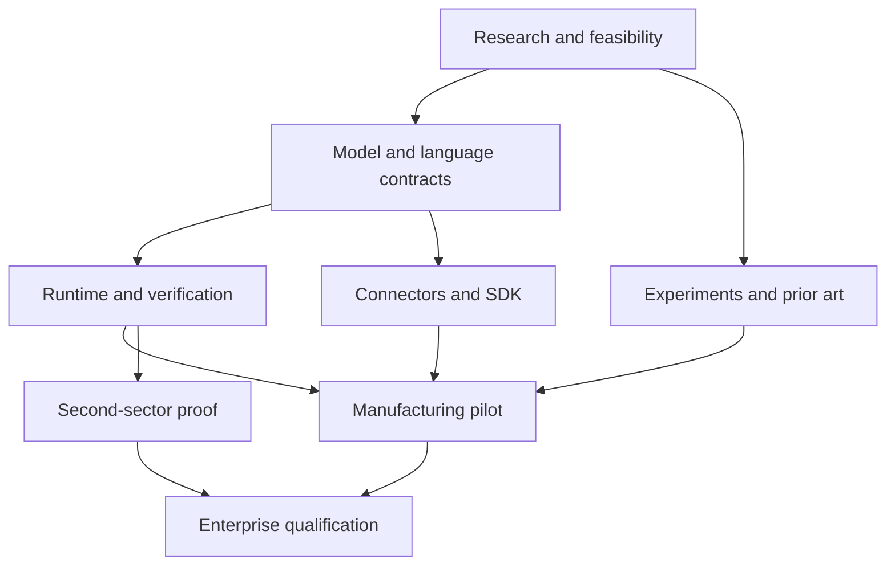

# From research to deployment

GitHub state and assignments are authoritative. Each ID below maps to one issue, an acceptance statement and explicit upstream tasks in [backlog.json](backlog.json). [issue-map.json](issue-map.json) records stable issue numbers. Run `node planning/validate.mjs` after a scope change. An issue may be parallelized when prerequisites have landed and shared contracts are stable. Review the [collaboration protocol](../CONTRIBUTING.md) before claiming.

| Brief | Coverage |
|---|---|
| 1–3: vision, scientific ownership, enterprise properties | F01–F05, S01–S12, E01–E08, Q01–Q04 |
| 4: research, competitors, all scientific methods and feasibility | R01–R08, X07 and X10 |
| 5: graph, compiler, selection, incremental/decomposition/cache, explanations and verification | M01–M12, S01–S10, X01–X10, A01–A06 |
| 6: language, SDK and visual modeling | M03–M10, U03, Q01 |
| 7–8: components, technology and native qualification | F01–F05, R07, E01–E08, U01–U06 |
| 9: first pilot, second sector and later verticals | V01–V07, P01 |
| 10: integrations and recoverability | I01–I09, E03–E05 |
| 11: lifecycle and execution policy | S01, S10–S12, E04, A02, Q02 |

Delivery gates are cumulative. Research evidence permits limited technical experiments. The first sellable release also requires historical replay with a design partner, verified feasibility, human review and installation qualification. The enterprise gate adds tenant isolation, durable workflow, recovery, operations and support. Cross-sector generality and scale claims require the later benchmark gates. Milestones group workstreams rather than predict delivery dates. Subtasks and scope may expand after customer discovery.

## Research

| Issue | Deliverable | Upstream |
|---|---|---|
| [#1 R01](https://github.com/ameenalqershi/wow-decision-intelligence/issues/1) | Map enterprise planning and decision platforms | — |
| [#2 R02](https://github.com/ameenalqershi/wow-decision-intelligence/issues/2) | Compare optimizers and modeling languages | — |
| [#3 R03](https://github.com/ameenalqershi/wow-decision-intelligence/issues/3) | Map optimization science and computational limits | — |
| [#4 R04](https://github.com/ameenalqershi/wow-decision-intelligence/issues/4) | Review prior art, publications and patent claims | R02 |
| [#5 R05](https://github.com/ameenalqershi/wow-decision-intelligence/issues/5) | Model pilot economics and select verticals | R01 |
| [#6 R06](https://github.com/ameenalqershi/wow-decision-intelligence/issues/6) | Validate demand and pilot data with a design partner | R05 |
| [#7 R07](https://github.com/ameenalqershi/wow-decision-intelligence/issues/7) | Qualify native adapters and redistribution | R02 |
| [#8 R08](https://github.com/ameenalqershi/wow-decision-intelligence/issues/8) | Approve the phase-zero evidence dossier | R01, R02, R03, R04, R05 |

## Foundation

| Issue | Deliverable | Upstream |
|---|---|---|
| [#9 F01](https://github.com/ameenalqershi/wow-decision-intelligence/issues/9) | Publish system boundaries and architecture decisions | — |
| [#10 F02](https://github.com/ameenalqershi/wow-decision-intelligence/issues/10) | Establish contributor intake and coordination | — |
| [#11 F03](https://github.com/ameenalqershi/wow-decision-intelligence/issues/11) | Build cross-platform validation pipeline | F02 |
| [#12 F04](https://github.com/ameenalqershi/wow-decision-intelligence/issues/12) | Design tenant threat model and trust boundaries | F01 |
| [#13 F05](https://github.com/ameenalqershi/wow-decision-intelligence/issues/13) | Version API, schema and extension contracts | F01 |

## Model

| Issue | Deliverable | Upstream |
|---|---|---|
| [#14 M01](https://github.com/ameenalqershi/wow-decision-intelligence/issues/14) | Define revisioned entity and hyperedge graph | F05 |
| [#15 M02](https://github.com/ameenalqershi/wow-decision-intelligence/issues/15) | Index dependencies and impact across revisions | M01 |
| [#16 M03](https://github.com/ameenalqershi/wow-decision-intelligence/issues/16) | Implement typed UDIR and source spans | F05 |
| [#17 M04](https://github.com/ameenalqershi/wow-decision-intelligence/issues/17) | Validate dimensions, calendars and currency conversion | M03 |
| [#18 M05](https://github.com/ameenalqershi/wow-decision-intelligence/issues/18) | Specify DML grammar, AST and diagnostics | M03 |
| [#19 M06](https://github.com/ameenalqershi/wow-decision-intelligence/issues/19) | Build bounded declarative parser and binder | M05 |
| [#20 M07](https://github.com/ameenalqershi/wow-decision-intelligence/issues/20) | Implement semantic analysis and normalization | M04, M06 |
| [#21 M08](https://github.com/ameenalqershi/wow-decision-intelligence/issues/21) | Implement capability-checked solver lowering | M07 |
| [#22 M09](https://github.com/ameenalqershi/wow-decision-intelligence/issues/22) | Expose typed C# modeling SDK | M03, M04 |
| [#23 M10](https://github.com/ameenalqershi/wow-decision-intelligence/issues/23) | Deliver JSON Schema and versioned model import | M03, F05 |
| [#24 M11](https://github.com/ameenalqershi/wow-decision-intelligence/issues/24) | Implement immutable model registry and provenance | M01, M03 |
| [#25 M12](https://github.com/ameenalqershi/wow-decision-intelligence/issues/25) | Implement safe presolve and transformation ledger | M07 |

## Runtime

| Issue | Deliverable | Upstream |
|---|---|---|
| [#26 S01](https://github.com/ameenalqershi/wow-decision-intelligence/issues/26) | Define solver capability and result contracts | M03 |
| [#27 S02](https://github.com/ameenalqershi/wow-decision-intelligence/issues/27) | Integrate integer scheduling adapter | M08, S01, R07 |
| [#28 S03](https://github.com/ameenalqershi/wow-decision-intelligence/issues/28) | Integrate LP and MILP adapter | M08, S01, R07 |
| [#29 S04](https://github.com/ameenalqershi/wow-decision-intelligence/issues/29) | Implement independent feasibility and cost checker | M03, S01 |
| [#30 S05](https://github.com/ameenalqershi/wow-decision-intelligence/issues/30) | Validate bounds and classify evidence strength | S04 |
| [#31 S06](https://github.com/ameenalqershi/wow-decision-intelligence/issues/31) | Implement capability-first solver planning | S01, M08 |
| [#32 S07](https://github.com/ameenalqershi/wow-decision-intelligence/issues/32) | Govern worker CPU, memory, queues and deadlines | S01 |
| [#33 S08](https://github.com/ameenalqershi/wow-decision-intelligence/issues/33) | Implement budgeted solver portfolio | S06, S07 |
| [#34 S09](https://github.com/ameenalqershi/wow-decision-intelligence/issues/34) | Enable compatible hints and solver switching | S08, S04 |
| [#35 S10](https://github.com/ameenalqershi/wow-decision-intelligence/issues/35) | Persist evidence, lineage and audit reports | S04, S05, M11 |
| [#36 S11](https://github.com/ameenalqershi/wow-decision-intelligence/issues/36) | Implement decision state machine and approval policies | S10, F04 |
| [#37 S12](https://github.com/ameenalqershi/wow-decision-intelligence/issues/37) | Expose REST API and idempotent job worker | S07, S11 |

## Research engineering

| Issue | Deliverable | Upstream |
|---|---|---|
| [#38 X01](https://github.com/ameenalqershi/wow-decision-intelligence/issues/38) | Run exhaustive separability and reuse experiment | R03, R04 |
| [#39 X02](https://github.com/ameenalqershi/wow-decision-intelligence/issues/39) | Detect exact components and certify separability | M02, M07, X01 |
| [#40 X03](https://github.com/ameenalqershi/wow-decision-intelligence/issues/40) | Produce canonical fingerprints and reuse permissions | M11, M07 |
| [#41 X04](https://github.com/ameenalqershi/wow-decision-intelligence/issues/41) | Validate cache entries and prevent stale bound reuse | X03, S05 |
| [#42 X05](https://github.com/ameenalqershi/wow-decision-intelligence/issues/42) | Implement bounded repair and full-solve fallback | X02, X04, S04 |
| [#43 X06](https://github.com/ameenalqershi/wow-decision-intelligence/issues/43) | Evaluate separators, SCCs and coordinated decomposition | X02, S03 |
| [#44 X07](https://github.com/ameenalqershi/wow-decision-intelligence/issues/44) | Build reproducible benchmark harness and corpus | R03, F03 |
| [#45 X08](https://github.com/ameenalqershi/wow-decision-intelligence/issues/45) | Evaluate incremental and portfolio hypotheses | X05, X07, S08 |
| [#46 X09](https://github.com/ameenalqershi/wow-decision-intelligence/issues/46) | Evaluate learned selection against deterministic policy | S06, X07 |
| [#47 X10](https://github.com/ameenalqershi/wow-decision-intelligence/issues/47) | Maintain innovation register and stop decisions | R04, X01 |

## Manufacturing

| Issue | Deliverable | Upstream |
|---|---|---|
| [#48 V01](https://github.com/ameenalqershi/wow-decision-intelligence/issues/48) | Specify manufacturing datasets and optimization model | R05, M03 |
| [#49 V02](https://github.com/ameenalqershi/wow-decision-intelligence/issues/49) | Implement deterministic dispatch baseline | V01 |
| [#50 V03](https://github.com/ameenalqershi/wow-decision-intelligence/issues/50) | Implement finite-capacity production scheduling | V01, S02, S04 |
| [#51 V04](https://github.com/ameenalqershi/wow-decision-intelligence/issues/51) | Deliver outage and demand-change scenarios | V03, S10 |
| [#52 V05](https://github.com/ameenalqershi/wow-decision-intelligence/issues/52) | Validate pilot against planner historical schedule | V02, V04, R06 |

## Second sector

| Issue | Deliverable | Upstream |
|---|---|---|
| [#53 V06](https://github.com/ameenalqershi/wow-decision-intelligence/issues/53) | Specify independent workforce coverage model | M09 |
| [#54 V07](https://github.com/ameenalqershi/wow-decision-intelligence/issues/54) | Demonstrate core reuse across sectors | V06, S03, S04 |

## Integrations

| Issue | Deliverable | Upstream |
|---|---|---|
| [#55 I01](https://github.com/ameenalqershi/wow-decision-intelligence/issues/55) | Define connector SDK and mapping manifests | F05, F04 |
| [#56 I02](https://github.com/ameenalqershi/wow-decision-intelligence/issues/56) | Implement CSV and JSON snapshot import | I01, M10 |
| [#57 I03](https://github.com/ameenalqershi/wow-decision-intelligence/issues/57) | Implement REST ingestion and authenticated webhooks | I01, S12 |
| [#58 I04](https://github.com/ameenalqershi/wow-decision-intelligence/issues/58) | Implement incremental sync, recovery and health | I02, I03 |
| [#59 I05](https://github.com/ameenalqershi/wow-decision-intelligence/issues/59) | Deliver optional WOW ERP connector | I04, V01 |
| [#60 I06](https://github.com/ameenalqershi/wow-decision-intelligence/issues/60) | Qualify SAP, Oracle and Dynamics adapters | I04 |
| [#61 I07](https://github.com/ameenalqershi/wow-decision-intelligence/issues/61) | Qualify Odoo, ERPNext and custom ERP adapters | I04 |
| [#62 I08](https://github.com/ameenalqershi/wow-decision-intelligence/issues/62) | Add SQL, Excel and event-stream adapters | I04 |
| [#63 I09](https://github.com/ameenalqershi/wow-decision-intelligence/issues/63) | Qualify CRM, MES, WMS and IoT feeds | I04 |

## Intelligence

| Issue | Deliverable | Upstream |
|---|---|---|
| [#64 A01](https://github.com/ameenalqershi/wow-decision-intelligence/issues/64) | Implement immutable scenario comparison | M11, S10 |
| [#65 A02](https://github.com/ameenalqershi/wow-decision-intelligence/issues/65) | Explain decisions, alternatives and conflicts | S04, S05, A01 |
| [#66 A03](https://github.com/ameenalqershi/wow-decision-intelligence/issues/66) | Implement LP sensitivity and relaxation analysis | S03, A02 |
| [#67 A04](https://github.com/ameenalqershi/wow-decision-intelligence/issues/67) | Add discrete-event and Monte Carlo simulation | A01 |
| [#68 A05](https://github.com/ameenalqershi/wow-decision-intelligence/issues/68) | Model forecast uncertainty and risk | A04 |
| [#69 A06](https://github.com/ameenalqershi/wow-decision-intelligence/issues/69) | Add verified advisory recommendations and optional MCP | S12, A02 |

## Applications

| Issue | Deliverable | Upstream |
|---|---|---|
| [#70 U01](https://github.com/ameenalqershi/wow-decision-intelligence/issues/70) | Ship cross-platform professional CLI | S12 |
| [#71 U02](https://github.com/ameenalqershi/wow-decision-intelligence/issues/71) | Qualify Microsoft Blazor desktop delivery | F01 |
| [#72 U03](https://github.com/ameenalqershi/wow-decision-intelligence/issues/72) | Build visual modeling studio and graph explorer | U02, M05, M09 |
| [#73 U04](https://github.com/ameenalqershi/wow-decision-intelligence/issues/73) | Build scheduling and scenario workspace | U02, V04, A01 |
| [#74 U05](https://github.com/ameenalqershi/wow-decision-intelligence/issues/74) | Build evidence viewer and benchmark dashboard | U02, S10, X07 |
| [#88 U06](https://github.com/ameenalqershi/wow-decision-intelligence/issues/88) | Build administration and developer portals | U02, E01, I01 |

## Enterprise

| Issue | Deliverable | Upstream |
|---|---|---|
| [#75 E01](https://github.com/ameenalqershi/wow-decision-intelligence/issues/75) | Implement tenant-aware identity and authorization | F04, F05 |
| [#76 E02](https://github.com/ameenalqershi/wow-decision-intelligence/issues/76) | Persist models and jobs with EF Core | F01, E01, M11 |
| [#77 E03](https://github.com/ameenalqershi/wow-decision-intelligence/issues/77) | Implement outbox, scheduling and notifications | E02, S12 |
| [#78 E04](https://github.com/ameenalqershi/wow-decision-intelligence/issues/78) | Implement human approvals and gated external execution | S11, E01, I04 |
| [#79 E05](https://github.com/ameenalqershi/wow-decision-intelligence/issues/79) | Add telemetry, audit retention and operations tools | E02, S07 |
| [#80 E06](https://github.com/ameenalqershi/wow-decision-intelligence/issues/80) | Package self-hosted Docker and SaaS profiles | E02, E05 |
| [#81 E07](https://github.com/ameenalqershi/wow-decision-intelligence/issues/81) | Isolate extension code and native workers | F04, S07 |
| [#82 E08](https://github.com/ameenalqershi/wow-decision-intelligence/issues/82) | Implement scale-out queue and resource fairness | E03, E07 |

## Quality

| Issue | Deliverable | Upstream |
|---|---|---|
| [#83 Q01](https://github.com/ameenalqershi/wow-decision-intelligence/issues/83) | Add compiler property and differential tests | M07, M08 |
| [#84 Q02](https://github.com/ameenalqershi/wow-decision-intelligence/issues/84) | Run integration, accessibility and isolation tests | U04, E01, S12 |
| [#85 Q03](https://github.com/ameenalqershi/wow-decision-intelligence/issues/85) | Publish release evidence and licensing inventory | E06, Q01, Q02 |
| [#86 Q04](https://github.com/ameenalqershi/wow-decision-intelligence/issues/86) | Decide MVP, enterprise and scale release gates | V05, V07, Q03, X08 |

## Portfolio

| Issue | Deliverable | Upstream |
|---|---|---|
| [#87 P01](https://github.com/ameenalqershi/wow-decision-intelligence/issues/87) | Evaluate expansion across proposed sectors | V07, R06 |
